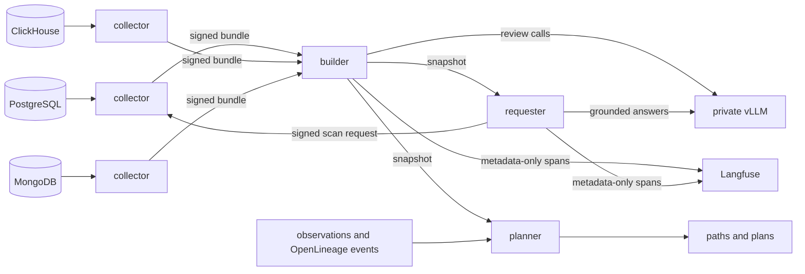
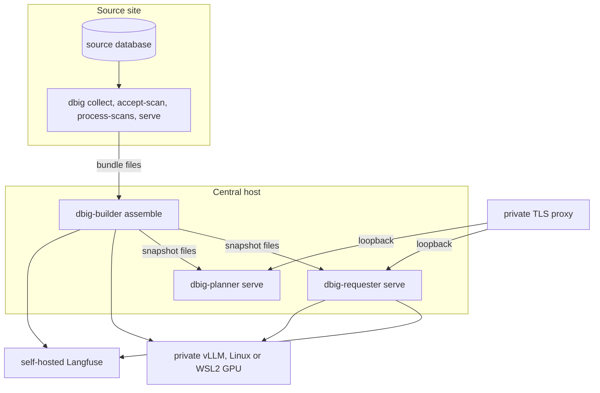
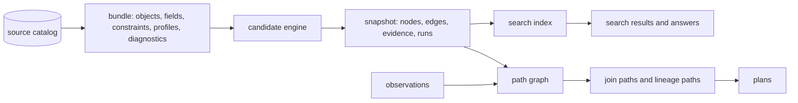
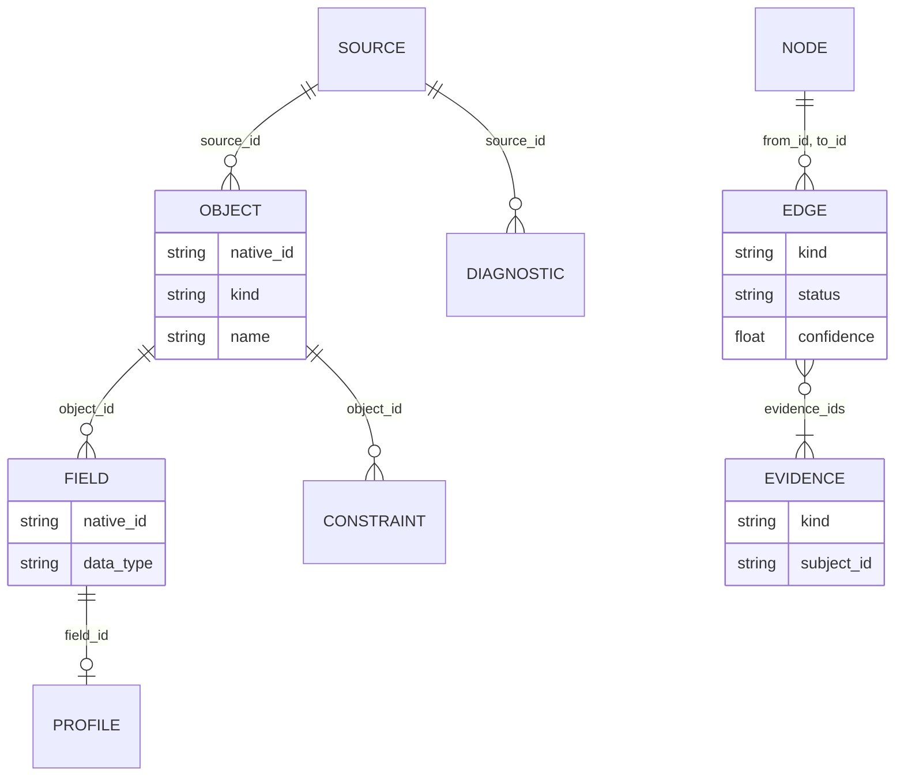
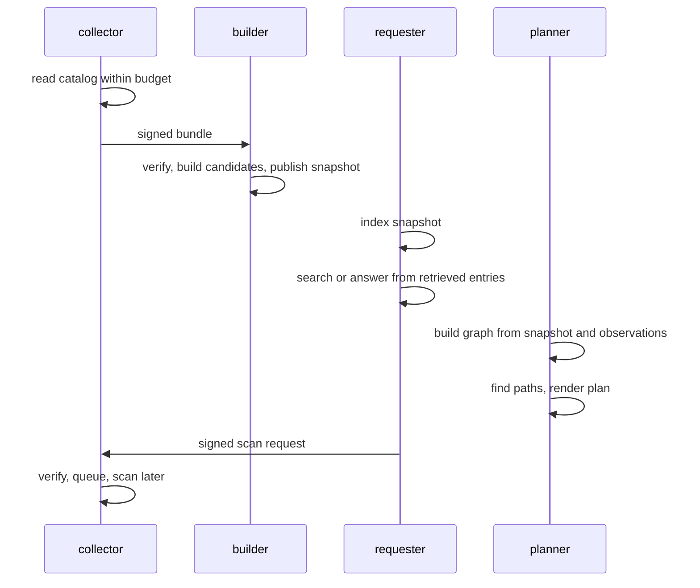

# Architecture

How the system fits together, runs, stores data and what it guarantees. For what it is and how to start, see [README.md](README.md). For the code, see [TECHNICAL_IMPLEMENTATION.md](TECHNICAL_IMPLEMENTATION.md). Terms are defined in [GLOSSARY.md](GLOSSARY.md).

## System context

<!-- verified: bce5fee -->

The only things that cross a trust boundary are signed bundles, a snapshot and signed scan requests. The planner makes no model call. Source credentials never leave a collector.

## Deployment

<!-- verified: bce5fee -->

No container image or orchestration file ships with this project. Each role is a Python process started by its own command. The host, port and every secret come from the operator.

| Process | Command | Network | Needs |
| --- | --- | --- | --- |
| Collector | `dbig collect` (one run) | Outbound to its source, verified TLS by default | Source connection and signing key, as secret references |
| Collector intake | `dbig serve` | Loopback bind, bearer token | Signing keys for scan requests |
| Builder | `dbig-builder assemble` (one run) | Outbound to vLLM and Langfuse only when review is configured | Signing keys to verify bundles |
| Requester | `dbig-requester serve` | Loopback bind, bearer token | Snapshot, state directory, optional vLLM |
| Planner | `dbig-planner serve` | Loopback bind, bearer token | Graph directory from `dbig-planner build` |

Each `serve` command refuses a non-loopback host and takes `--port` as a required argument. Remote access needs a TLS proxy that you run. A public exposure is unsupported. See [TECHNICAL_IMPLEMENTATION.md](TECHNICAL_IMPLEMENTATION.md) §17.3 for the routes and §5 for configuration precedence.

## Main data flow

<!-- verified: bce5fee -->

The snapshot is the interchange contract. The search index and the path graph are caches that anyone can rebuild from it.

## Data contract

<!-- verified: bce5fee -->

`NODE` stands for a source, object or field row. A snapshot has no diagnostics file. `confidence` stays null until calibrated.

## Main workflow

<!-- verified: bce5fee -->

A question is answered only from retrieved entries, and a plan is returned, never run.

## Guarantees and limits

<!-- verified: bce5fee -->

| Guarantee | Held by |
| --- | --- |
| A collector reads metadata only by default. Sampling, history and value tokens are opt-in per source. | `packages/collectors/src/dbig_collectors/config.py::SourceConfig` |
| A consumer rejects an unknown major version, a bad signature, an unsafe path or a digest mismatch. | `packages/contracts/src/dbig_contracts/artifact.py::read_artifact` |
| An object with no server-assigned identity is not catalogued, and a diagnostic says so. | `packages/collectors/src/dbig_collectors/runtime.py::discover_clickhouse` |
| An incremental run that lacks a complete scan keeps the last complete bundle of that source and marks the snapshot `partial`. | `packages/catalog-builder/src/dbig_builder/state.py::assemble_incremental` |
| A candidate is never lineage, and a model suggestion is weak evidence only. | `packages/catalog-builder/src/dbig_builder/reviewer.py::review_candidates` |
| The planner opens no source database connection and runs no plan. | `packages/planner/src/dbig_planner/plans.py::render_plan` |
| A scan request that is unsigned, expired, replayed or out of scope is refused. | `packages/collectors/src/dbig_collectors/scan.py::accept_scan` |

Measured quality is limited. On the one live run, 5 of 21 proposed relationships were true and 16 were false ([artifacts/live-test-report.md](artifacts/live-test-report.md), section 8). Fixes for that run are on unmerged branches. See [README.md](README.md#limits).

## Security and personal data

<!-- verified: bce5fee -->

The catalogue holds names, types, statistics and optional owner comments. It holds no row values. Value tokens exist only in bundles, are keyed per run, and never enter a snapshot. Source text, such as comments and SQL, is untrusted data: pages escape it and models see it marked as data. Every secret is a named environment variable that `dbig_contracts.security.secret_from_env` resolves. [THREAT_MODEL.md](docs/THREAT_MODEL.md) lists the eleven modelled threats, each control and its test, and the known gaps. Details are in [TECHNICAL_IMPLEMENTATION.md](TECHNICAL_IMPLEMENTATION.md) §13.

## Performance

<!-- verified: bce5fee -->

At 10 sources, 200 objects and 1,000 fields, every command finished in under 3 s, with assemble peaking at 110 MiB and each collector at most 44 MiB, and an in-process search had a 87 ms median. These come from `scripts/scale_benchmark.py` run on 2026-10-04 and recorded in [TODO.md](TODO.md) (change: verification fixes 1-10, item 9). Model latency is unmeasured on a GPU host. Method and caveats: [TECHNICAL_IMPLEMENTATION.md](TECHNICAL_IMPLEMENTATION.md) §14.

## Libraries, standards and external services

<!-- verified: bce5fee -->

| Item | Role | Where it is confined |
| --- | --- | --- |
| PostgreSQL, ClickHouse, MongoDB drivers | Read source catalogs | Collector extras only |
| vLLM, OpenAI-compatible client | Private model calls | Builder and requester, configured private URL only |
| LangGraph | Fixed review workflow | Builder |
| Langfuse | Metadata-only spans | Builder and requester; a required install, used only when configured |
| SQLGlot, NetworkX | SQL parsing, bounded path search | Planner |
| OpenLineage | Event standard for planner input | Planner |
| FastAPI, Uvicorn | Private REST | `api` extra of the collectors, requester and planner |

Versions and the reason for each choice: [TECHNICAL_IMPLEMENTATION.md](TECHNICAL_IMPLEMENTATION.md) §4. Design decisions are recorded with their dates in TECHNICAL_IMPLEMENTATION.md §6a, §7a, §7b, §8b and §16. Research background: [ARCHITECTURE_RESEARCH.md](docs/ARCHITECTURE_RESEARCH.md).
