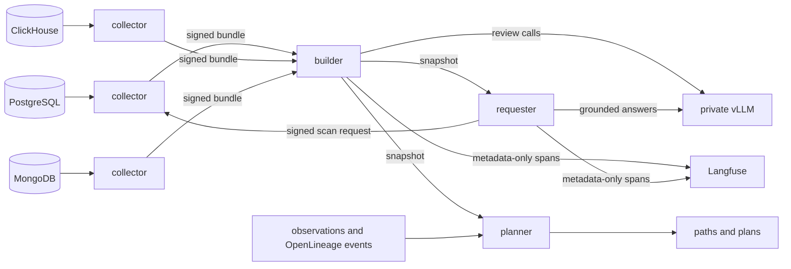
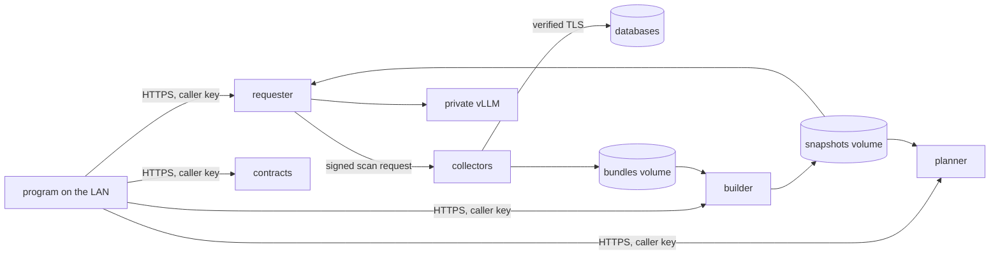
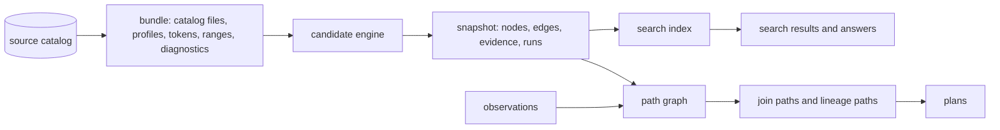
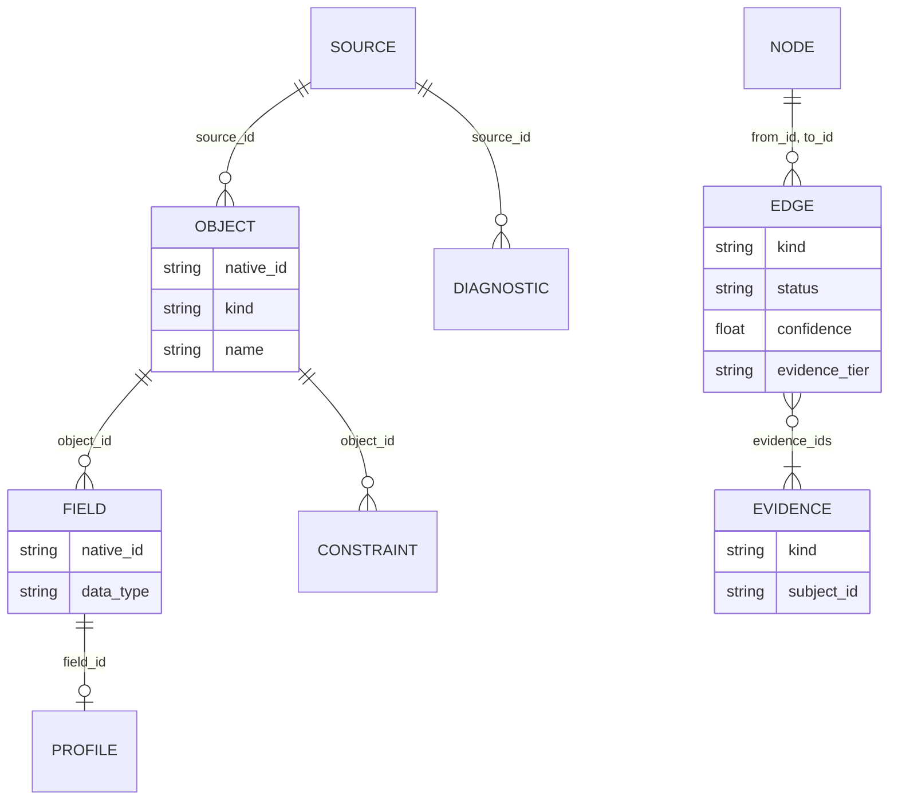
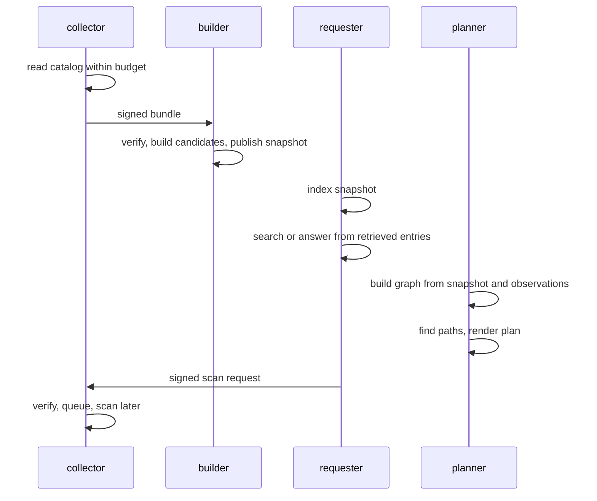

# Architecture

How the system fits together, runs, stores data and what it guarantees. For what it is and how to start, see [README.md](README.md). For the code, see [TECHNICAL_IMPLEMENTATION.md](TECHNICAL_IMPLEMENTATION.md). Terms are defined in [GLOSSARY.md](GLOSSARY.md).

## System context

<!-- verified: 6e43d33 -->

The only things that cross a trust boundary are signed bundles, a snapshot and signed scan requests. The planner makes no model call. Source credentials never leave a collector.

## Deployment

<!-- verified: 2bf154a -->

Two ways to run it. Each role can run as a Python process started by its own command, as before. Or the five packages run as five containers on one LAN host, from `deploy/compose.yaml` (report Part 3; owner decisions D1, D2 and D6 of 2026-11-10).

| Container | Command | State | Outbound |
| --- | --- | --- | --- |
| `collectors` | `dbig serve --bundle-root ...`: scan intake and the worker in one process | queue SQLite, `bundles` read-write | its databases, over verified TLS |
| `builder` | `dbig-builder serve`: assembly jobs | `bundles` read-only, `snapshots` read-write, job SQLite | vLLM and Langfuse when review is on |
| `requester` | `dbig-requester serve` | `snapshots` read-only, search index | vLLM, the collector, Langfuse |
| `planner` | `dbig-planner serve` | `snapshots` read-only, graph | none |
| `contracts` | `dbig-contracts serve`: the IR schemas and a record check | none | none |

The caller runs the pipeline (lead ruling D3 (a)): it asks the requester for a scan, starts an assembly on the builder, then calls `POST /v1/catalogue/reindex` and `POST /v1/planner/graph`. The builder points `snapshots/current` at each new snapshot. Until the reindex, search answers `STALE_INDEX`.

**The LAN boundary.** No inbound traffic from outside the LAN and no outbound traffic beyond it, held by five layers:

| Layer | Mechanism | Where |
| --- | --- | --- |
| L1 host bind | each published port has `host_ip` set to the LAN address, never all interfaces | `deploy/compose.yaml`, checked by `scripts/ci_check.py::compose_problems` in the tests (T1) |
| L2 inbound firewall | `DOCKER-USER` drops LAN-interface traffic from outside the LAN CIDR | `deploy/lan_firewall.py`, `deploy/dbig-firewall.service` |
| L3 egress firewall | the compose subnet reaches only the listed database, model and Langfuse addresses | same |
| L4 application | every model, Langfuse and collector URL passes `private_base_url`; a database host must be, or resolve only to, private addresses; a `serve` binds only loopback, or a private IP literal with TLS | `packages/contracts/src/dbig_contracts/security.py::bind_refusal`, `::private_host_refusal` |
| L5 caller identity | a key per caller, stored as SHA-256 with scopes and an expiry; two hashes per caller let a key rotate | `packages/contracts/src/dbig_contracts/service.py::ServiceGuard` |

Every service serves TLS with an IP-SAN certificate from a private CA (`scripts/make_ci_certs.py --ip`). Docker's `iptables` backend is required, because the `nftables` backend has no `DOCKER-USER` chain. Containers run read-only as UID 10001 with every capability dropped. Secrets are files under `deploy/secrets/`, read through `<NAME>_FILE`. Images are built on a machine with internet and loaded on the host from one `docker save` tarball (`scripts/build_images.py`), so the host needs no outbound access. `scripts/lan_boundary_check.py` checks the boundary on the host (T4, T5, T7). On 2026-11-11 the stack ran end to end on one machine (ports on loopback), and T5 and T7 passed in throwaway network namespaces; T4 and T6 on the LAN host, and the firewall on a real host, have not run. The project databases on the remote host get TLS from the same private CA through `deploy/remote_tls.py`, with plaintext kept (owner, 2026-11-11).

| Setting | Where | Example |
| --- | --- | --- |
| LAN address, LAN CIDR, interface | `deploy/.env` | `LAN_IP`, `LAN_CIDR`, `LAN_INTERFACE` |
| Compose subnet and one address per service | `deploy/.env` | `DBIG_SUBNET`, `REQUESTER_IP` |
| Allowed outbound targets | `deploy/.env` | `DBIG_EGRESS=ip:port,...` |
| Caller keys, one file per service | `deploy/secrets/<service>-keys.json` | `{"keys": [{"caller", "sha256", "scopes", "expires_at"}]}` |
| Service configuration | `deploy/config/<service>.toml` | the same TOML as the CLIs |

Without Compose, each `serve` command still binds loopback by default, and a LAN bind needs `--tls-cert` and `--tls-key`. A public exposure is unsupported. See [TECHNICAL_IMPLEMENTATION.md](TECHNICAL_IMPLEMENTATION.md) §17.3 for the routes and §5 for configuration precedence.

## Main data flow

<!-- verified: 6e43d33 -->

The snapshot is the interchange contract. The search index and the path graph are caches that anyone can rebuild from it.

## Data contract

<!-- verified: 6e43d33 -->

`NODE` stands for a source, object or field row. A snapshot has no diagnostics file. `confidence` stays null until calibrated; `evidence_tier` carries the strength of a candidate.

## Main workflow

<!-- verified: 6e43d33 -->

A question is answered only from retrieved entries, and a plan is returned, never run.

## Guarantees and limits

<!-- verified: 6e43d33 -->

| Guarantee | Held by |
| --- | --- |
| A collector reads metadata only by default. Sampling, history, cardinality probes, format profiles and value tokens are opt-in per source. | `packages/collectors/src/dbig_collectors/config.py::SourceConfig` |
| A consumer rejects an unknown major version, a bad signature, an unsafe path or a digest mismatch. | `packages/contracts/src/dbig_contracts/artifact.py::read_artifact` |
| An object with no server-assigned identity is not catalogued, and a diagnostic says so. | `packages/collectors/src/dbig_collectors/runtime.py::discover_clickhouse` |
| An incremental run that lacks a complete scan keeps the last complete bundle of that source and marks the snapshot `partial`. | `packages/catalog-builder/src/dbig_builder/state.py::assemble_incremental` |
| A candidate is never lineage, and a model suggestion is weak evidence only. | `packages/catalog-builder/src/dbig_builder/reviewer.py::review_candidates` |
| The planner opens no source database connection and runs no plan. | `packages/planner/src/dbig_planner/plans.py::render_plan` |
| A scan request that is unsigned, expired, replayed or out of scope is refused. | `packages/collectors/src/dbig_collectors/scan.py::accept_scan` |

Measured quality is limited. On the one live run, 5 of 21 proposed relationships were true and 16 were false ([artifacts/live-test-report.md](artifacts/live-test-report.md), section 8). Phase 1 to 7 fixes for that run are merged to `main`. A later PostgreSQL and ClickHouse run, scored with the owner's rule that every cross-source pair is false, found 35 true and 13 false of 48 candidates ([summary](artifacts/run-20261020-pgch/summary.md), step 1). The two runs use different data and scoring, so do not compare them. See [README.md](README.md#limits).

## Security and personal data

<!-- verified: 6e43d33 -->

The catalogue holds names, types, statistics and optional owner comments. It holds no row values. Value tokens and value ranges exist only in bundles, are keyed per run, and never enter a snapshot. Source text, such as comments and SQL, is untrusted data: pages escape it and models see it marked as data. Every secret is a named environment variable that `dbig_contracts.security.secret_from_env` resolves. [THREAT_MODEL.md](docs/THREAT_MODEL.md) lists the eleven modelled threats, each control and its test, and the known gaps. Details are in [TECHNICAL_IMPLEMENTATION.md](TECHNICAL_IMPLEMENTATION.md) §13.

## Performance

<!-- verified: 6e43d33 -->

At 10 sources, 200 objects and 1,000 fields, every command finished in under 3 s, with assemble peaking at 110 MiB and each collector at most 44 MiB, and an in-process search had a 87 ms median. These come from `scripts/scale_benchmark.py` run on 2026-10-04 and recorded in [TODO.md](TODO.md) (change: verification fixes 1-10, item 9). The benchmark predates the Phase 1 to 7 changes and was not repeated. Model latency is unmeasured on a GPU host. Method and caveats: [TECHNICAL_IMPLEMENTATION.md](TECHNICAL_IMPLEMENTATION.md) §14.

## Libraries, standards and external services

<!-- verified: 6e43d33 -->

| Item | Role | Where it is confined |
| --- | --- | --- |
| PostgreSQL, ClickHouse, MongoDB drivers | Read source catalogs | Collector extras only |
| vLLM, OpenAI-compatible client | Private model calls | Builder and requester, configured private URL only |
| LangGraph | Fixed review workflow | Builder |
| Langfuse | Metadata-only spans | Builder and requester; a required install, used only when configured |
| SQLGlot, NetworkX | SQL parsing, bounded path search | Planner |
| OpenLineage | Event standard for planner input | Planner |
| FastAPI, Uvicorn | Private REST | `api` extra of the collectors, requester and planner |

Versions and the reason for each choice: [TECHNICAL_IMPLEMENTATION.md](TECHNICAL_IMPLEMENTATION.md) §4. Design decisions are recorded with their dates in TECHNICAL_IMPLEMENTATION.md §6a, §7a, §7b, §8b and §16. Research background: [ARCHITECTURE_RESEARCH.md](docs/ARCHITECTURE_RESEARCH.md).
