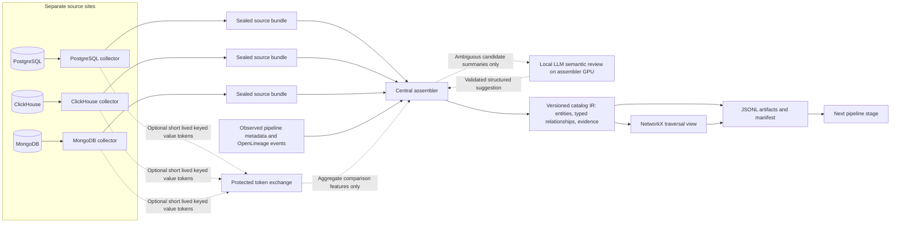

# Database Intelligence Graph Generator: architecture and open-source research

**Decision draft — 23 September 2026.** This is a research deliverable, not an engine implementation. The workspace was empty when inspected. Findings below come from current project repositories, source files, release pages, issues, and official database documentation; no live database, workload, or integration benchmark was available. Release claims are bounded by the date above.

## 1. Executive Summary

Build a small Python **collector and assembler** system with an owned, versioned Catalog IR. Deploy a collector near each database and let a central, headless assembler consume sealed collector bundles. This changes the original single-process diagram: the user confirmed sources require separate collectors. Use SQLGlot for SQL parsing, optional NetworkX for traversal, and optional Valentine for schema-match *candidate evidence*. Keep graph storage and library objects out of the interchange contract. Use JSONL plus a manifest as the first artifact format and SQLite for local incremental state.

The most important semantic rule is: **references, joins, similarity, and lineage are different assertions**. A SELECT join never proves data movement. Lineage requires observed transformation SQL or pipeline metadata, as confirmed by the user. Static view definitions can support *defined* lineage; an observed successful write or pipeline event supports *executed* lineage. Inferred cross-database references can be strong without becoming lineage.

Apache-2.0, MIT, and BSD are all free, permissive licenses and are welcome in this project; this recommendation is **not** a claim that DataHub or OpenMetadata cannot be used because they are Apache-licensed. DataHub's Apache-2.0 code is usable. OpenMetadata's repository root is Apache-2.0, but its Python `ingestion/` subtree has the separate **Collate Community License 1.0**. That license permits use and modification subject to its terms, with an exclusion for competing online services; personal or small internal use is not automatically forbidden. However, it is outside this specification's requested Apache/MIT/BSD-only *core dependency* policy. The separate reason not to deploy either full catalog is operational scope: this headless stage needs its own evidence-rich artifact, not a catalog server. Psycopg 3 is LGPL-3.0-only, so the initial PostgreSQL driver choice is BSD-3-Clause `pg8000`. [Apache use FAQ](https://www.apache.org/foundation/license-faq), [DataHub license](https://github.com/datahub-project/datahub/blob/master/LICENSE), [OpenMetadata ingestion license](https://github.com/open-metadata/OpenMetadata/blob/main/ingestion/LICENSE), [Psycopg package license](https://pypi.org/project/psycopg/), [pg8000 package](https://pypi.org/project/pg8000/).

## 2. Restatement of Requirements

The stage must inspect roughly 10 PostgreSQL, ClickHouse, and MongoDB sources containing about 200 data objects and 1,000 fields. It must emit deterministic machine-readable structure, capabilities, profiles, explicit constraints, inferred relationships, observed SQL or pipeline lineage, evidence, diagnostics, and traversable multi-hop paths. It must be headless, extensible to new stores, careful with database load, and based on permissively licensed dependencies. Raw sample persistence is off by default. The user confirmed that cross-source value comparison in memory is permitted, that lineage is limited to observed transformation SQL and pipeline metadata, and that databases require separate collectors.

## 3. Important Assumptions

1. Each collector can write an artifact to a shared transfer mechanism, though collectors may run at different times. The assembler need not open a direct connection to source databases.
2. A configured `source_id` identifies a logical deployment and survives endpoint or credential rotation. It is unique across collectors.
3. A complete collector snapshot is authoritative only for the source scope it explicitly covers. A partial or failed scan cannot imply deletion.
4. Metadata-only mode is mandatory; profiles, query history, and sample-based matching are optional capabilities.
5. Central processing of cross-source HMAC tokens or ephemeral samples is allowed only within the trusted run boundary. The transfer channel is encrypted and access controlled.
6. Precision of inferred references matters more than recall. The engine may abstain.

## 4. Unclear Requirements / Questions

The three architecture-changing questions were answered before research. The following are implementation inputs, not blockers to this recommendation:

| Decision to record before build | Why it matters | Proposed default |
| --- | --- | --- |
| Maximum collector-to-assembler delay | Determines whether ephemeral value comparison is possible | Support asynchronous bundles; optional short-lived secure token exchange |
| Whether all sites share a key service | Needed for comparable keyed value tokens | Per-run HMAC key distributed to authorized collectors |
| Allowed metadata sensitivity | SQL text and comments may contain secrets | Persist SQL fingerprints and redacted snippets only |
| Desired precision target and evaluation corpus | Needed to calibrate probability | Start with conservative tiers; do not publish numerical probability until measured |
| Object-rename semantics | Stable identity through renames requires source-specific IDs | Emit rename hints, but treat unverified rename as delete plus add |
| Whether pipeline metadata exists | Cross-database lineage is otherwise sparse | OpenLineage ingestion as optional input |

## 5. Existing Open-Source Landscape

The landscape divides into catalog platforms (DataHub, OpenMetadata, Apache Atlas), lineage specifications/services (OpenLineage, Marquez), parsers (SQLGlot, SQLLineage), schema matchers (Valentine), dependency profilers (Metanome and Desbordante), discovery networks (Aurum), and graph libraries (NetworkX). None is a clean fit for a distributed, permissive, artifact-first collector that keeps typed relationship evidence and produces no user-facing catalog service. This is a composition problem, not a fork problem. [DataHub ingestion architecture](https://github.com/datahub-project/datahub/blob/master/docs/architecture/metadata-ingestion.md), [OpenLineage object model](https://openlineage.io/docs/spec/object-model/), [Aurum paper](https://dspace.mit.edu/entities/publication/95356453-b1c6-45cf-8909-655696b90479).

## 6. Repository Comparison

The table combines purpose, language, license, activity, release evidence, maintainers, architecture, dependencies, extension surface, headless use, standalone output, and integration difficulty. “No” means the reviewed project does not offer this as a native feature for our contract; it does not imply the feature can never be built around it. GitHub issue and pull-request counts are not used as quality scores.

| Project | Fit and technical evidence | Activity, license, integration decision |
| --- | --- | --- |
| [DataHub](https://github.com/datahub-project/datahub) | Python ingestion sources and file sink inside a broad Java-backed metadata platform. Its current [Postgres](https://docs.datahub.com/docs/generated/ingestion/sources/postgres), [ClickHouse](https://docs.datahub.com/docs/generated/ingestion/sources/clickhouse), and [MongoDB](https://docs.datahub.com/docs/generated/ingestion/sources/mongodb) docs cover our three systems. Postgres/ClickHouse offer conditional profiling and lineage; MongoDB exposes sampled schema, not a comparable relationship engine. The [file sink](https://github.com/datahub-project/datahub/blob/master/metadata-ingestion/sink_docs/metadata-file.md) emits DataHub metadata events, not our IR. [Setup](https://github.com/datahub-project/datahub/blob/master/metadata-ingestion/setup.py) shows a large base and extra dependency surface. | Actively maintained, [1.7 line shown in current docs/releases](https://github.com/datahub-project/datahub/releases), multiple contributors, Apache-2.0 at repository root. Excellent reference, difficult library embedding because work units, URNs, generated models, and some lineage paths expect DataHub context. Do not fork or run full stack. |
| [OpenMetadata](https://github.com/open-metadata/OpenMetadata) | Schema-first Java service, React UI, Python ingestion framework; PostgreSQL/ClickHouse/MongoDB connectors, profiling, and lineage are relevant references. [Developer notes](https://github.com/open-metadata/OpenMetadata/blob/main/DEVELOPER.md) describe generated Python models and server coupling. | Active; [2.0.2 release dated 16 September 2026](https://github.com/open-metadata/OpenMetadata/releases). Root [Apache-2.0 license](https://github.com/open-metadata/OpenMetadata/blob/main/LICENSE) does **not** cover `ingestion/`'s [Collate Community License](https://github.com/open-metadata/OpenMetadata/blob/main/ingestion/LICENSE). Do not copy or install its ingestion code under the stated license policy; integration difficulty high. |
| [SQLGlot](https://github.com/tobymao/sqlglot) | Python parser, AST, optimizer, qualification and column lineage; official PostgreSQL and ClickHouse dialects. Its [onboarding source](https://github.com/tobymao/sqlglot/blob/main/posts/onboarding.md) explains the schema and upstream SQL needed for accurate `SELECT *` lineage. No database discovery, profiling, or artifact contract. | Active; [30.19.0 released 22 September 2026](https://pypi.org/project/sqlglot/). MIT, Python >=3.9, core package has no required runtime dependencies. Lead maintainer Toby Mao plus contributors. Low integration difficulty for SQL analysis, but parser output needs validation. |
| [SQLLineage](https://github.com/reata/sqllineage) | Python SQL lineage tool using SQLFluff/sqlparse plus NetworkX; library and CLI, column lineage and SQLAlchemy metadata awareness. No source discovery, profiles, or cross-store artifact. [README](https://github.com/reata/sqllineage) and [implementation notes](https://github.com/reata/sqllineage/blob/master/docs/behind_the_scene/how_sqllineage_work.rst) show architecture. | Active; [v1.5.8 release in May 2026](https://github.com/reata/sqllineage/releases), MIT. Useful fallback benchmark, but a second production parser increases dialect and dependency drift. Medium integration difficulty. |
| [Valentine](https://github.com/delftdata/valentine) | Python schema matching of pandas/Polars dataframes, with COMA, Cupid, Jaccard, distribution matching, Similarity Flooding; no FK-direction or lineage semantics. Its [1.0 `pyproject.toml`](https://github.com/delftdata/valentine/blob/master/pyproject.toml) lists NumPy, pandas, NLTK, NetworkX, RapidFuzz, PuLP, POT, SciPy, etc.; embeddings are optional. | **Active, not abandoned:** [1.0.0 released 14 May 2026](https://github.com/delftdata/valentine/releases), Apache-2.0, Python >=3.10,<3.15, Delft Data maintainers and contributors. Medium integration difficulty; use in a bounded experiment or optional matcher, never as the final inference policy. |
| [NetworkX](https://github.com/networkx/networkx) | Python graph algorithms; [MultiDiGraph](https://networkx.org/documentation/stable/reference/classes/multidigraph.html) supports parallel directed edges and arbitrary attributes. It does not supply a durable metadata schema, incremental state, or graph-service API. | Active; [3.7 published 21 September 2026](https://pypi.org/project/networkx/3.7/), [BSD-3-Clause](https://github.com/networkx/networkx/blob/main/LICENSE.txt). Low integration difficulty as an in-memory traversal implementation at this scale. |
| [Sentence Transformers](https://github.com/huggingface/sentence-transformers) | Python local embedding library; [project metadata](https://github.com/huggingface/sentence-transformers/blob/main/pyproject.toml) shows Torch/Transformers/Hugging Face dependencies. No schema matching policy or calibrated reference probabilities. | Active; [6.1.0 published 18 September 2026](https://pypi.org/project/sentence-transformers/), Apache-2.0 library, Python >=3.10. Heavy optional dependency; model license and training provenance are separate checks. Valentine's optional embeddings extra currently caps this dependency below 6, so resolve that version constraint in any experiment. |
| [Metanome](https://github.com/HPI-Information-Systems/Metanome) | Java/Maven/Tomcat profiling platform and algorithm ecosystem; inclusion/functional/unique dependencies. No direct Python collector library or native Postgres/ClickHouse/MongoDB graph contract. [README](https://github.com/HPI-Information-Systems/Metanome) describes the service/frontend build. | Apache-2.0. Documentation still describes Java 8–11 and an older deployment stack; a recent production-ready release was not verified. Algorithmic reference, high integration difficulty. |
| [Aurum](https://github.com/mitdbg/aurum-datadiscovery) | MIT-licensed Python/Java discovery network with joinability and search primitives. [Quick start](https://github.com/mitdbg/aurum-datadiscovery/blob/master/docs/quick_start.md) requires Java profiler, Elasticsearch 6, and Python tested on 3.4–3.6. | Historical research implementation; no current release suitable for this runtime was verified. Valuable graph and path model, high integration difficulty. |
| [Marquez](https://github.com/MarquezProject/marquez) / [OpenLineage](https://github.com/OpenLineage/OpenLineage) | OpenLineage specifies jobs, runs, datasets, facets, and column lineage; Marquez persists and serves these events. Strong pipeline-lineage interchange, but neither is our complete schema/profile/reference IR. | Apache-2.0 projects. Marquez 0.50 line documented in its [README](https://github.com/MarquezProject/marquez); server + DB + UI is unnecessary here. OpenLineage import/export is low/medium effort; Marquez runtime integration is high. |
| [Desbordante](https://github.com/Desbordante/desbordante-core) | Newer C++/Python profiler with approximate inclusion-dependency work; a [2026 paper](https://arxiv.org/abs/2608.02213) is relevant to later scale. | Active but [AGPL-3.0 repository license](https://github.com/Desbordante); exclude as a dependency under current policy. Its paper can inform independent algorithm design. |

The comparison covers support and coupling explicitly: DataHub/OpenMetadata have the broadest database connector coverage and headless ingestion, but their emitted records are platform-specific; SQLGlot/SQLLineage have SQL lineage but no crawling; Valentine has matching but no lineage; Metanome/Desbordante profile dependencies without our connector set; NetworkX only stores in-memory graph state. Testing and documentation are strongest for SQLGlot, NetworkX, and the platform connectors; none has tests for **our** cross-system inference. A proof of concept must therefore use our own acceptance corpus.

The support matrix makes the runtime distinctions explicit. “PG/CH/Mongo” means native *discovery connectors* for PostgreSQL/ClickHouse/MongoDB, not merely that a parser recognizes SQL from that system. “Artifact” means a standalone file output, though it may use the project's own schema.

| Project | PG / CH / Mongo discovery | Table / column lineage | Profiling / query history | Library, standalone artifact, backend coupling | Testing, docs, integration effort |
| --- | --- | --- | --- | --- | --- |
| DataHub | Yes / yes / yes | Yes / conditional by source and feature | Yes / PG and CH optional; Mongo limited | Python ingestion API and file sink; output is DataHub events; full platform needs backend | Broad connector tests/docs; high effort to embed selectively |
| OpenMetadata | Yes / yes / yes | Yes / conditional by source | Yes / connector-specific | Python ingestion workflows emit OpenMetadata schema; full platform needs server | Extensive generated schemas/tests/docs; high effort and license excludes ingestion reuse |
| SQLGlot | No / no / no | AST and column lineage primitives; caller identifies writes | No / no | Python library, no artifact/backend | Strong dialect tests/docs; low-medium effort for our resolver |
| SQLLineage | No / no / no; SQLAlchemy can supply schema metadata | Yes / yes | No / no | Python library/CLI with text/graph output; no server required | Tests/docs and active fixes; medium effort, second parser stack |
| Valentine | No / no / no; accepts DataFrames | No / no | Instance-value matchers / no query history | Python library, no backend or native catalog artifact | Paper, tests, renewed docs; medium effort to adapt summaries and audit deps |
| NetworkX | No / no / no | Traverses caller-provided edges | No / no | In-memory Python library; serialization is not an IR | Mature tests/docs; low effort |
| Sentence Transformers | No / no / no | No / no | No / no | In-process model library; local model files, no server required | Mature docs/tests; medium effort plus heavyweight optional runtime |
| Metanome | No native three-source Python connector set | No / no | Dependency profiling / no query history | Java algorithm/backend modules; service/frontend deployment | Research algorithms/tests, older deployment docs; high effort |
| Aurum | Relational/file ingestion examples; no maintained three-source set | Discovery paths, not transformation lineage | Discovery profiles / no query history | Mixed Java/Python plus Elasticsearch; API after model build | Research tests/docs tied to old stack; high effort |
| Marquez / OpenLineage | No / no / no as database crawlers | Yes / yes via events/facets | Event metadata / no DB query history | OpenLineage library/spec can emit files; Marquez is a backend service | Strong spec/docs; low-medium mapping effort, high server effort |
| Desbordante | Data input/profiler, no maintained three-source collectors | No / no | Dependency profiling / no query history | C++ core with Python binding; AGPL | Active research/tests; license blocks runtime use |

## 7. Best Reusable Components

Adopt SQLGlot's pure-Python distribution as the SQL AST and qualifier, with exact dialect and package version recorded per assertion. Its own [FAQ](https://pypi.org/project/sqlglot/) warns that parsing is lenient and is not database validation; parsed SQL alone cannot prove an executed transformation. Use NetworkX MultiDiGraph as a derived in-memory view, not serialization. Use `pg8000`, `clickhouse-connect`, and PyMongo as connector drivers; consider SQLAlchemy only as a helper for future relational adapters, not the connector protocol. [ClickHouse Connect license/runtime](https://github.com/ClickHouse/clickhouse-connect), [PyMongo package metadata](https://github.com/mongodb/mongo-python-driver/blob/main/pyproject.toml).

Trial Valentine 1.0 on candidate *pairs of small schema summaries*, including its COMA and string/structural methods, against a simple custom baseline. Do not feed whole source databases to it or treat its similarity output as a posterior probability. Its paper explicitly frames matching methods as candidates requiring evaluation in the target discovery scenario. [Valentine paper](https://ieeexplore.ieee.org/document/9458921/), [Valentine release](https://github.com/delftdata/valentine/releases).

## 8. Projects We Should NOT Use and Why

Do not deploy full DataHub, OpenMetadata, Atlas, or Marquez solely for this stage: they add services and impose a platform-specific output contract. This is an architecture decision, not a judgment that Apache-2.0 is unusable. DataHub's Apache-licensed code may be reused with its notices. OpenMetadata `ingestion/` has a separate license whose terms may permit a small internal deployment, but it is outside the stated Apache/MIT/BSD-only core dependency policy; revising that policy would be a separate choice. Do not use Desbordante as a linked Python dependency under an AGPL-free requirement. Do not adopt Aurum or Metanome runtimes for a Python 3.12 collector given their documented old toolchains and service dependencies. Do not install both SQLGlot and SQLLineage in production without a measured dialect gap; use SQLLineage only in comparative tests. Do not make an embedding model, Valentine, Polars, DuckDB, or a graph database mandatory before evidence demonstrates a need.

## 9. Proposed Final Architecture

In plain terms, this stage inventories each configured database, observes only permitted query/pipeline activity, finds declared and plausible hidden links between fields, and emits a typed machine-readable graph for the next pipeline stage. For example, it may find a declared PostgreSQL FK, observe a ClickHouse query joining an events field to a customer field, and propose a MongoDB `customerId` reference based on names, keyness, and sampled value overlap. The output distinguishes those three claims and carries the evidence for each. It does not invent a data-flow lineage edge merely because two values match. No person needs to browse or edit a catalog for the stage to run.



The solid arrows are durable metadata flow. Dotted arrows are optional, bounded paths for cross-source comparison and LLM review. Keyed tokens never become public graph fields or normal durable artifacts, and model suggestions are validated before they become weak evidence. Collectors do source-specific reads, the assembler resolves identities and relationships, and the next stage reads artifacts. The assembler has no database credentials.

Each collector has independent deadlines and capability diagnostics. The assembler works from validated bundles and can rerun inference without rereading a production database. Run modes are `metadata`, `profile`, and `full`; each mode's actual completeness is in the manifest. Cross-source lineage imports pipeline metadata alongside database collector bundles. Libraries are behind interfaces so a driver/parser can change without changing the output format.

## 10. Connector Architecture

Use a synchronous `Collector` protocol initially: `probe()`, `discover(scope)`, `observe_query_history(cursor, budget)`, `profile(object, budget)`, `sample(object, budget)`, `checkpoint()`. Calls yield typed observations and diagnostics, not graph edges. A collector may implement internal async I/O, but the protocol does not require async. At 10 sources/200 objects, source-level parallel jobs give useful concurrency without forcing all adapters into one event loop. Local queues bound per-database concurrency.

Capabilities should be **versioned and contextual**, not booleans alone. Example: `{name: "query_history", state: "available|denied|disabled|unsupported|degraded", scope: "own|all", fidelity: "normalized_sql|full_sql|shape_only", privilege: "pg_read_all_stats", observed_at: ...}`. `schema_mode` can be `declared`, `sample_inferred`, or `mixed`; `row_count` can state `exact` or `estimate`. Capabilities are probed at runtime, because database version, grants, and settings change. PostgreSQL runs per database and uses catalogs/information schema plus pg statistics; ClickHouse uses system tables and engine-aware metadata; MongoDB uses collection metadata, indexes/validators, and bounded sampled document paths. PostgreSQL information-schema visibility depends on privileges; ClickHouse's system tables likewise reflect grants. [PostgreSQL information-schema tables](https://www.postgresql.org/docs/current/infoschema-tables.html), [ClickHouse system columns](https://clickhouse.com/docs/reference/system-tables/columns), [DataHub ClickHouse privilege notes](https://docs.datahub.com/docs/generated/ingestion/sources/clickhouse).

The capability inventory must cover databases/namespaces, datasets, fields, native types and nullability, keys, unique/other constraints, indexes, views, routines, triggers, descriptions, counts/sizes, statistics, sampled values, and query history. Expected initial coverage is:

| Source | Declared structure | Conditional discovery | Explicitly absent or different |
| --- | --- | --- | --- |
| PostgreSQL | Databases, schemas, tables/views, columns, PK/FK/unique/check constraints, indexes, comments, routines/triggers | View/function definitions and query history according to grants; stats and samples according to `SELECT` | Cross-database FK is not a native PostgreSQL constraint |
| ClickHouse | Databases, tables/views/materialized views, columns/types, engine expressions, comments, indexes/projections where exposed | System query logs, table statistics, samples, UDF/dictionary metadata by version and grants | Primary-key/sorting expression is generally not an enforced unique key; do not emit relational FK semantics |
| MongoDB | Databases, collections/views, indexes, validators, BSON/native collection metadata | Sample-inferred nested paths/types, count/size, profiler or query shapes if already available | No declared SQL columns, ordinary FKs, stored procedures, or SQL nullability |

An unsupported item is a capability result, not an empty observation. This lets the assembler distinguish “no FK exists” from “FK discovery was impossible.” SQLAlchemy reflection can help a future generic SQL connector, but direct source APIs should remain primary for capabilities SQLAlchemy does not model.

## 11. Canonical Metadata / Catalog IR

Own the IR and publish JSON Schema. An `Entity` has `id`, `kind`, `source_id`, canonical `path_segments`, display name, `parent_id`, attributes, source-specific extension namespace, first/last seen times, definition fingerprint, and observation provenance. Kinds include source, database, namespace, table, collection, view, materialized view, field, index, constraint, function, procedure, trigger, job, query, and run. A Mongo field is a path with array markers and observed type frequencies, *not* a declared SQL column. A ClickHouse primary-key expression is preserved as an engine expression, *not* asserted as a uniqueness constraint. A `Relationship` has a stable assertion ID, `type`, `source_id`, `target_id`, direction semantics, `status`, evidence IDs, origin, and validity interval. A composite FK is one constraint entity or assertion group with ordered component mappings; it must not become unrelated single-column FKs.

Identity format should be a canonical tuple encoded as an opaque, deterministic ID, for example `urn:dbintel:v1:<base32(sha256(canonical tuple))>`, with the readable tuple stored separately. Tuple fields include tenant/scope, configured source ID, entity kind, and ordered dialect-aware identifier segments. Avoid credentials, hostnames, ad hoc slash joining, and forced lowercasing. Respect quoted PostgreSQL identifier case, ClickHouse namespace rules, Mongo dotted keys/arrays, and Unicode normalization. IDs remain stable if a connection endpoint changes; an object rename changes its ID unless a connector supplies a trustworthy source object ID and explicit rename evidence. Run IDs are random UUIDs and never part of entity IDs.

**Standard mapping:** OpenLineage jobs/runs/datasets and its current [explicit Lineage Job Facet](https://openlineage.io/docs/spec/facets/job-facets/lineage/) make it the preferred lineage import/export format. They do not model our constraint, inferred-reference, similarity, and evidence records. DataHub's [metadata model](https://github.com/datahub-project/datahub/blob/master/docs/metadata-standards.md), OpenMetadata's [schema-first model](https://github.com/open-metadata/OpenMetadata/blob/main/DEVELOPER.md), and Atlas [relationship definitions](https://atlas.apache.org/api/v2/json_AtlasRelationshipDef.html) are useful references, not better internal contracts. OpenTelemetry [database semantic conventions](https://opentelemetry.io/docs/specs/semconv/database/database-spans/) are suitable for scan telemetry and trace attribution, not as a metadata graph schema. Thus: own the IR and offer explicit import/export mappings, especially for OpenLineage.

## 12. Graph Model

The authoritative store is the entity/relationship/evidence IR. Build a heterogeneous in-memory graph with source, namespace, dataset, field, job, and query nodes; containment and typed relationship edges. Keep three **logical projections** over this one data model: structure, reference/discovery, and lineage. This prevents an unrestricted path search from treating `SEMANTIC_MATCH` as data movement. NetworkX MultiDiGraph fits the initial size and parallel assertions; a custom adjacency index can replace it if measured latency or memory requires it. A graph database adds deployment and synchronization costs without demonstrated benefit at ~1,000 fields. [NetworkX MultiDiGraph](https://networkx.org/documentation/stable/reference/classes/multidigraph.html).

Multi-hop results must include the ordered edge IDs, allowed edge-type grammar, per-edge evidence, source scope, and hop limit. Traversal may reverse a reference edge for exploration while preserving its actual direction. Do not collapse `customers.id -> orders.customer_id` into a table lineage edge. To traverse from one FK to the next through the `orders` table, use an explicit dataset-membership transition with a cost and label; otherwise column-only paths incorrectly stop or imply value derivation. Default path policies: reference paths allow FK/inferred-reference plus membership transitions; lineage paths allow lineage/derivation only; a broad discovery path can include semantic matches but must say so.

At this scale, graph-tool and igraph add native build/runtime complexity for little gain; rustworkx can be revisited if measured traversal CPU dominates. A custom adjacency map is straightforward for a few path queries but reimplements mature graph algorithms. An embedded SQLite edge index can support disk-backed lookup later, whereas DuckDB is more attractive for analytical scans than interactive graph paths. The migration boundary is the IR-to-graph adapter, so this choice is reversible. This is an engineering inference from the stated scale and deployment constraints, not a graph benchmark.

## 13. Relationship Types

| Type | Meaning and direction | Assertion rule |
| --- | --- | --- |
| `FOREIGN_KEY` | Referencing fields → referenced key, possibly composite | Declared catalog constraint |
| `INFERRED_REFERENCE` | Candidate referencing field(s) → candidate key | Multi-signal inference with direction evidence |
| `QUERY_JOIN` | Fields joined in observed query; symmetric unless predicate implies otherwise | Parsed, resolved equality or other join predicate; record operator |
| `VALUE_INCLUSION` | Sampled source values appear in target values | Directional sample observation, not full inclusion proof |
| `SCHEMA_MATCH` | Structural/name correspondence, usually symmetric | Matcher result, no reference claim |
| `SEMANTIC_MATCH` | Similar meaning, symmetric | Semantic evidence, no reference claim |
| `VIEW_DEPENDENCY` | Read dataset → defined view | Definition or database dependency observation |
| `TABLE_LINEAGE` | Input dataset → output dataset | Observed/defined transformation and target write |
| `COLUMN_LINEAGE` | Input field → output field | Resolved transformation expression |
| `DERIVATION` | Expression/function-level dependency | Typed transform and output, not mere join |

An edge may coexist with other types between the same nodes. `QUERY_JOIN` and `VALUE_INCLUSION` are evidence-bearing relations, not automatically final `INFERRED_REFERENCE`s. Each assertion records `observation_kind = declared | defined | executed | sampled | inferred`, plus validity and parser/matcher version.

## 14. Hidden Relationship Inference Algorithm

1. **Candidate generation:** remove impossible pairs by source/domain policy, incompatible value family, incompatible granularity, low-quality ubiquitous names (`id`, `name`, `date`) without context, and self-pairing. Generate candidates from key-like target columns, explicit unique indexes, observed joins, lexical/token similarity, and optional semantic nearest neighbors. At 1,000 fields there are 499,500 unordered pairs, so blocking still matters for false positives and future scale.
2. **Profile:** derive target uniqueness, non-nullness, approximate cardinality, type distribution, and source/target sample sizes. For Mongo paths record presence and array element type distribution. Prefer catalog statistics and bounded scans.
3. **Value evidence:** normalize only compatible types. Use a per-run HMAC key to make comparable tokens at separate collectors; compute cardinality and MinHash/containment sketches, and optionally exchange small encrypted token sets for confirmation. The HMAC key must not appear in artifacts. Tokens are sensitive, have a short TTL, and are never public graph attributes. Common values, empty samples, truncated identifiers, and correlated sampling reduce evidence quality. A high sampled inclusion score is not proof of a full inclusion dependency.
4. **Context:** score name tokens, referenced table stem, neighbor fields, query joins, index position, and schema/graph context. Keep independent signal families separate to avoid double counting correlated lexical features.
5. **Decision:** apply hard vetoes (incompatible type semantics, target clearly nonunique for a single-key reference, low support, ambiguous equal candidates), estimate direction, then calibrate. Emit `INFERRED_REFERENCE` only above a validated high-precision threshold; emit weaker `SCHEMA_MATCH`/`VALUE_INCLUSION` evidence otherwise. Preserve competing targets and abstention reasons.

**Direction inference:** orient a candidate `A -> B` only when `B` has an observed/declared key or strong uniqueness estimate, sampled values from `A` are largely included in `B` under adequate support, and `A` has plausible reference cardinality/context. An observed `JOIN A.x = B.y` gives pairing evidence but no direction on its own. If both sides are unique, both directions are plausible; record an undirected match or `direction = unknown` unless names, constraints, or transformation context resolve it. For composite keys, test tuples together and preserve field order. A data-copy lineage edge must never be inferred from reference direction.

For small data, a simple bounded set comparison may outperform a complex dependency miner. If larger sources require full unary/composite inclusion-dependency search, use the [Metanome IND algorithm survey](https://hpi.de/fileadmin/user_upload/fachgebiete/naumann/publications/PDFs/2019_duersch_inclusion.pdf) and [Desbordante research paper](https://arxiv.org/abs/2608.02213) to design or evaluate a separate profiler; do not import AGPL code. Value inclusion is neither sufficient nor always necessary for a foreign key (sampling gaps and delayed replication matter).

## 15. Confidence / Evidence Model

Avoid the example's fixed 0.97 weighted sum. A number called “confidence” should mean a calibrated probability over a defined evaluation population, not an arbitrary similarity average. Use an evidence schema with metric name, value, sample support, estimator, uncertainty, measurement timestamp, source run, parser/matcher version, and sensitivity. First ship `strength = declared | strong | tentative | rejected` and `confidence = null` for uncalibrated inferences. Declared FK truth is a catalog assertion, not a 100% measured relationship in current data.

Build a labeled development corpus with declared FKs as *some* positives, deliberately hard negative candidate pairs, synthetic edge cases, and a small reviewed evaluation set outside the production workflow. Hold out whole databases/schemas to test transfer. Calibrate separate models for within-source and cross-source pairs using logistic/isotonic calibration only after enough labels; report precision-recall and calibration, not accuracy on a mostly negative all-pairs set. Choose an operating threshold by a target precision lower confidence bound. Query joins, name similarity, and graph proximity are correlated; do not multiply their likelihoods as if independent. Drift and missing capabilities require recalibration or abstention. Export `model_id`, calibration set/version, threshold, and a reason trace with every numerical probability.

## 16. SQL Lineage Architecture

Use SQLGlot with explicit dialect, captured catalog snapshot, default database/schema/search path, and source-specific identifier resolution. Parse each statement; classify read tables, write targets, join predicates, views, and transformations; qualify aliases/CTEs/subqueries; expand `*` only with reliable schema; emit unresolved diagnostics rather than guessed columns. SQLGlot's [lineage implementation description](https://github.com/tobymao/sqlglot/blob/main/posts/onboarding.md) requires schemas and upstream queries for correct column paths. Its [FAQ](https://pypi.org/project/sqlglot/) calls the parser lenient. A reported [quoted-identifier lineage issue](https://github.com/tobymao/sqlglot/issues/7733) and [large-query performance issue](https://github.com/tobymao/sqlglot/issues/5112) justify an acceptance corpus and timeout. Pin a tested version.

Create tests for CTEs, aliases, subqueries, UNION branches, INSERT…SELECT, CTAS, UPDATE, MERGE, nested queries, view chains, `SELECT *`, quoted identifiers, ambiguity, and both SQL dialects. Treat procedure bodies and dynamic SQL as partial/unresolved unless a supported parser can statically resolve a specific statement. `SELECT` alone yields read usage and possible join evidence, never write lineage. A view definition yields `VIEW_DEPENDENCY` and **defined** column lineage; a successful observed write yields **executed** lineage. Record transformations (direct, cast, arithmetic, aggregate, conditional, unknown), not only source/target pairs. SQLLineage remains a benchmark; its May 2026 release still calls procedure parsing preliminary. [SQLLineage release notes](https://github.com/reata/sqllineage/releases).

## 17. Query-History Architecture

PostgreSQL `pg_stat_statements` is optional and aggregates normalized query shapes. It needs preloading/extension setup and `pg_read_all_stats` to view other users' SQL. It provides calls and query IDs, but no durable per-execution time cursor, so use a snapshot fingerprint plus call-count deltas with reset/version detection; do not claim exact event-time lineage from it. Query text can be a representative statement and may contain literals in edge cases. [PostgreSQL documentation](https://www.postgresql.org/docs/current/pgstatstatements.html), [predefined roles](https://www.postgresql.org/docs/current/predefined-roles.html).

ClickHouse `system.query_log` carries execution times and query text, but is local per node; a full cloud/cluster view needs a carefully bounded multi-node read. Capture `QueryFinish`, query ID, event time, normalized hash, and a high-water mark with overlap/deduplication. Do not issue `SYSTEM FLUSH LOGS` from the scanner. On ClickHouse 26.8+, `system.user_query_log` can expose **only the collector user's** history without access to all queries; it is insufficient for broad workload discovery unless the collector is the workload user. Query logging may be disabled. [ClickHouse query-log docs](https://clickhouse.com/docs/reference/system-tables/query_log), [26.8 release note](https://clickhouse.com/blog/clickhouse-release-26-08).

MongoDB's profiler is off by default and can add load; never enable it automatically. `$queryStats` reports query shapes but its output is explicitly marked unsupported/unstable and Atlas M10+ specific; it is a weak optional signal, not a durable lineage source. Existing profiler/aggregation pipeline records may reveal `$lookup`, `$merge`, or `$out`, but completeness must be stated. Prefer pipeline metadata for cross-database movement. [Mongo profiler](https://www.mongodb.com/docs/manual/tutorial/manage-the-database-profiler/), [$queryStats](https://www.mongodb.com/docs/manual/reference/operator/aggregation/querystats/).

## 18. MongoDB-Specific Architecture

Represent a collection and nested field paths without pretending that optional fields are declared columns. Record field presence, observed BSON type histogram, array element path, nesting depth, validator `$jsonSchema` if present, index keys, view pipeline, and sample size. Preserve `_id` and `ObjectId` as BSON types. DBRef (`$ref`, `$id`, optional `$db`) is direct reference evidence; ordinary `userId`/ObjectId fields are candidates, not declared FKs. Arrays of IDs form multivalued references; embedded documents are containment, not joins. Parse observed aggregation `$lookup` as a query join, and `$merge`/`$out` as transformation/write evidence when execution is observed. MongoDB documents distinguish DBRefs/manual references and define `$lookup` as a join. [Database references](https://www.mongodb.com/docs/manual/reference/database-references/), [$lookup](https://www.mongodb.com/docs/manual/reference/operator/aggregation/lookup/).

Sampling with `$sample` can have different execution plans depending on stage order and sample fraction; use `maxTimeMS`, size limits, and explain or safer bounded reads as needed. Never let a `null` sampling size trigger an unbounded scan; DataHub's Mongo connector explicitly allows that option, illustrating why our budget validator must forbid it. [Mongo `$sample`](https://www.mongodb.com/docs/manual/reference/operator/aggregation/sample/), [DataHub Mongo sampling configuration](https://docs.datahub.com/docs/generated/ingestion/sources/mongodb).

## 19. Semantic Matching Architecture

Begin with deterministic tokenization, stemming/synonyms supplied in configuration, acronym handling, table context, RapidFuzz-style lexical features, and structural matching. Evaluate local embeddings only on pairs that survive blocking and have enough descriptive text. Embeddings are useful for `customer`/`client` terminology; they are poor evidence for direction, keyhood, or actual value overlap, and very short identifiers are ambiguous. Keep `SEMANTIC_MATCH` separate from `INFERRED_REFERENCE`. A candidate model is [BAAI/bge-small-en-v1.5](https://huggingface.co/BAAI/bge-small-en-v1.5), whose model card lists MIT; pin a specific model revision and review training-data provenance. [Sentence Transformers](https://github.com/huggingface/sentence-transformers) is Apache-2.0 but pulls a larger Torch/Transformers stack; it belongs in an optional extra. Its score is never called calibrated confidence. Compare an embedding-enabled variant against a nonembedding baseline on held-out schemas before retaining it.

### Optional LLM-assisted semantic review

An LLM call can be useful when deterministic blocking finds a small set of plausible but ambiguous candidates: for example, `client_key` versus `customer_id` with sparse descriptions, or a query comment that explains a business synonym. It may propose a semantic equivalence, a direction *hint*, an acronym expansion, or a concise explanation of existing evidence. The model's prose is **not** an observed database fact. It cannot assert a foreign key, prove value inclusion, or create table/column lineage; lineage remains restricted to observed transformation SQL and pipeline metadata. A model output should have its own `MODEL_SUGGESTION` evidence kind, not `DECLARED` or `EXECUTED`.

Run this only in the assembler after deterministic candidate generation. The user selected a **local GPU-hosted model**: keep the model server on the assembler host or a protected internal network and allow no cloud fallback. Send candidate IDs, names, types, containing datasets, approved descriptions, neighboring schema context, and non-sensitive aggregate evidence with support counts. Do not send credentials, raw sampled values, keyed value tokens, full query logs, SQL literals, or unrestricted document text. Treat comments/descriptions as untrusted input that may contain prompt injection. The model has no database credentials, tools, or authority to read a source.

The response contract is a strict schema with `candidate_id`, `semantic_relation = same_concept | related | unrelated | uncertain`, `direction_hint = source_to_target | target_to_source | unknown`, `referenced_evidence_ids`, and a short `rationale`. Validate IDs, enums, and evidence references against the input; reject unknown claims and fail closed to `uncertain` on refusal, timeout, parse error, or provider outage. No model-generated numerical score is called calibrated probability. Cache by candidate fingerprint, prompt version, model digest, and redaction policy; cap candidates, tokens, requests, GPU time, and latency per run. Record server/model/version, prompt template hash, input fingerprint, time, and usage in diagnostics while avoiding sensitive prompt persistence. Compare incremental precision and recall on held-out schemas against the no-LLM baseline before enabling this in normal runs.

**Local tool decision, updated 2026-09-23:** use [vLLM](https://docs.vllm.ai/en/stable/) (Apache-2.0) on a Linux or WSL2 GPU host. Its [OpenAI-compatible server](https://docs.vllm.ai/en/stable/serving/openai_compatible_server.html) and [structured-output support](https://docs.vllm.ai/en/stable/features/structured_outputs.html) provide the bounded local review call. Use the [OpenAI Python SDK](https://github.com/openai/openai-python) strictly against the configured private vLLM base URL; this is a protocol client, not a hosted-model dependency. Require a protected endpoint, configured auth reference, explicit local model identity and no cloud fallback. Trial [Qwen3 8B](https://huggingface.co/Qwen/Qwen3-8B) (Apache-2.0), compare a smaller model if GPU memory or latency requires it, and pin the final artifact/revision/quantization after benchmarking the actual GPU. Do not infer VRAM capacity from model file size. vLLM's exact schema-constrained behavior must pass contract tests on the pinned versions.

[Ollama](https://docs.ollama.com/api/introduction) and [llama.cpp](https://github.com/ggml-org/llama.cpp/blob/master/tools/server/README.md) remain evaluated alternatives, not v1 dependencies. The user selected vLLM; a runtime change requires a new decision.

### Agent framework decision

Use [LangGraph](https://docs.langchain.com/oss/python/langgraph/overview) (MIT) for one explicit, bounded `StateGraph`: redact candidate context, call local vLLM, validate, then return weak evidence or a typed failure. The deterministic assembler still chooses candidates, owns budgets and publishes the graph. LangGraph gives named workflow nodes that can be traced and tested without granting the model database or arbitrary tool access. This is a workflow, not a free-running multi-agent system.

Do not add the top-level [LangChain](https://github.com/langchain-ai/langchain) package in v1. Its high-level agents/integrations do not add a needed feature to these four fixed nodes; LangGraph itself depends on `langchain-core`, which the lockfile will include transitively. Do not add [LangGraph Swarm](https://github.com/langchain-ai/langgraph-swarm-py) in v1. Swarm implements dynamic specialized-agent handoffs and may pass full shared message history by default; this reviewer has no peer handoffs and such sharing complicates privacy. [PydanticAI](https://pydantic.dev/docs/ai/overview/) is also not selected. Reconsider any of these only after a measured need and user approval.

Use self-hosted [Langfuse](https://langfuse.com/self-hosting) for workflow visibility. The [Python SDK](https://langfuse.com/docs/observability/sdk/python/overview) can create manual spans for each node. Start with approved metadata only, because automatic [LangGraph callback tracing](https://langfuse.com/integrations/frameworks/langgraph) can capture inputs and outputs; enable its graph visualization only after canary tests establish effective masking. Current self-hosted architecture uses separate web/worker, PostgreSQL, ClickHouse, Redis/Valkey and S3-compatible storage; these are Langfuse operations dependencies, not source connections. Langfuse outages cannot stop graph publication.

## 20. Profiling Strategy

Minimum useful per field: observed/declared type, null or absence rate with denominator, approximate distinct count with estimator, uniqueness estimate, value length/range or numeric quantiles where relevant, common pattern class, and a bounded value sketch for join candidates. Per object: row/document count **with exact/estimate label**, size estimate, sampling method, sample count, and profile timestamp. Use database statistics first: PostgreSQL `pg_stat_all_tables.n_live_tup` is an estimate; MongoDB `$collStats` metadata count can be approximate on sharded clusters; ClickHouse table/parts metadata is engine dependent. [PostgreSQL statistics](https://www.postgresql.org/docs/current/monitoring-stats.html), [Mongo `$collStats`](https://www.mongodb.com/docs/manual/reference/operator/aggregation/collstats/), [ClickHouse tables](https://clickhouse.com/docs/reference/system-tables/tables).

Do not run `COUNT(DISTINCT ...)` or random-order full scans by default. PostgreSQL `TABLESAMPLE SYSTEM` samples pages, while `BERNOULLI` considers rows across the table; neither plus `LIMIT` guarantees a cheap, unbiased fixed-size sample. Record method and bias. ClickHouse should exploit engine `SAMPLE` only when supported by the table key, or read a bounded partition/projection under read limits. Mongo sampling must be capped and timed. For sensitive columns, exclude from value features by policy. Polars is optional: 1,000 columns of compact profiles do not require a dataframe engine.

## 21. Incremental Processing / Caching

Collectors maintain a local SQLite state DB keyed by source ID, scope, object ID, connector version, and scan policy. Store definition hashes, metadata observation time, profile fingerprints and freshness, query-history checkpoint, and prior bundle digest. Distinguish a *schema fingerprint* from a *data freshness signal*: unchanged DDL does not mean values or profile are unchanged. Each profile has a TTL or source change signal and sampling seed. The assembler stores prior entity/edge fingerprints and dependency links; changed field metadata invalidates its candidate comparisons, affected SQL qualification, and traversals touching changed edges. A view SQL change invalidates that view's lineage descendants. Query-history windows use overlap and deduplication.

Deletion is emitted only after a complete authoritative scan of the same scope; partial/permission-denied scans leave prior entities with stale/unknown status. Bundles are immutable; an assembly run lists exact source bundle digests. Avoid claiming a global point-in-time snapshot when collectors run at different times.

## 22. Pipeline Interface

Use a Python library with two thin CLIs: `dbintel collect --config source.toml --output bundle/` at each source site, and `dbintel assemble --input bundles/ --output catalog/` centrally. TOML is parsed with Python 3.12's `tomllib`, and credentials are environment/secret-manager references rather than literal configuration values. A library API supports embedding in the parent pipeline. File/object-store artifacts are the durable handoff; standard output is only for status/manifest path and exit code. This is simpler than a persistent REST/gRPC service for 10 sources, yet respects the distributed deployment. A message queue may trigger collection or carry bundle locations later; it is not a canonical transport. A service becomes justified only for interactive freshness, high-frequency events, or centralized orchestration that cannot be handled by the parent pipeline.

## 23. Artifact / Serialization Format

Each sealed collector bundle contains `manifest.json`, `entities.jsonl`, `observations.jsonl`, `profiles.jsonl`, and `diagnostics.jsonl`. The assembled output contains `manifest.json`, `entities.jsonl`, `relationships.jsonl`, `evidence.jsonl`, `profiles.jsonl`, and `diagnostics.jsonl`; lineage uses typed relationships rather than a conflicting duplicate `lineage.jsonl`. Optional `openlineage.jsonl` is an interoperability export. A manifest includes IR schema version, producer/connector/parser/model versions, source scope, start/end/as-of times, capabilities, completeness, counts, SHA-256 digest per file, run mode, sampling policy ID, and upstream bundle digests. Validate references and checksums before atomic publish. Sort records by stable ID for deterministic diffs.

An abridged `relationships.jsonl` record illustrates the contract; its referenced evidence record carries the actual measurements, sample support, and sensitivity classification:

```json
{"schema_version":1,"kind":"relationship","id":"rel_7c9f","type":"INFERRED_REFERENCE","source_id":"field_orders_customer_id","target_id":"field_customers_id","direction":"source_to_target","status":"tentative","origin":"inference","observation_kind":"inferred","evidence_ids":["ev_42","ev_43"],"confidence":null,"observed_at":"2026-09-23T08:00:00Z"}
```

The short IDs above are illustrative; production entity and assertion IDs follow the canonical deterministic identity rules in section 11. Collector bundles contain observations, not inferred graph edges. If cross-site value checks are enabled, collectors exchange only short-lived keyed tokens through an access-controlled channel outside the durable bundle; the assembler deletes them after feature extraction and emits aggregate evidence with support counts and uncertainty.

JSONL is easy to stream, inspect, and evolve at this scale. JSON Schema uses semantic versioning: patch for clarifications, minor for additive fields/types with tolerant readers, major for changed meaning/removal; each record has an explicit `schema_version` major and a `kind` discriminator. Include migration readers for the prior major version. SQLite is internal cache, not pipeline contract. Parquet/Arrow become optional for large profile tables or sketches only after size measurements. Protobuf imposes code generation for little benefit here; graph serialization ties consumers to a library. Raw samples are never in the default artifact.

The format alternatives have distinct roles: one monolithic JSON file is simple but poor for streaming and partial diagnostics; Parquet/Arrow are efficient typed columnar batches but awkward for heterogeneous nested evidence and manual inspection; SQLite or DuckDB would make convenient queryable *secondary* artifacts, but introduce database-file compatibility and concurrent-writer rules into the handoff; protobuf is compact and strongly typed but adds generated-client coordination; GraphML/NetworkX pickle lose key IR semantics or introduce unsafe/runtime-specific loading. A consumer needing random access can build a local SQLite index from JSONL without changing the canonical contract.

## 24. Security and Database Load

Provision a dedicated read-only identity per source and grant only the specific metadata, sample, and optional query-history rights needed. Metadata-only and profiling grants should be separable. PostgreSQL needs connection plus object visibility and `SELECT` for sampled data; `pg_read_all_stats` is an **optional elevated read privilege** to see other users' query text. An operator must separately enable `pg_stat_statements`; the scanner cannot do it. ClickHouse requires object/system-table access appropriate to the desired scope and table `SELECT` for profiling; enforce `readonly`, execution time, read rows/bytes, memory, and source concurrency limits. Mongo needs list/read and optional stats/profile privileges; never enable the profiler or modify settings. [PostgreSQL role docs](https://www.postgresql.org/docs/current/predefined-roles.html), [ClickHouse source grants](https://docs.datahub.com/docs/generated/ingestion/sources/clickhouse), [Mongo profiler caution](https://www.mongodb.com/docs/manual/tutorial/manage-the-database-profiler/).

Use TLS, secret references rather than passwords in config/artifacts, statement or operation timeouts, per-source read budgets, cancellation, narrow projections, bounded samples, and circuit-breaker diagnostics after repeated timeouts. Avoid `ORDER BY random()`, unbounded `DISTINCT`, full collection schema scans, and high-concurrency cluster-wide log reads. Treat query text, comments, error strings, HMAC tokens, and even distributions as potentially sensitive. Redact or hash SQL literals; record only approved SQL snippets. The collector bundle must declare its data classification.

Bind the local model server to loopback when co-located with the assembler, or use an authenticated private endpoint if separated. Pin the exact model artifact and block cloud fallback. Keep model prompts/outputs out of general application logs; validate metadata text as untrusted input, and grant the model process no database credentials or direct source-network access.

## 25. Expected Performance

At 200 objects and 1,000 fields, local graph construction and candidate matching should usually be seconds after bundles arrive; 499,500 raw field pairs make blocking important. Metadata-only source collection is likely seconds to tens of seconds **per source**, but network latency, catalog size, permissions, and source load dominate. Profiling and query-log scans can take tens of seconds to minutes, and the slowest remote collector plus transfer delay sets wall-clock time. The original seconds-to-one-minute target is a hypothesis, not a reliable guarantee. Define budgets per source and publish partial completeness when exceeded. Benchmark cold/warm PostgreSQL, ClickHouse, and Mongo fixtures with realistic large tables before committing an SLA. No actual runtime benchmark was performed for this report.

Local LLM review adds GPU-dependent latency and must have its own request/time budget; a slower or unavailable vLLM service cannot block deterministic artifact publication. Model file size is not a VRAM or throughput benchmark. Compare Qwen3 8B and a smaller local variant on the actual GPU before adding the model to any end-to-end time target. Include Langfuse span overhead and failure behavior in the same benchmark.

## 26. Licensing Analysis

| Component | Current evidence | Decision |
| --- | --- | --- |
| SQLGlot | [MIT](https://github.com/tobymao/sqlglot/blob/main/pyproject.toml) | Core |
| NetworkX | [BSD-3-Clause](https://github.com/networkx/networkx/blob/main/LICENSE.txt) | Optional graph view |
| Valentine | [Apache-2.0](https://github.com/delftdata/valentine/blob/master/LICENSE), but has a sizeable [dependency tree](https://github.com/delftdata/valentine/blob/master/pyproject.toml) | Optional, lock and audit transitives |
| DataHub | [Apache-2.0 repository](https://github.com/datahub-project/datahub) | Reference; library embedding requires dependency audit |
| OpenMetadata `ingestion/` | [Collate Community License 1.0](https://github.com/open-metadata/OpenMetadata/blob/main/ingestion/LICENSE) | Exclude from permissive runtime/code reuse |
| Psycopg 3 | [LGPL-3.0-only](https://pypi.org/project/psycopg/) | Exclude under stated all-permissive core policy |
| pg8000 / asyncpg | [BSD-3-Clause](https://pypi.org/project/pg8000/) / [Apache-2.0](https://github.com/MagicStack/asyncpg) | pg8000 first; asyncpg optional alternative |
| ClickHouse Connect / PyMongo | [Apache-2.0](https://clickhouse.com/blog/python-async-native-client) / [Apache-2.0](https://github.com/mongodb/mongo-python-driver/blob/main/pyproject.toml) | Core drivers |
| Desbordante | [AGPL-3.0](https://github.com/Desbordante) | Research only |
| Sentence Transformers / example BGE model | [Apache-2.0 library](https://github.com/huggingface/sentence-transformers/blob/main/pyproject.toml) / [MIT model card](https://huggingface.co/BAAI/bge-small-en-v1.5) | Optional, pin model revision and audit training provenance |
| vLLM / OpenAI Python protocol client | [Apache-2.0 server](https://github.com/vllm-project/vllm/blob/main/LICENSE) / [Apache-2.0 client](https://github.com/openai/openai-python/blob/main/LICENSE) | Selected private local-model serving and assembler client; no hosted API |
| Qwen3 8B / 4B | [Apache-2.0 8B](https://huggingface.co/Qwen/Qwen3-8B) / [Apache-2.0 4B](https://huggingface.co/Qwen/Qwen3-4B) | Evaluate and pin one model artifact/quantization |
| LangGraph / LangChain / LangGraph Swarm | [MIT LangGraph](https://github.com/langchain-ai/langgraph/blob/main/LICENSE) / [MIT LangChain](https://github.com/langchain-ai/langchain/blob/master/LICENSE) / [MIT Swarm](https://github.com/langchain-ai/langgraph-swarm-py/blob/main/LICENSE) | LangGraph selected for fixed reviewer workflow; top-level LangChain and Swarm deferred; audit transitives |
| Langfuse self-hosted / Python SDK | [Repository license and `ee/` exception](https://github.com/langfuse/langfuse/blob/main/LICENSE) / [SDK repository](https://github.com/langfuse/langfuse-python) | Selected metadata-only agent visibility, deployed inside the environment; verify exact server/SDK licenses and dependency lock |

**License clarification:** Apache-2.0, MIT, and BSD allow free private and commercial use; size and business purpose do not restrict their use. [Apache's FAQ](https://www.apache.org/foundation/license-faq) states this explicitly. OpenMetadata's root [Apache-2.0 license](https://github.com/open-metadata/OpenMetadata/blob/main/LICENSE) and `ingestion/` [Collate Community License](https://github.com/open-metadata/OpenMetadata/blob/main/ingestion/LICENSE) must be considered separately. The latter grants royalty-free use/modification/distribution but excludes certain competing online services; it is not equivalent to an Apache/MIT/BSD dependency. A small personal or internal use may fit its terms, but the architecture does not depend on that distinction. DataHub is Apache-2.0 and can be used; we simply do not need its full server for this stage. LGPL Psycopg is also usable in many projects, but it differs from the user's narrower core dependency policy. None of these distinctions imply that an Apache-licensed library costs money.

Valentine's current dependency requirement includes `chardet>=7`. The current chardet package advertises a permissive license, but its 2026 relicensing has a [public dispute](https://github.com/chardet/chardet/issues/327) and [follow-up clarification](https://github.com/chardet/chardet/issues/355). This is a reason to keep Valentine optional until a reproducible locked dependency and license review is completed, not a legal conclusion about chardet. At implementation time, generate an SBOM from the exact lockfile and reject GPL/AGPL/LGPL or nonpermissive packages in the **core** environment unless the project policy changes. Verify each bundled model and dataset separately.

## 27. Major Risks / Unknowns

1. Cross-source sample comparison may be impossible for asynchronous sites without temporarily persisting sensitive derived tokens; the policy and TTL need a concrete design.
2. High value overlap among low-cardinality or ubiquitous identifiers can create convincing false references. Target uniqueness, support, hard negatives, and abstention are essential.
3. Query history is incomplete, truncated, aggregated, or privileged. Absence of a join or lineage event is not negative evidence.
4. SQL parser success can silently mis-resolve identifiers or stars. Unresolved cases must remain visible. [SQLGlot issue example](https://github.com/tobymao/sqlglot/issues/7733).
5. Mongo schema inference misses rare fields and changes under sampling; store coverage and observed type distributions.
6. ClickHouse engine semantics, materialized views, dictionaries, distributed tables, and query logs vary by deployment; do not invent relational constraints.
7. Source-local snapshots are not globally simultaneous. Cross-database inference requires timestamp and freshness handling.
8. Incremental profile invalidation has no universal cheap change signal; TTL and explicit staleness are necessary.
9. OpenMetadata and driver licenses show that repo-level badges are insufficient; check the exact imported path and locked transitives.

## 28. Recommended Repository Structure

```text
src/dbintel/
  ir/                 # versioned models, ID rules, schema migrations
  collectors/         # protocol, capability probe, source budgets
    postgres/
    clickhouse/
    mongodb/
  observations/       # normalized metadata and query observations
  sql/                # SQLGlot adapter, resolution, lineage extraction
  profile/            # bounded estimators and token/sketch handling
  match/              # blocking, features, calibration, decision policy
  llm/                # optional provider adapter and bounded candidate review
  graph/              # projections and typed path traversal
  artifacts/          # JSONL writers/readers, manifest, validation
  state/              # SQLite checkpoints and invalidation
  cli.py
schemas/              # published JSON Schemas and migrations
tests/fixtures/       # dialect, Mongo, relationship, artifact corpora
tests/integration/    # container-backed source tests
docs/decisions/       # ADRs, capability and privilege matrix
```

## 29. Implementation Phases

1. **Contract first:** finalize IR 1.0 draft, IDs, relationship semantics, bundle validation, provenance, status/completeness, and path grammar with the downstream consumer. Build an offline fixture assembler before live connectors.
2. **Metadata collectors:** PostgreSQL, ClickHouse, MongoDB capabilities and structural discovery. Verify source/version/privilege matrices using disposable instances; add complete/partial snapshot semantics.
3. **SQL and lineage:** SQLGlot acceptance corpus, view definitions, query-history opt-in, observed writes, OpenLineage input/export. Measure precision of resolved column lineage; unresolved is a first-class output.
4. **Bounded profiles and inference:** cheap statistics, sampling budgets, candidate blocking, value token/sketch exchange, direction logic, conservative tiers, evaluation corpus. Include bounded LangGraph review through local vLLM in version 1 for ambiguous candidates and self-hosted Langfuse metadata traces; evaluate incremental value against a no-LLM baseline. The core graph still publishes when the local model or telemetry is unavailable. Valentine and embeddings remain separate experiments.
5. **Incremental and operational hardening:** SQLite checkpoints, selective invalidation, deterministic artifact diffs, source load tests, SBOM/license audit, security review, and realistic timing benchmarks.

Each phase has a gate: schema compatibility, connector privilege/load tests, lineage acceptance cases, inference precision and calibration, then end-to-end time/impact. No production-scale rollout should depend on a numerical confidence threshold until phase 4 validates it.

## 30. Final Recommendation

Proceed with a **distributed collector + central assembler**, an owned Catalog IR, typed evidence-rich assertions, and an artifact-first Python library/CLI. Use SQLGlot as the single production SQL parser; NetworkX as a replaceable traversal view; Valentine and local embeddings only if they beat a deterministic baseline in held-out tests. Include a local GPU-hosted vLLM/Qwen semantic reviewer driven by a bounded LangGraph workflow in version 1, and self-host Langfuse for metadata-only visibility. The graph still publishes when either service is unavailable. The LLM cannot independently assert an FK or lineage. Top-level LangChain and LangGraph Swarm are unnecessary v1 dependencies. Import/export OpenLineage for observed pipeline lineage. Keep the core dependency set permissive, with pg8000 instead of Psycopg 3 and no OpenMetadata ingestion or AGPL profiler code. Start implementation with the IR and collector bundle contract, because that boundary is the hardest to change after multiple source sites and a downstream consumer depend on it.

### Concrete module and package decisions

These are the **implementation choices**, not an already installed or tested dependency lock. At implementation time, pin exact releases after connector integration tests and inspect the complete transitive dependency/license set. Keep one Python package with separate installation extras for source collectors and assembler so a source site does not install all drivers, graph libraries, or model dependencies.

| Module / concern | Chosen implementation | Why and boundary |
| --- | --- | --- |
| Runtime and packaging | Python 3.12+, `pyproject.toml`, [uv](https://github.com/astral-sh/uv) for lock/sync | Matches the proposed language; one codebase with collector and assembler entry points. Distribute a frozen lock or build artifact per site. Do not require uv at runtime. |
| Configuration | Standard-library `tomllib` plus [Pydantic v2](https://github.com/pydantic/pydantic/blob/main/pyproject.toml) | TOML avoids a YAML parser dependency; Pydantic validates source IDs, scopes, budgets, and secret *references*. Secrets stay outside config and artifacts. |
| Catalog IR and protocol | Owned Python models with Pydantic boundary validation, `typing.Protocol` for collectors; published JSON Schema | The exchange format is ours, not a DataHub/OpenMetadata/SQLGlot/NetworkX object. Immutable, typed records and schema migrations are explicit. |
| Artifact validation | [jsonschema](https://github.com/python-jsonschema/jsonschema) plus standard-library `json`, `hashlib`, `pathlib`, and atomic rename | Validate producer and consumer records against published schemas; verify manifest digests and referential integrity. Use base `jsonschema` without GPL-bearing optional format extras; use `format-nongpl` only if needed and audited. |
| PostgreSQL connector | [pg8000](https://pypi.org/project/pg8000/) (BSD-3-Clause), direct `pg_catalog`/information-schema SQL | The collector needs narrow metadata reads and bounded queries, not a full ORM. `pg8000` is pure Python and permits the requested core license set. Test supported PostgreSQL versions, TLS, timeouts, and catalog permissions. |
| ClickHouse connector | [clickhouse-connect](https://github.com/ClickHouse/clickhouse-connect) (Apache-2.0), direct `system.*` and bounded queries | Official Python driver using the HTTP interface. Pin and test its current 1.x API separately from older 0.x examples. Preserve engine semantics and query-log availability. |
| MongoDB connector | [PyMongo](https://github.com/mongodb/mongo-python-driver/blob/main/pyproject.toml) (Apache-2.0), including its bundled `bson` | Use the official driver to inspect collections, indexes, validators, and sampled document paths. Do not install the unrelated third-party `bson` package. |
| SQL parser and lineage | [SQLGlot](https://github.com/tobymao/sqlglot) (MIT) plus **our** catalog-aware name resolver and lineage writer | Parse observed/defined PostgreSQL and ClickHouse SQL once. Record unresolved cases and parser version. SQLGlot is a parser, not a database or proof of execution. |
| Pipeline lineage interchange | OpenLineage event/facet adapter; optional [openlineage-python](https://pypi.org/project/openlineage-python/) (Apache-2.0) extra | Import only observed job/run/dataset edges and explicit column lineage; export where downstream needs the standard. The core IR remains richer than OpenLineage. The optional client is useful for typed event generation, not necessary to store our graph. |
| Structural and lexical matching | Own candidate blocking/direction/abstention policy plus [RapidFuzz](https://rapidfuzz.github.io/RapidFuzz/) (MIT) | RapidFuzz provides name similarity only. Keyness, type compatibility, value evidence, joins, and context determine reference claims. No matcher library makes the final decision. |
| Local LLM semantic review | [vLLM](https://docs.vllm.ai/en/stable/) server on Linux or WSL2 GPU + [OpenAI Python SDK](https://github.com/openai/openai-python) to its private endpoint, Pydantic validation, first trial with Apache-2.0 [Qwen3 8B](https://huggingface.co/Qwen/Qwen3-8B) | Review only ambiguous candidates. Model output is weak evidence, never an automatic FK or lineage claim. Pin server/model versions and measure schema conformance, fit, accuracy and latency. |
| Reviewer workflow | [LangGraph](https://github.com/langchain-ai/langgraph) `StateGraph` | Four fixed steps: redact, request, validate, record. The assembler owns sequencing, budgets and publication; no model tool or source DB access. `langchain-core` is a transitive dependency; top-level LangChain and LangGraph Swarm are not installed. |
| Agent visibility | Self-hosted [Langfuse](https://langfuse.com/self-hosting) + Python SDK | Manual, metadata-only spans for reviewer steps, token usage, failures and validation. Protect traces from raw prompts/outputs and check callback masking before enabling agent graph visualization. Run its own web/worker, PostgreSQL, ClickHouse, Redis/Valkey and object storage. |
| Bounded profiling and cross-source comparison | Source statistics plus bounded samples; standard-library `hmac`, `hashlib`, `math`, `statistics`, `secrets` | Start with exact comparisons of small keyed-token sets and explicit support counts. Add MinHash/sketch packages only after scale and error measurements justify them. Shared per-run secret and short-lived protected token channel are an optional capability. |
| Confidence policy | Own evidence records and conservative `declared/strong/tentative/rejected` tiers; `confidence = null` until calibrated | A similarity score must not masquerade as probability. If a labeled evaluation corpus becomes large enough, use optional [scikit-learn](https://github.com/scikit-learn/scikit-learn/blob/main/COPYING) (BSD-3-Clause) for calibration, pinned to the model artifact. |
| Graph and path search | [NetworkX MultiDiGraph](https://networkx.org/documentation/stable/reference/classes/multidigraph.html) (BSD-3-Clause) in the assembler | Preserves parallel typed assertions and supports path algorithms at the stated scale. It is a rebuildable view over the IR, never the durable output format. |
| Incremental state | Standard-library `sqlite3` per collector and assembler | Checkpoints, fingerprints, freshness, and selective invalidation need transactions, but no external state server. This database file is internal, not the pipeline contract. |
| Artifact format | Standard-library JSON/JSONL plus manifest and published JSON Schema | A sealed, deterministic bundle per source and an assembled result that downstream stages can stream. No raw sample values by default. Optional Parquet only after measured size/throughput need. |
| CLI and diagnostics | [Click](https://github.com/pallets/click/blob/main/pyproject.toml) (BSD-3-Clause) and standard-library `logging` | Two commands, `collect` and `assemble`, with noninteractive exit codes and machine-readable diagnostics. Avoid UI/server concerns. A library API remains primary. |
| Transport and orchestration | The parent pipeline's existing secure file/object-store transfer and scheduler | Collectors produce bundles locally, then the pipeline transfers them. Do not mandate Kafka, a shared database, REST, gRPC, or cloud-specific SDK in the core. Implement a transport adapter only when the deployment is known. |
| Development and tests | [pytest](https://github.com/pytest-dev/pytest/blob/main/pyproject.toml), [Ruff](https://github.com/astral-sh/ruff), disposable PostgreSQL/ClickHouse/MongoDB integration fixtures, and an offline SQL/IR golden corpus | Validate dialect resolution, permission/partial-scan behavior, bounded source load, deterministic artifacts, and precision of inferred edges. No live production database is needed for CI. |

**Suggested install split:** base `pydantic`, `jsonschema`, `click`; `postgres` extra `pg8000`; `clickhouse` extra `clickhouse-connect`; `mongodb` extra `pymongo`; `assembler` extra `sqlglot`, `rapidfuzz`, `networkx`; `openlineage` extra `openlineage-python`; `llm-local` extra `langgraph`, `openai`, `langfuse` on the assembler only. vLLM and a pinned model run separately on a Linux or WSL2 GPU host; self-hosted Langfuse server and backing stores run in a separate trusted telemetry deployment. `pytest` and `ruff` are development dependencies, while `uv` is a packaging tool. The source collector installation needs only base plus its driver. If a collector performs local SQL analysis before sealing a bundle, that site may also install `sqlglot`, but the default is to parse centrally from approved observations.

**Deferred rather than silently included:** [Valentine](https://github.com/delftdata/valentine) is an optional benchmark for candidate schema matches, not an FK engine; [Sentence Transformers](https://github.com/huggingface/sentence-transformers) plus a separately licensed/pinned model is an optional semantic experiment; [Polars](https://github.com/pola-rs/polars) and PyArrow/Parquet are optional if profile volumes grow; SQLAlchemy is optional for a future generic SQL connector. None is needed for the initial 10-source/1,000-field system. Do not install SQLLineage alongside SQLGlot as a second production parser. Do not require DataHub, OpenMetadata, Marquez, a graph database, Elasticsearch, a message queue, or an embedding model to run this stage.
