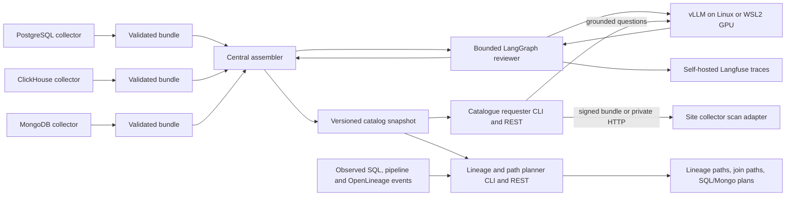

# Database Intelligence Graph Generator

Evidence-first discovery of database objects, likely relationships, and **observed** data lineage across PostgreSQL, ClickHouse, and MongoDB, with two independent user-facing modules. Implementation is in progress: contracts, source-local collectors, and the central builder exist; the requester and planner remain TODO work.

## What the system will do

Collectors run beside each configured source with read-only credentials and produce versioned bundles. A central builder validates them, compares permitted features across sources, ranks relationship candidates, and publishes a versioned catalog snapshot. The **catalogue requester** independently searches that snapshot, answers grounded natural-language questions with a private local LLM, and dispatches new scan requests. The **lineage and path planner** independently imports observed SQL/pipeline metadata and OpenLineage events, returns observed lineage or possible join paths, and generates reviewable SQL/MongoDB plans without executing them. Both modules will ship as separate installable Python packages with CLIs and optional HTTP JSON REST services; they share only the artifact contract.

## Project documents

- [TECHNICAL_IMPLEMENTATION.md](TECHNICAL_IMPLEMENTATION.md): binding implementation contract, module ownership, algorithms, data formats, gates, and acceptance criteria.
- [TODO.md](TODO.md): live, ordered implementation ledger with verification and decision gates.
- [ARCHITECTURE_RESEARCH.md](ARCHITECTURE_RESEARCH.md): 30-section research record and upstream source links.
- [AGENTS.md](AGENTS.md) and [CLAUDE.md](CLAUDE.md): working rules for coding agents. `AGENTS.md` is the canonical policy.

## Current state

The `dbig-contracts` package validates signed JSONL collector bundles and catalog snapshots. The `dbig-collectors` package has PostgreSQL, ClickHouse, and MongoDB metadata discovery with source-local credentials and defensive limits. The `dbig-catalog-builder` package validates signed source bundles, publishes a sealed snapshot, distinguishes declared foreign keys from tentative references, and can review ambiguous candidates through a configured private vLLM endpoint with metadata-only Langfuse spans. Its model output is cited, validated weak evidence; model failure still publishes the deterministic snapshot as partial. Current tests use synthetic drivers and a fake model; live database, GPU/model and telemetry deployment tests are still required. The requester and planner have not been implemented yet, so the product is not deployable end to end.

For local development, run `uv sync --locked --dev` and `uv run pytest`. Build a package with `uv build --package dbig-contracts` or `uv build --package dbig-collectors`. At a source site, install only the matching collector extra (`postgresql`, `clickhouse`, or `mongodb`), set the configured connection JSON and signing key in the process environment, then run `dbig collect --config <source.toml> --out <new-bundle-directory>`. The config's `[source]` section requires `source_id`, `kind`, `connection_env`, `signing_key_env`, `signing_key_id`, and an allowed `namespaces` list. The collector refuses plaintext transport and records a partial bundle when stable source identity is unavailable. Never put credentials in TOML or shell arguments.

The selected LLM stack is vLLM for private GPU serving, LangGraph for the builder's fixed review workflow, and self-hosted Langfuse for metadata-only visibility. The requester also calls the private vLLM endpoint for grounded catalogue questions. The planner is deterministic and makes no LLM call. Top-level LangChain and LangGraph Swarm remain deferred. The exact GPU, model revision, service versions and telemetry infrastructure must be validated before deployment.

## Developer setup

1. Install Python 3.12+, Git, [Graphify](https://github.com/Graphify-Labs/graphify), [Graft](https://github.com/trailhq/Graft), and [Codebase Memory MCP](https://github.com/DeusData/codebase-memory-mcp). The supported local graph versions used when creating this repository were Graphify 0.9.65, Graft 0.18.0, and Codebase Memory MCP 0.11.0.
2. Clone the repository and run `python scripts/install_hooks.py` from its root. Git does not propagate local hook configuration through a clone.
3. Copy `.env.example` to `.env` and fill local values. `.env` is ignored by Git. Source credentials must be supplied through the approved secret store or process environment, never committed.
4. Run `python scripts/graph_sync.py --check-tools` to verify graph commands are on `PATH`.
5. Before implementation, read `TECHNICAL_IMPLEMENTATION.md` and keep `TODO.md` open and updated after each meaningful change.

## Commit and CI policy

The **pre-commit** hook refreshes Graphify, Graft, and Codebase Memory and aborts on any failure. The **post-commit** hook refreshes them again against the committed tree. This ordering matters: a post-commit hook alone cannot reject a commit already written. Graph caches are local regeneration products; CI rebuilds them and enforces freshness. GitHub currently denies branch protection/rulesets for this private repository on the account plan, so CI is visible but cannot be made a mandatory remote merge gate. The owner chose to keep the repository private and rely on local hooks plus inspected CI results.

## Licenses and upstream tools

Apache-2.0 and MIT are free for small and commercial uses. [DataHub](https://github.com/datahub-project/datahub) is Apache-2.0 and usable as a reference or integration target; its complete platform is outside this project's chosen scope. [OpenMetadata](https://github.com/open-metadata/OpenMetadata) has different terms for its `ingestion/` subtree, so the project does not embed that code under its permissive-core policy. Full reasoning and citations are in the research document.

[Amundsen](https://github.com/amundsen-io/amundsen) is Apache-2.0 but its repository was archived in September 2026; use its ingestion/search architecture as a reference, not a v1 runtime dependency. [OpenLineage](https://github.com/OpenLineage/OpenLineage) is Apache-2.0 and supplies the run/job/dataset/facet event standard for planner import/export. Neither repository requires deploying its complete stack. The binding module boundaries and exact package decisions are in [TECHNICAL_IMPLEMENTATION.md](TECHNICAL_IMPLEMENTATION.md#17-independent-requester-and-planner-contract-approved-2026-09-23).

The graph tools named above index **this source repository** for developers. They are not runtime dependencies of the Database Intelligence Graph Generator and are not the graph artifact delivered to its users.
