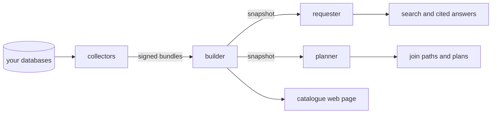

# Database Intelligence Graph Generator

Finds the tables, fields and likely relationships in your PostgreSQL, ClickHouse and MongoDB databases, and shows them as a searchable catalogue. It never reads row values by default. It marks every relationship it guesses as a guess.

## What it is

<!-- verified: bce5fee -->

Four parts, each its own installable Python package:

- **Collectors** run next to each database with a read-only account and write a signed bundle.
- The **builder** joins the bundles into one catalogue snapshot and proposes relationships between sources.
- The **requester** searches the snapshot, answers questions with your own private model, and asks a collector to scan again.
- The **planner** finds join paths and observed lineage, and writes reviewable SQL or MongoDB reads. It never runs them.



## Status

<!-- verified: bce5fee -->

All four parts work and pass 546 tests, including live tests on PostgreSQL, ClickHouse and MongoDB containers in CI. One live run on real databases found problems, listed under Results. Fixes are on unmerged branches (`feat/catalogue-fixes`, `fix/live-findings`, `fix/phase7`), described in [docs/plans/CATALOGUE_FIXES_IMPLEMENTATION_PLAN.md](docs/plans/CATALOGUE_FIXES_IMPLEMENTATION_PLAN.md). Open work: [TODO.md](TODO.md).

## Quickstart

<!-- verified: bce5fee -->

You need Python 3.12 and [uv](https://github.com/astral-sh/uv) 0.10 or later.

```bash
uv sync --locked --all-extras --dev
uv run pytest
```

To catalogue your own databases, follow [docs/LOCAL_RUN.md](docs/LOCAL_RUN.md). It covers read-only accounts, TLS, secrets, the commands and how to read the page. Example configurations are in [examples/local](examples/local).

## Worked example

<!-- verified: bce5fee -->

This builds a snapshot from the synthetic bundle that the tests keep in `tests/golden/ir-v1`, then searches it. The key below is the public test key for that fixture, not a credential.

```bash
mkdir -p /tmp/dbig-example
cat > /tmp/dbig-example/builder.toml <<'EOF'
[builder]
signing_keys = { golden = "DBIG_SIGNING_KEY" }
EOF
cat > /tmp/dbig-example/requester.toml <<'EOF'
[requester]
snapshot_dir = "/tmp/dbig-example/snapshot"
state_dir = "/tmp/dbig-example/state"
api_key_env = "REQUESTER_TOKEN"
EOF
export DBIG_SIGNING_KEY=golden-fixture-key-not-a-credential
uv run dbig-builder assemble --config /tmp/dbig-example/builder.toml \
  --bundle tests/golden/ir-v1/collector-bundle --out /tmp/dbig-example/snapshot
uv run dbig-requester index --config /tmp/dbig-example/requester.toml
uv run dbig-requester search --config /tmp/dbig-example/requester.toml --query customers
```

The search returns the table `customers` and its field `id` from source `golden-site`. The snapshot is `partial` because the fixture bundle carries a diagnostic. `assemble` refuses an existing `--out` directory, so delete `/tmp/dbig-example` to run it again.

## Results

<!-- verified: bce5fee -->

One live run on real PostgreSQL 16.15, ClickHouse 26.8.2.7 and MongoDB 7.0.41 databases, plaintext on loopback, 2026-10-06 to 2026-10-12, at commit `2e87fa7` (an ancestor of `main`). Source: [artifacts/live-test-report.md](artifacts/live-test-report.md).

| Check | Result |
| --- | --- |
| Test suite on the tested code | 477 passed, 69 skipped, 0 failed |
| Read-only accounts refuse writes | pass |
| Catalogue of the three sources | `complete`, 48 objects, 1,035 fields |
| Counts, names and types match the databases | pass |
| Proposed relationships | 5 true, 16 false of 21; 40 confirmed relationships missing |
| Searches | 4 of 5 pass |
| Natural-language questions | 0 of 30 answered |
| TLS | not tested |

Performance at 10 sources, 200 objects and 1,000 fields is in [ARCHITECTURE.md](ARCHITECTURE.md#performance).

## Limits

<!-- verified: bce5fee -->

- The relationship proposals are weak on real data. Treat each as a candidate to review, not as a fact.
- Executed lineage is unavailable until you choose a source of query history. OpenLineage events work (a completed run is `executed`, a job event is `defined`).
- A cross-source plan stays `unresolved` until you configure a staging target.
- The model features need a private vLLM server. No GPU host has passed the acceptance gate.
- The services bind to loopback only. Remote access needs your own TLS proxy.
- Only the database versions that CI runs are supported.

The full guarantees and non-goals are in [ARCHITECTURE.md](ARCHITECTURE.md#guarantees-and-limits).

## License

MIT. See [LICENSE](LICENSE). Licenses of the pinned dependencies are in `supply-chain/licenses.json`, produced by `scripts/supply_chain.py`.

## Links

- [ARCHITECTURE.md](ARCHITECTURE.md): how it fits together, runs and stores data.
- [TECHNICAL_IMPLEMENTATION.md](TECHNICAL_IMPLEMENTATION.md): code map, algorithms, dated design decisions, developer setup.
- [GLOSSARY.md](GLOSSARY.md): terms.
- [docs/LESSONS.md](docs/LESSONS.md): approaches that failed.
- [docs/LOCAL_RUN.md](docs/LOCAL_RUN.md) and [docs/LIVE_TEST.md](docs/LIVE_TEST.md): run it on your databases.
- [THREAT_MODEL.md](THREAT_MODEL.md), [TODO.md](TODO.md), [ARCHITECTURE_RESEARCH.md](ARCHITECTURE_RESEARCH.md), [AGENTS.md](AGENTS.md).
