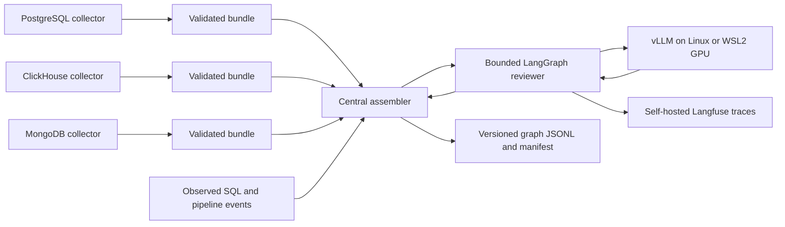

# Database Intelligence Graph Generator

Headless, evidence-first discovery of database objects, likely relationships, and **observed** data lineage across PostgreSQL, ClickHouse, and MongoDB. The project is in the architecture and implementation-planning stage; no collector or assembler runtime has been implemented yet.

## What the system will do

Collectors run beside each configured source with read-only credentials. They discover schema and bounded profiles, then produce signed or digest-verified, versioned bundles. A central assembler validates the bundles, compares safe features across sources, ranks relationship candidates, imports observed SQL/pipeline lineage, and emits a machine-readable graph. In version 1, a bounded LangGraph workflow asks a local vLLM model to review ambiguous candidates. Self-hosted Langfuse records approved workflow metadata. Model suggestions cannot, by themselves, establish a foreign key or lineage edge.

## Project documents

- [TECHNICAL_IMPLEMENTATION.md](TECHNICAL_IMPLEMENTATION.md): binding implementation contract, module ownership, algorithms, data formats, gates, and acceptance criteria.
- [TODO.md](TODO.md): live, ordered implementation ledger with verification and decision gates.
- [ARCHITECTURE_RESEARCH.md](ARCHITECTURE_RESEARCH.md): 30-section research record and upstream source links.
- [AGENTS.md](AGENTS.md) and [CLAUDE.md](CLAUDE.md): working rules for coding agents. `AGENTS.md` is the canonical policy.

## Current state

This repository contains plans, workflow policy, Git hooks, and CI scaffolding. It does **not** yet contain production code. The tools and versions listed in the technical plan are choices to validate in an implementation lockfile, not claims that the application is deployable now.

The selected LLM stack is vLLM for private GPU serving, LangGraph for the fixed review workflow, and self-hosted Langfuse for metadata-only visibility. The assembler uses the OpenAI-compatible Python client against the private vLLM endpoint. Top-level LangChain and LangGraph Swarm are deferred because v1 has no model-selected tools or agent handoffs. The model and Langfuse deployment are still design tasks; the exact GPU, model revision, service versions and telemetry infrastructure must be validated before deployment.

## Developer setup

1. Install Python 3.12+, Git, [Graphify](https://github.com/Graphify-Labs/graphify), [Graft](https://github.com/trailhq/Graft), and [Codebase Memory MCP](https://github.com/DeusData/codebase-memory-mcp). The supported local graph versions used when creating this repository were Graphify 0.9.65, Graft 0.18.0, and Codebase Memory MCP 0.11.0.
2. Clone the repository and run `python scripts/install_hooks.py` from its root. Git does not propagate local hook configuration through a clone.
3. Copy `.env.example` to `.env` and fill local values. `.env` is ignored by Git. Source credentials must be supplied through the approved secret store or process environment, never committed.
4. Run `python scripts/graph_sync.py --check-tools` to verify graph commands are on `PATH`.
5. Before implementation, read `TECHNICAL_IMPLEMENTATION.md` and keep `TODO.md` open and updated after each meaningful change.

## Commit and CI policy

The **pre-commit** hook refreshes Graphify, Graft, and Codebase Memory and aborts on any failure. The **post-commit** hook refreshes them again against the committed tree. This ordering matters: a post-commit hook alone cannot reject a commit already written. Graph caches are local regeneration products; CI rebuilds them and enforces freshness. GitHub currently denies branch protection/rulesets for this private repository on the account plan, so CI is visible but cannot be made a mandatory remote merge gate. The owner chose to keep the repository private and rely on local hooks plus inspected CI results.

## Licenses and upstream tools

Apache-2.0 and MIT are free for small and commercial uses. [DataHub](https://github.com/datahub-project/datahub) is Apache-2.0 and usable as a reference or integration target; the complete platform is outside this headless v1. [OpenMetadata](https://github.com/open-metadata/OpenMetadata) has different terms for its `ingestion/` subtree, so the project does not embed that code under its permissive-core policy. Full reasoning and citations are in the research document.

The graph tools named above index **this source repository** for developers. They are not runtime dependencies of the Database Intelligence Graph Generator and are not the graph artifact delivered to its users.
