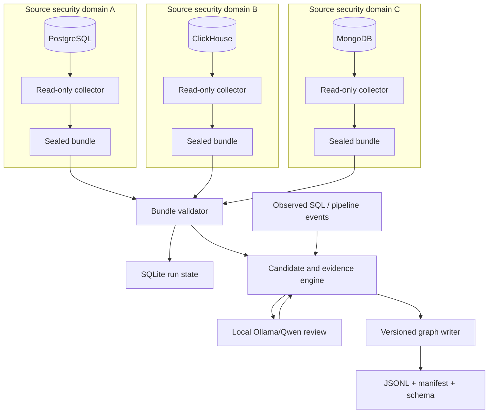

# Technical implementation contract

Status: design baseline, 2026-09-23. This file records **decisions to implement and verify**. It does not imply that the runtime, connectors, benchmarks, or lockfile already exist. Every unresolved fact is tracked in [TODO.md](TODO.md); agents must request a user decision where a choice changes behavior, security, cost, or scope. The research and source links behind these decisions are in [ARCHITECTURE_RESEARCH.md](ARCHITECTURE_RESEARCH.md).

## 1. Product boundary and non-negotiable behavior

The product is a headless generator of a versioned, machine-readable database intelligence graph. It discovers PostgreSQL tables/views/columns/keys; ClickHouse databases/tables/columns/engines; MongoDB databases/collections/indexes/validators/document paths. It profiles within explicit budgets and infers *candidates* for undeclared same-source and cross-source references. It emits actual lineage only when defined or observed SQL, job metadata, or OpenLineage events show a transformation. Similar values alone are not lineage. No UI, catalog server, broad query agent, or central DB login belongs in v1.

Each source has a separate collector process and network/credential boundary. One trusted assembler receives collector bundles. Cross-source sampled values may be compared **in memory**; raw values are discarded after feature extraction. Production requires an approved secure bundle transfer and common tokenization key distribution. The assembler's local LLM gets only minimized, redacted candidate context; it never gets credentials, raw sampled values, SQL literals, or live DB tools.

The initial scale assumption is about 10 sources, 200 objects, and 1,000 fields. All budgets, freshness windows, and limits are configuration, not hardcoded policy. Defaults below are proposals until measured and approved.

## 2. Execution topology



Collector responsibilities: scope authorization, source discovery, bounded profiling, source-local feature extraction, permitted SQL/pipeline observation, redaction, bundle schema validation, manifest hashes, and atomic publication. Assembler responsibilities: validation and identity resolution, run reconciliation, cross-source feature comparison, candidate blocking and ranking, evidence policy, observed lineage parsing, local semantic review, graph materialization, QA, and deterministic artifact publication.

No collector waits for another collector. A run can mark a missing source as `partial`, preserve prior known state with age metadata, and avoid silently deleting unseen objects. Source-local exceptions become typed diagnostics.

## 3. Repository and deployable boundaries

Proposed package layout (create only as implementation tasks become active):

```text
src/dbig/
  cli.py                 # click CLI: collect, assemble, validate, inspect
  config.py              # tomllib load, environment/secret references, Pydantic validation
  ir/                    # Pydantic records, IDs, schema export, migrations
  bundle/                # JSONL writer/reader, digest/signature, manifest, atomicity
  collectors/
    base.py              # typed Protocol, budgets, diagnostics
    postgres.py          # pg8000 metadata, keys, views, sample plan
    clickhouse.py        # clickhouse-connect system tables and sample plan
    mongodb.py           # PyMongo metadata, validators, document paths
  profile/               # typed metrics, safe sampling, value tokenization
  match/                 # blocking, lexical/type/key/value evidence, direction, abstain
  lineage/               # SQLGlot resolver, observed run importer, OpenLineage adapter
  llm/                   # Ollama client, redacted prompt, schema, cache, timeout
  assemble/              # reconciliation, graph writer, run state
  security/              # redaction, secret resolution, path and bundle validation
tests/fixtures/          # labeled synthetic PG/CH/Mongo cases, SQL and event fixtures
schemas/                 # immutable published JSON Schemas per IR version
config/                  # safe example TOML only; local.toml ignored
scripts/                 # developer graph/CI helpers, not runtime modules
.githooks/               # local Git gate and refresh
.github/workflows/       # required PR checks
```

One Python distribution with extras: base assembler, `postgres`, `clickhouse`, `mongo`, `llm`, and `openlineage`. Collector packages install only the matching driver and shared IR/bundle/profile modules. The assembler uses no DB driver and receives no source credentials. Build separate lockfile slices or pinned artifacts after dependency/license audit. `uv` manages developer resolution; deployed binaries/wheels do not require `uv` at runtime.

## 4. Module and third-party decisions

| Concern | Decision | Specific use and boundary |
| --- | --- | --- |
| Language and build | Python 3.12+, `pyproject.toml`, `uv`, `uv.lock`, hatchling or equivalent build backend after packaging spike | Reproducible environment; verify Windows/Linux wheel availability and lock all extras. |
| CLI | Click | Commands `collect`, `assemble`, `validate-bundle`, `validate-graph`, `explain-edge`, `schema`. Exit codes and JSON diagnostics. |
| Config and IR | `tomllib`, Pydantic v2, standard `typing.Protocol` | TOML config, typed records, strict validation, secret references; no arbitrary YAML. |
| Serialization | standard `json`, `hashlib`, `pathlib`, `tempfile`; `jsonschema` for published contract | Canonical UTF-8 JSONL, digests, schema validation, atomic replace. |
| PostgreSQL | `pg8000` | Read-only direct catalog SQL, timeouts and TLS. No ORM and no Psycopg in permissive core. |
| ClickHouse | `clickhouse-connect` | `system.*`, engine metadata, bounded queries and permitted query log. |
| MongoDB | `pymongo` bundled `bson` | Collection/index/validator metadata, sampled documents; never install unrelated `bson`. |
| SQL lineage | SQLGlot | Parse supported PostgreSQL/ClickHouse SQL; our resolver binds identifiers to catalog objects. Unsupported SQL is diagnostic, never fabricated lineage. |
| Matching | RapidFuzz plus our deterministic policies | Name similarity is one feature, never sufficient alone. |
| Graph algorithms | NetworkX `MultiDiGraph`, optional internal view | Parallel typed edges and traversal; canonical persisted IR is independent of NetworkX. |
| Pipeline interchange | OpenLineage spec; `openlineage-python` extra only if needed | Import/export observed job/run/dataset facets, preserve provenance. |
| Local LLM | Ollama Python client, Ollama server, trial Qwen3 8B | One bounded structured-output call per ambiguous candidate batch; no cloud fallback. Record model digest, prompt/schema version, latency. |
| Agent framework | None in v1 | The reviewer is a fixed call, not an autonomous tool loop. Revisit PydanticAI/LangGraph only on measured need. |
| Runtime state | SQLite stdlib | Local assembler run index, bundle receipts, stable IDs, edge history, cache keys. WAL mode where appropriate. |
| Telemetry | stdlib `logging` JSON formatter initially; OpenTelemetry later only if justified | Source/run IDs, counts, timings, errors. Never log values or credentials. |
| Test/tooling | pytest, Ruff, mypy/pyright, Bandit, pip-audit, `cyclonedx-py` or equivalent, license checker selected during dependency lock | CI must run deterministic unit, integration, contract, security and license gates. |
| Source-code intelligence | Graphify, Graft, Codebase Memory MCP | Developer-only structural graphs. Graphify first, then Graft, then CBM. Git hooks/CI refresh them without LLM/deep modes. |
| Ponytail | Ponytail plugin skills | Agent design/review discipline; use all named skills when available, record results and do not equate a slash command with a CI test. |

Version numbers and exact lock hashes are deliberately pending. The installed developer graph tools at setup were Graphify 0.9.65, Graft 0.18.0, CBM 0.11.0; CI should pin these or a reviewed upgrade. Application dependency pins require a real lockfile, CVE/license check, and connector test matrix before final selection.

## 5. Configuration and secrets

Configuration is explicit TOML plus `DBIG_*` environment overrides, with a strict precedence contract: CLI explicit flag > process environment > TOML > documented safe default. `.env` is a developer-local input to a launcher, never read implicitly in production. `.env` is ignored; `.env.example` has harmless placeholders. Secret values are resolved at runtime from process environment or an approved secret manager reference. Never put passwords, DSNs with embedded credentials, HMAC keys, tokens, or private SQL in source, examples, artifacts, logs, test snapshots, or graph tool indexes.

Source config fields: source ID, kind, connection reference, allowed databases/schemas/collections, TLS policy, read timeout, query budget, sample rows/documents, byte budget, concurrency, history access flag, permitted lineage event path, sensitivity policy. Assembler config fields: bundle roots, output path, freshness threshold, matching thresholds, local Ollama URL/model/digest, request timeout, batching, GPU concurrency, logging, bundle verification policy. Every user-supplied path is canonicalized and constrained to an approved root.

Secrets are never passed on command lines. Collector has least-privilege read permissions and a query cancellation timeout. The cross-source comparison key has run scope, a key ID only in manifests, and secure distribution to authorized collectors. If no shared key is available, disable cross-source value evidence and record that capability as unavailable rather than comparing incompatible hashes. Decide retention and cryptographic signing before production rollout.

## 6. IR and artifact contract

Use append-style JSONL files in a bundle directory plus a manifest written last. Planned files: `sources.jsonl`, `objects.jsonl`, `fields.jsonl`, `constraints.jsonl`, `profiles.jsonl`, `observations.jsonl`, `diagnostics.jsonl`. The assembler output adds `nodes.jsonl`, `edges.jsonl`, `evidence.jsonl`, `runs.jsonl`, and `manifest.json`. Canonical JSON uses stable key ordering and UTF-8; IDs are deterministic from normalized source identity and source-native stable identifiers where available. Do not base IDs on display names alone. Every record has `ir_version`, `record_type`, `id`, `source_id`, `observed_at`, `collector_version`, and provenance where applicable.

Manifest fields: format/IR version, source/run ID, creation window, collector build, scope hash, file paths, sizes, SHA-256 digests, counts, content classification, key ID if tokenized, optional signature metadata, diagnostics summary, and completion status. Readers reject unknown major versions, duplicate IDs, unsafe paths, missing files, digest mismatches, invalid JSON, impossible timestamps, missing references, and record counts that disagree with the manifest. Minor additions must be backward compatible. The producer writes temp files, fsyncs, validates, and atomically renames the manifest last; the consumer never reads an incomplete directory.

Object kinds: database, schema, table, view, materialized view, ClickHouse dictionary/engine-bearing table, MongoDB collection, job, and run. Field kinds include relational columns and normalized MongoDB document paths with type unions and array cardinality. Graph edge types: `CONTAINS`, `DECLARES_FK`, `REFERENCE_CANDIDATE`, `JOINS_OBSERVED`, `WRITES`, `READS`, `DERIVES_FROM`, `RUNS_JOB`. Each edge has status (`declared`, `strong`, `tentative`, `rejected`, `observed`), direction, evidence IDs, explanation, source/run provenance, first/last seen, and limitations. A field-name match can create only a *candidate*.

Evidence records are immutable and typed: catalog key, uniqueness/index, compatible type, name similarity, value containment/overlap, join observation, query-plan observation, SQL AST mapping, OpenLineage facet, LLM suggestion, and counterevidence. Preserve metrics and denominators; never publish an uncalibrated similarity as a probability. `confidence` remains null until calibrated on labeled data. Every relationship cites at least one non-LLM evidence record; lineage cites execution/definition metadata and parse resolution.

## 7. Collector implementation

Common protocol: `discover(config, budget) -> DiscoveryResult`, `profile(object, budget) -> ProfileResult`, `observe_lineage(config, budget) -> ObservationResult`, `emit_bundle(result, destination) -> Manifest`. Budget accounting covers queries, wall time, rows, bytes and source-specific concurrency. Cancel on expiry, emit partial diagnostics, and respect source read-only transactions where supported. No unrestricted `SELECT *` on large tables.

PostgreSQL: query `pg_catalog` for namespaces, relations, attributes, keys, FK constraints, indexes, view/materialized-view definitions, statistics and comments where allowed. Use quoted identifiers and parameterized dynamic values. Prefer catalog row estimates and existing statistics; use bounded sample queries only when permitted. Record partitioning and composite key order. Capture observed SQL only from configured logs/audit/job metadata, never assume `pg_stat_statements` includes result data or execution time history sufficient for lineage.

ClickHouse: query `system.databases`, `system.tables`, `system.columns`, `system.data_skipping_indices`, relevant constraints/projections/parts where available. Preserve engine, partition/sort/primary expressions and distributed/shard semantics. Capture `system.query_log` only with explicit access, retention bounds and redaction. Mutations and materialized views require engine-aware parsing; do not convert a same-name table relation into a FK.

MongoDB: list databases/collections, indexes, validator JSON Schema, collection options and safe stats; sample documents using bounded strategy, flatten nested paths with array markers, type counts, null/missing distinction and path depth limit. Preserve `_id` and index information. A path ending in `Id` is only a lexical candidate. Aggregation pipelines or change-stream/job records count as lineage only when observed and resolvable.

Collector errors become codes such as `PERMISSION_DENIED`, `TIMEOUT`, `UNSUPPORTED_VERSION`, `PARSE_UNRESOLVED`, `BUDGET_EXHAUSTED`, `PARTIAL_SCAN`; never silently substitute empty results for unavailable metadata.

## 8. Profiling and cross-source value evidence

Per field, compute bounded null/non-null counts, approximate or exact distinct count with method label, min/max for allowed types, length histogram, top-frequency sketches only if safe, and type/nullability distribution. Use source statistics where trustworthy, annotate freshness. Sample selection and size are recorded. Sensitive fields can be metadata-only. Value normalization is type-aware; preserve case/locale policy, leading zeros, time zone, binary encoding, and null distinction. Candidate pair comparison requires compatible normalized types and direction checks.

Raw sample values exist only in collector memory and, for allowed cross-source comparison, controlled assembler memory. Persist HMAC tokens or aggregate overlap metrics only according to the data policy; plain hashes are insufficient against dictionary attacks for low-entropy values. Encrypt bundle transport/storage if token sets are exported. Clear buffers on process exit; Python cannot guarantee memory zeroization, so deployment isolation and short retention are required. Never put raw values in LLM context, logs, graph artifacts, or developer code graphs.

Initial candidate blocking: compare only permitted source pairs; require compatible value domains or explicit manual relationship hint; then generate top-K per field by normalized lexical similarity plus key/uniqueness cues. Compute evidence on blocked pairs, not all 1,000² pairs. Support composite keys by ordered tuple comparison only when component mapping is justified. Direction asks whether child values are contained in a candidate unique parent key, plus null/duplication rates, join evidence and counterexamples. Abstain when sample support or uniqueness is insufficient. Cross-source matches are `REFERENCE_CANDIDATE` unless observed joins or stronger evidence warrants an approved status tier.

## 9. Lineage and query history

Inputs are observed SQL text/normalized fingerprints with provenance and times, view definitions, job/run records, and OpenLineage events. A view definition is *defined* transformation lineage, distinguished from an executed job. SQLGlot parses PostgreSQL/ClickHouse dialects; our resolver qualifies tables/columns against a snapshot, handles aliases/CTEs/stars where resolvable, and records unresolved expressions. Capture `INSERT ... SELECT`, `CREATE TABLE AS`, materialized view definitions, configured transformation jobs, and reads/writes. Column lineage is emitted only when expressions map to known fields; otherwise table-level edge plus diagnostic. SQL text stored only under policy after literal/comment redaction; default artifact stores fingerprint, parser version and redacted snippet.

OpenLineage import maps dataset namespace/name to source/object IDs and run/job facets to observed edges. Unmatched datasets remain unresolved observations. Distinguish lineage from observed joins: a SELECT join proves a query used two datasets, not that one was derived from the other. No LLM may invent lineage.

## 10. Local LLM review in version 1

After deterministic scoring, send only ambiguous candidates within a configured token/time budget to assembler-local Ollama. Trial model is Qwen3 8B; final model, quantization and digest depend on GPU VRAM and measured latency/accuracy. Prompt includes normalized object/field labels, types, structural metrics, sanitized descriptions, source context and evidence IDs. It excludes raw rows, token sets, SQL literals and connection details. Require JSON Schema output: candidate ID, decision (`supports`, `opposes`, `unknown`), short reason, cited evidence IDs, and any suggested follow-up. Validate with Pydantic; reject malformed, uncited or invented evidence. Persist model/digest, prompt/schema versions and response hash for audit; redact response text as necessary.

The reviewer adds only `MODEL_SUGGESTION` evidence and can reprioritize review; it cannot convert a candidate into a declared FK or an observed lineage edge. A timeout, local server outage or invalid output produces a typed diagnostic and the deterministic graph still publishes. The v1 deployment enables review for ambiguous cases, then compares precision/recall and latency with the no-LLM baseline. No agent framework, tool calling, autonomous query planning or cloud API in v1.

## 11. Assembler, state and incremental runs

Assembler validates all manifests before reading records, builds a normalized in-memory index and uses SQLite for durable run receipts and IDs. Process bundles idempotently by manifest digest. Reconcile object lifecycle across complete source scans only; a missing/failed source does not imply deletions. Edge first/last seen and evidence history survive reruns. Cache matching on object profile hashes, normalization version, algorithm version, and relevant config hash. Invalidate on source key changes, schema changes, consent changes or tokenization key rotation. Deterministic sorting means same inputs/config/tool versions produce byte-identical graph data except declared run metadata.

Partial runs identify which sources and capabilities were unavailable. A graph can be published with partial status if its manifest says so; downstream can enforce full-only. No permanent central raw sample store.

## 12. Command and error contract

Planned commands (names and flags are a decision, pending CLI implementation):

```text
dbig collect --config <source.toml> --source-id <id> --out <bundle-dir>
dbig validate-bundle <bundle-dir> --json
dbig assemble --config <assembler.toml> --bundle <path> [--bundle <path> ...] --out <graph-dir>
dbig validate-graph <graph-dir> --json
dbig explain-edge <edge-id> --graph <graph-dir> --json
dbig schema --version <major.minor> --out <dir>
```

Exit codes: 0 complete success; 2 invalid invocation/config; 3 security/integrity violation; 4 unavailable source or partial result (unless `--allow-partial`); 5 internal error; 6 validation failure. JSON diagnostics have code, severity, source ID, object ID if safe, timestamp, retryability, and redacted message. CLI never prints secrets or raw values.

## 13. Security and operations

Use read-only accounts, TLS verification, per-query timeouts, connection pooling limits, process separation by source, and explicit allowlists. Bundle receiver enforces size limits, path traversal rejection, digest verification and trusted transport; optional signatures become mandatory if transfer is not otherwise authenticated. Require workload identity or equivalent secret delivery in production. Scrub logs and crash reports. Keep source-side raw sample in RAM only. Retention schedules apply to manifests and profiler tokens. Provide key rotation and rerun semantics. Run each collector on a schedule agreed with source owners; source load metrics and budgets are visible in diagnostics.

Threat tests: malicious bundle path/JSON, oversized record, duplicate ID, HMAC mismatch, prompt injection in comments/SQL, model hallucinated IDs, timeout, collector privilege failure, and stale manifest replay. The LLM prompt treats source metadata as data, never instructions.

## 14. Test and acceptance plan

Unit/contract: IR schema round-trips, versioning, stable IDs, atomic bundle write/read, digest tamper rejection, bounded budget accounting, normalization and scoring, SQL resolver known/unknown cases, LLM schema rejection and timeout, deterministic graph diff. Integration: disposable PostgreSQL, ClickHouse, MongoDB with representative keys, composite joins, arrays/nested paths, views, materialized views, and pipeline events; test least-privilege roles and source failures. Golden fixtures include true/false relationships, ambiguous names, sparse/low-cardinality fields and observed transformations. Measure candidate precision/recall at fixed review budgets; report coverage and abstention separately. Measure no-LLM and local-LLM accuracy and latency on the same held-out corpus. Acceptance thresholds require user approval after a labeled corpus exists; do not invent success percentages.

Performance: benchmark at the stated 10/200/1,000 scale with per-source load and bundle bytes, assembler wall time/RAM, LLM p50/p95, cache hit rate. Security: dependency vulnerability/license report, secrets scan, least-privilege integration checks, malformed bundle fuzz/property tests. CI cannot test live private databases; those run in a separate authorized environment.

## 15. Git, graph tooling, Ponytail and CI/CD contract

The repository hook path is `.githooks`, installed via `python scripts/install_hooks.py`. Pre-commit calls `scripts/graph_sync.py`: check for partial staging that would make graphs reflect a different tree, refresh Graphify with `graphify update .`, refresh Graft with `graft build .` and verify `graft check .`, then run `codebase-memory-mcp cli index_repository --repo-path . --mode fast --persistence false`. Every required command must exist and exit 0; no silent fallback. Post-commit runs the same refresh against the committed tree. All steps are deterministic structural modes with no semantic/deep LLM calls. Graph caches are ignored until the artifact policy is chosen. Git's `--no-verify` and `core.hooksPath` overrides can bypass local hooks; protected branches and required CI compensate, but no local mechanism can make bypass impossible.

CI on pull requests and pushes to `main`: install pinned Python, Graphify, Node/Graft, and Codebase Memory; run graph refresh/graft drift checks; check docs and TODO structure. Once code and a lockfile exist, run Ruff, types, tests and vulnerability audit. Integration containers, license/SBOM gates and measured quality thresholds remain implementation tasks. The release workflow refuses to publish until a tested package and lockfile exist. GitHub currently returns HTTP 403 for private-repository branch protection/rulesets on this account plan; by user decision, the repository remains private, so CI results cannot be a mandatory remote merge gate here.

Ponytail is a coding-agent methodology, not a runtime dependency. On every meaningful change, apply `/ponytail [lite | full | ultra | off]` with `full` as intended baseline when the plugin is installed; run review for current diff, audit for repository-wide design, debt to keep TODO debt visible, gain only with measurements, and help when command behavior is uncertain. In Codex, upstream documents these as `@ponytail-*` skills after plugin installation/restart. If unavailable, explicitly report that status and manually apply the same minimal-design checks; never pretend a skill ran. Agent instructions in AGENTS.md and CLAUDE.md are the controlling project policy.

## 16. Decisions requiring user input or empirical evidence

1. Resolved: generated developer graphs are local/CI caches and are never committed.
2. Resolved: make the first commit and use `https://github.com/Reza-Sh83/db-catalogue.git` as `origin`.
3. Exact GPU model/VRAM and RAM; model size and latency remain provisional.
4. Safe source sample/byte/time budgets and per-source authorization.
5. Bundle transfer, signatures, retention and shared tokenization-key mechanism.
6. Target versions and compatibility matrix for PostgreSQL, ClickHouse and MongoDB.
7. Source of observed SQL/job metadata and its privacy policy.
8. Labeled evaluation corpus and acceptance thresholds.

These are tracked in TODO.md. Work that does not depend on them may proceed; behavior-changing assumptions must be surfaced to the user, including in the middle of a task.
