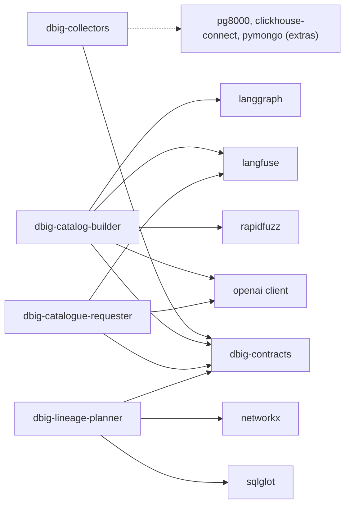
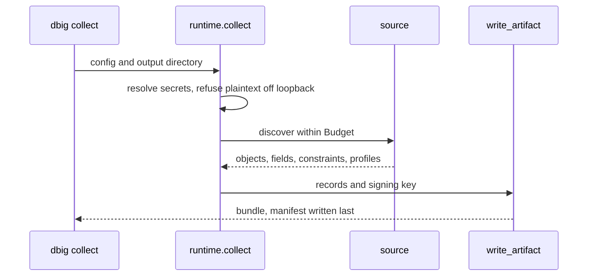
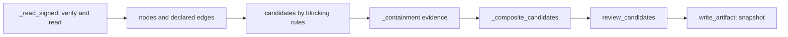
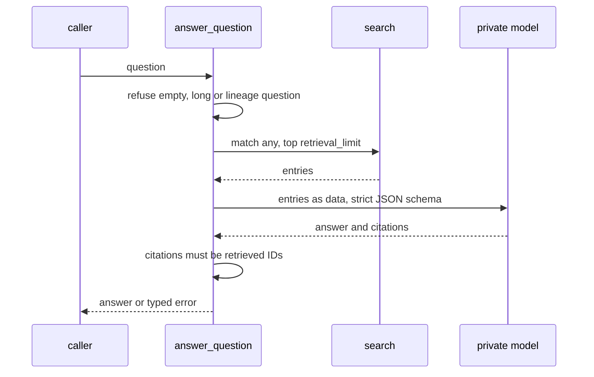
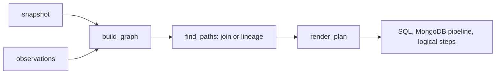
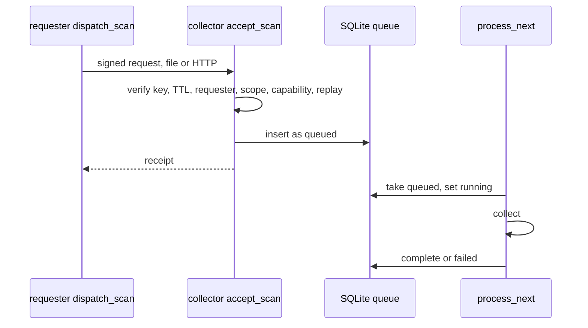
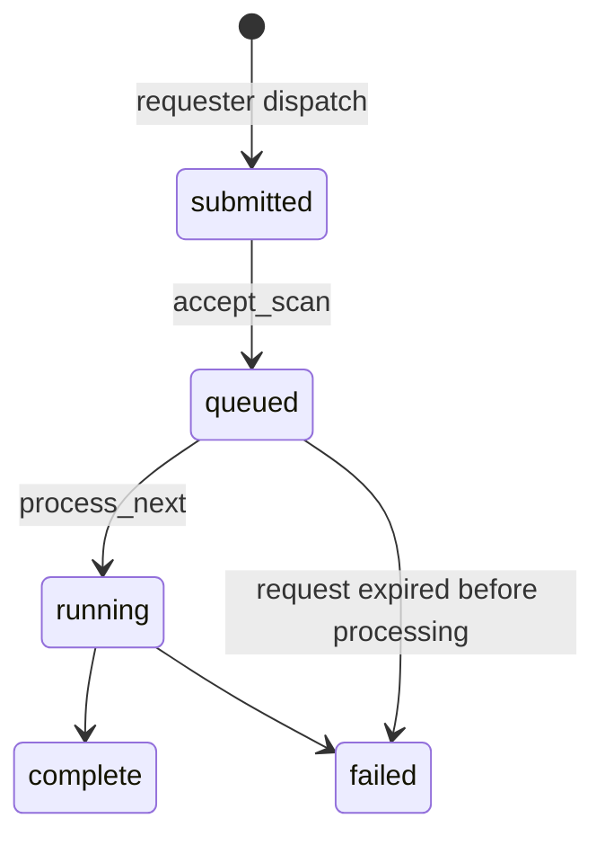
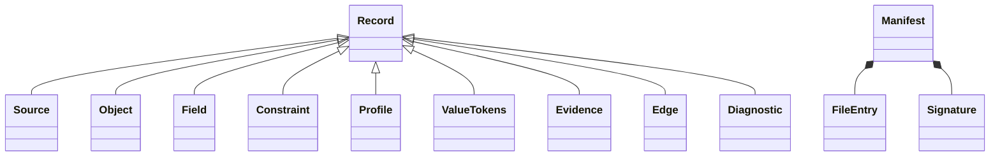

# Technical implementation contract

Status: binding design baseline, with all five package roles implemented and tested on synthetic inputs and, in CI, on live PostgreSQL, ClickHouse and MongoDB containers. This file records decisions with their dates and the code map. Open items and live verification are in [TODO.md](TODO.md). The research behind the decisions is in [ARCHITECTURE_RESEARCH.md](ARCHITECTURE_RESEARCH.md). Terms are defined in [GLOSSARY.md](GLOSSARY.md).

## Package map and dependencies

<!-- verified: bce5fee -->



No role imports another role. Every internal import goes to `dbig_contracts`, checked in all four packages on this commit. `scripts/package_isolation.py` and the `package-isolation` CI job prove from the built wheels that the requester and planner install and import without each other. For the other roles the rule rests on import review. The versions and the reason for each library are in §4 and §17.1.

## Module map

<!-- verified: bce5fee -->

| Package | Module | Owns | Entry point |
| --- | --- | --- | --- |
| `packages/contracts/src/dbig_contracts` | `models.py` | IR record types, `Manifest` | `models.py::Record` |
| | `artifact.py` | Canonical JSON, signing, atomic write, read with checks | `artifact.py::write_artifact`, `artifact.py::read_artifact` |
| | `scan.py` | Scan request, signature, receipt | `scan.py::verify_scan` |
| | `security.py`, `errors.py`, `ids.py` | Secret resolver, loopback rule, operator errors, stable IDs | `security.py::secret_from_env` |
| `packages/collectors/src/dbig_collectors` | `runtime.py` | Discovery for the three engines, budget, bundle write | `runtime.py::collect` |
| | `scan.py`, `api.py` | Scan intake queue (SQLite) and its private HTTP route | `scan.py::accept_scan` |
| `packages/catalog-builder/src/dbig_builder` | `builder.py` | Candidates, evidence, snapshot | `builder.py::assemble` |
| | `reviewer.py` | Bounded LangGraph review | `reviewer.py::review_candidates` |
| | `state.py` | SQLite receipts, incremental runs | `state.py::assemble_incremental` |
| | `render.py` | Static HTML page | `render.py::render_catalog` |
| `packages/requester/src/dbig_requester` | `search.py` | FTS5 index and ranked search | `search.py::search` |
| | `answer.py` | Grounded answer | `answer.py::answer_question` |
| | `scan.py` | Scan dispatch, file or HTTP | `scan.py::dispatch_scan` |
| `packages/planner/src/dbig_planner` | `graph.py` | Path graph from snapshot and observations | `graph.py::build_graph` |
| | `observations.py` | Observation and OpenLineage models, SQL relations | `observations.py::sql_relations` |
| | `paths.py`, `plans.py` | Path search, SQL and MongoDB rendering | `paths.py::find_paths`, `plans.py::render_plan` |

Each package also has `cli.py`, `config.py` and, for the three services, `api.py`. Tests are in `tests/`, helper scripts in `scripts/`, published JSON Schemas in `schemas/ir-v1/`, example configurations in `examples/local/`.

## Workflows

<!-- verified: bce5fee -->

**Collect.** One run reads one source and writes one bundle or nothing.



A reached limit or a missing namespace raises an operator error and writes no bundle (`runtime.py::collect`, `runtime.py::_refuse_missing_namespaces`).

**Assemble.** The builder turns signed bundles into a snapshot.



`assemble` marks the snapshot `partial` for a partial bundle, a foreign key whose target is outside the snapshot, a reused earlier bundle, or a failed review (`builder.py::assemble`). A failed review still publishes the deterministic snapshot.

**Ask.** The requester refuses before the model when it can.



Typed errors: `INVALID_QUESTION`, `LINEAGE_REQUIRES_PLANNER`, `NO_CATALOGUE_MATCH` (no model call), `MODEL_UNAVAILABLE_OR_INVALID` (`answer.py::answer_question`).

**Plan.** The planner never touches a source.



Limits: `PlannerConfig.max_hops` (default 4) and `max_paths` (default 20) in `config.py`.

**Scan request.** The requester asks, the collector decides.



## Status life cycles

<!-- verified: bce5fee -->



Scan status values are `ScanReceipt.status` in `packages/contracts/src/dbig_contracts/scan.py`. The `Edge` model allows `declared`, `strong`, `tentative`, `rejected` and `observed`. The builder sets `declared` and `tentative`; the planner sets `observed` on observed joins; `strong` and `rejected` are reserved. Planner lineage links are `executed` or `defined`. A path status is `found` or `unavailable` (`paths.py::find_paths`). A plan status is `ready_for_review`, `review_required` or `unresolved` (`plans.py::render_plan`).

## Key types

<!-- verified: bce5fee -->



All in `packages/contracts/src/dbig_contracts/models.py`. `Record` allows extra fields, so an older reader tolerates an added field. `SnapshotNode` is the strict union `Source | Object | Field` for `nodes.jsonl`.

## 1. Product boundary and non-negotiable behavior

<!-- verified: bce5fee -->

The product has four independently deployable roles: source collectors, a catalog builder, a catalogue requester, and a lineage and path planner. The requester and planner are independently installable Python packages with CLIs and optional HTTP JSON REST services. Collectors discover PostgreSQL, ClickHouse, and MongoDB metadata; the builder profiles within explicit budgets and infers *candidates* for same-source and cross-source references. The requester searches an existing snapshot, answers grounded natural-language questions through the private local model, and requests new scans. The planner returns observed transformation lineage, candidate join paths, and reviewable SQL/MongoDB plans without executing them. Similar values alone are never lineage. No central source-database login belongs in v1.

Each source has a separate collector process and network/credential boundary. One trusted assembler receives collector bundles. Cross-source sampled values may be compared **in memory**; raw values are discarded after feature extraction. Production requires an approved secure bundle transfer and common tokenization key distribution. The assembler's local LLM gets only minimized, redacted candidate context; it never gets credentials, raw sampled values, SQL literals, or live DB tools.

The initial scale assumption is about 10 sources, 200 objects, and 1,000 fields. All budgets, freshness windows, and limits are configuration, not hardcoded policy. Defaults below are proposals until measured and approved.

## 2. Execution topology

<!-- verified: bce5fee -->

The system context, deployment and data flow diagrams are in [ARCHITECTURE.md](ARCHITECTURE.md). Each source is its own security domain with its own collector.

Collector responsibilities: scope authorization, source discovery, bounded profiling, source-local feature extraction, permitted SQL/pipeline observation, redaction, bundle schema validation, manifest hashes, and atomic publication. Builder responsibilities: validation and identity resolution, run reconciliation, cross-source feature comparison, candidate blocking and ranking, evidence policy, local semantic review, QA, and deterministic catalog publication. The requester owns search, grounded answers, and authorized scan dispatch. The planner owns lineage parsing/import, typed path search, and query-plan rendering. Both consume versioned artifacts without importing each other or source drivers.

No collector waits for another collector. A run can mark a missing source as `partial`, preserve prior known state with age metadata, and avoid silently deleting unseen objects. Source-local exceptions become typed diagnostics.

## 3. Repository and deployable boundaries

<!-- verified: bce5fee -->

Package boundaries:

```text
packages/contracts/         # IR models, JSON Schema export, artifact validation, signatures
packages/collectors/        # source-site CLI, source drivers, budgets, scan intake
packages/catalog-builder/   # candidates, evidence, reviewer, snapshot, HTML page
packages/requester/         # search, grounded questions, scan dispatch, CLI and REST
packages/planner/           # lineage, paths, SQL and MongoDB plans, CLI and REST
tests/                      # pytest suite; tests/golden/ir-v1 holds the committed golden artifacts
schemas/ir-v1/              # published JSON Schemas per IR version
examples/local/             # safe example TOML; local runs use their own copies
scripts/                    # developer graph, CI and benchmark helpers, not runtime modules
.githooks/                  # pre-commit and post-commit graph refresh
.github/workflows/          # ci, docs, rules, release
.gitlab-ci.yml              # GitLab mirror of the GitHub workflows
```

Use a `uv` workspace for development, but publish separate wheels: contracts, collectors, catalog builder, catalogue requester, and lineage planner. Each role depends only on contracts and its own justified libraries; requester and planner never import one another. Collector driver extras install only the matching driver. The builder, requester, and planner have no source drivers or source credentials. REST serving is an optional extra on requester/planner. A shared workspace lock does not prove package isolation: CI must install each wheel in a clean environment and test CLI, API, and file-contract compatibility independently. `uv` is not required at runtime.

## 4. Module and third-party decisions

<!-- verified: bce5fee -->

| Concern | Decision | Specific use and boundary |
| --- | --- | --- |
| Language and build | Python 3.12+, `pyproject.toml`, `uv`, `uv.lock`, hatchling or equivalent build backend after packaging spike | Reproducible environment; verify Windows/Linux wheel availability and lock all extras. |
| CLI | Click | Four command groups: `dbig`, `dbig-builder`, `dbig-requester`, `dbig-planner`. Commands are listed in §12. Exit codes and operator errors as in §12a. |
| Config and IR | `tomllib`, Pydantic v2, standard `typing.Protocol` | TOML config, typed records, strict validation, secret references; no arbitrary YAML. |
| Serialization | standard `json`, `hashlib`, `pathlib`, `tempfile`; `jsonschema` as a dev dependency only | Canonical UTF-8 JSONL, digests, atomic replace. Pydantic validates records at run time; `jsonschema` checks the published schemas in tests and `scripts/export_schemas.py`. |
| PostgreSQL | `pg8000` | Read-only direct catalog SQL, timeouts and TLS. No ORM and no Psycopg in permissive core. |
| ClickHouse | `clickhouse-connect` | `system.*`, engine metadata, bounded queries and permitted query log. |
| MongoDB | `pymongo` bundled `bson` | Collection/index/validator metadata, sampled documents; never install unrelated `bson`. |
| SQL lineage | SQLGlot | Parse supported PostgreSQL/ClickHouse SQL; our resolver binds identifiers to catalog objects. Unsupported SQL is diagnostic, never fabricated lineage. |
| Matching | RapidFuzz plus our deterministic policies | Name similarity is one feature, never sufficient alone. |
| Graph algorithms | NetworkX `MultiDiGraph`, replaceable planner-local view | Parallel typed edges and bounded path search; canonical persisted IR is independent of NetworkX. |
| Pipeline interchange | OpenLineage spec; `openlineage-python` extra only if needed | Import/export observed job/run/dataset facets, preserve provenance. |
| Local LLM | vLLM OpenAI-compatible server on Linux or WSL2 GPU; `openai` Python client against its private base URL; trial Qwen3 `8B` | One bounded structured-output call per ambiguous candidate batch; no cloud fallback. Record model digest, prompt/schema version, latency. Confirm GPU support and JSON conformance on the pinned versions. |
| Review workflow | LangGraph `StateGraph` | Explicit nodes for redaction, model call, validation and evidence conversion. Our deterministic assembler owns scheduling and publication. No autonomous tools, DB access, dynamic handoffs or model-selected SQL. Top-level `langchain` and `langgraph-swarm` are excluded; `langchain-core` may enter transitively with LangGraph. |
| Runtime state | SQLite stdlib and FTS5 where available | Local builder run index; requester search index; planner path index. Each package owns its own rebuildable state. Check FTS5 availability at startup and fail with a typed capability error. |
| Requester API | FastAPI and Uvicorn in the requester `api` extra | Private HTTP JSON REST over the same application functions used by the CLI; no source drivers or planner dependency. |
| Planner API | FastAPI and Uvicorn in the planner `api` extra | Private HTTP JSON REST over the same deterministic planner functions used by the CLI; no source credentials or query execution. |
| Telemetry | stdlib structured logging plus self-hosted Langfuse Python SDK | Trace reviewer nodes, local model latency/usage, validation outcomes and redacted error codes with approved metadata only. Never export raw prompts, outputs, SQL, values or credentials. Langfuse is observability, not source catalog state. |
| Test/tooling | pytest, Ruff, mypy, pip-audit, `scripts/supply_chain.py` (CycloneDX SBOM and license report from `uv export`) | CI runs lint, types, tests, vulnerability audit, supply chain checks and live-source tests (§15). |
| Source-code intelligence | Graphify, Graft, Codebase Memory MCP | Developer-only structural graphs. Graphify first, then Graft, then CBM. Git hooks/CI refresh them without LLM/deep modes. |
| Ponytail | Ponytail plugin skills | Agent design/review discipline; use all named skills when available, record results and do not equate a slash command with a CI test. |

Application dependencies are ranges in each package `pyproject.toml`, resolved and hashed in `uv.lock`. The developer graph tools are pinned in `pyproject.toml` `[tool.dbig.graph-tools]` (§15).

## 5. Configuration and secrets

Configuration is explicit TOML plus `DBIG_*` environment overrides, with a strict precedence contract: CLI explicit flag > process environment > TOML > documented safe default. `.env` is a developer-local input to a launcher, never read implicitly in production. `.env` is ignored; `.env.example` has harmless placeholders. Secret values are resolved at runtime from process environment or an approved secret manager reference. Never put passwords, DSNs with embedded credentials, HMAC keys, tokens, or private SQL in source, examples, artifacts, logs, test snapshots, or graph tool indexes.

Source config fields: source ID, kind, connection reference, allowed databases/schemas/collections, TLS policy, read timeout, query budget, sample rows/documents, byte budget, concurrency, history access flag, permitted lineage event path, sensitivity policy. Assembler config fields: bundle roots, output path, freshness threshold, matching thresholds, private vLLM base URL/auth reference/model/digest, request timeout, batching, GPU concurrency, self-hosted Langfuse URL/key references, telemetry enablement, logging, bundle verification policy. Every user-supplied path is canonicalized and constrained to an approved root. The vLLM and Langfuse services have separate deployment secrets and network policies.

Secrets are never passed on command lines. Collector has least-privilege read permissions and a query cancellation timeout. The cross-source comparison key has run scope, a key ID only in manifests, and secure distribution to authorized collectors. If no shared key is available, disable cross-source value evidence and record that capability as unavailable rather than comparing incompatible hashes. Decide retention and cryptographic signing before production rollout.

## 6. IR and artifact contract

Use append-style JSONL files in a bundle directory plus a manifest written last. Planned files: `sources.jsonl`, `objects.jsonl`, `fields.jsonl`, `constraints.jsonl`, `profiles.jsonl`, `observations.jsonl`, `diagnostics.jsonl`. The assembler output adds `nodes.jsonl`, `edges.jsonl`, `evidence.jsonl`, `runs.jsonl`, and `manifest.json`. Canonical JSON uses stable key ordering and UTF-8; IDs are deterministic from normalized source identity and source-native stable identifiers where available. Do not base IDs on display names alone. Every record has `ir_version`, `record_type`, `id`, `source_id`, `observed_at`, `collector_version`, and provenance where applicable.

Manifest fields: format/IR version, source/run ID, creation window, collector build, scope hash, file paths, sizes, SHA-256 digests, counts, content classification, key ID if tokenized, optional signature metadata, diagnostics summary, and completion status. Readers reject unknown major versions, duplicate IDs, unsafe paths, missing files, digest mismatches, invalid JSON, impossible timestamps, missing references, and record counts that disagree with the manifest. Minor additions must be backward compatible. The producer writes temp files, fsyncs, validates, and atomically renames the manifest last; the consumer never reads an incomplete directory.

Object kinds: database, schema, table, view, materialized view, ClickHouse dictionary/engine-bearing table, MongoDB collection, job, and run. Field kinds include relational columns and normalized MongoDB document paths with type unions and array cardinality. Graph edge types: `CONTAINS`, `DECLARES_FK`, `REFERENCE_CANDIDATE`, `JOINS_OBSERVED`, `WRITES`, `READS`, `DERIVES_FROM`, `RUNS_JOB`. Each edge has status (`declared`, `strong`, `tentative`, `rejected`, `observed`), direction, evidence IDs, explanation, source/run provenance, first/last seen, and limitations. A field-name match can create only a *candidate*.

Evidence records are immutable and typed: catalog key, uniqueness/index, compatible type, name similarity, value containment/overlap, join observation, query-plan observation, SQL AST mapping, OpenLineage facet, LLM suggestion, and counterevidence. Preserve metrics and denominators; never publish an uncalibrated similarity as a probability. `confidence` remains null until calibrated on labeled data. Every relationship cites at least one non-LLM evidence record; lineage cites execution/definition metadata and parse resolution.

### 6a. Identity, rename, canonical encoding and migration (settled 2026-09-27)

**Identity.** `stable_id(source_id, kind, native_id)` hashes those three parts and prefixes the
kind, so an ID is reproducible from source facts and never from a display name. Each connector
supplies a source-native identifier: PostgreSQL uses `pg_class.oid` for an object and
`oid:attnum` for a field; ClickHouse uses the table UUID and `uuid:position`; MongoDB uses the
`listCollections` `info.uuid` and `uuid:path`. All three are assigned by the server and are
independent of the name, which is what makes a rename survivable.

**An object with no native identity is not catalogued.** ClickHouse reports the all-zeros UUID
for a table on a non-Atomic database engine, and a MongoDB view has no `info.uuid`. In both
cases the collector emits an `IDENTITY_UNAVAILABLE` diagnostic and drops the object and its
fields, rather than minting a name-derived ID. User decision on 2026-09-27: keep dropping and
make it loud. A catalogue entry whose identity cannot survive a rename would attach history and
edges to something that silently becomes a different object, which is the opposite of the
precision-over-recall rule. The cost is explicit: those objects never appear.

The drop is now visible without reading `diagnostics.jsonl`. The manifest carries
`diagnostics`, a count per diagnostic code, derived by the writer from the validated rows so a
producer cannot under-report, and checked by the reader against the actual rows so a manifest
cannot disagree with its own file. Any diagnostic already makes a bundle `partial`.
`diagnostics.jsonl` validates against a strict `Diagnostic` model whose `code` is required and
constrained, because per-code counts can only total the row count if every row has exactly one
well-formed code. Snapshots carry no diagnostics file and so report no summary at all, which is
different from reporting an empty one.

**Rename semantics.** Where native identity exists, a rename keeps the ID and changes `name`;
the object is the same object and its history and edges follow it. Where native identity does
not exist the object was never catalogued, so the delete-plus-add case does not arise in
practice. This is verified rather than asserted: the engines' own documentation is unreachable
from the build environment, so `tests/test_live_collectors.py` renames a real table, column and
collection on the pinned `postgres:16.15`, `clickhouse-server:25.8.33.6` and `mongo:7.0.41`
service containers and asserts the ID is unchanged while the name changed. Those tests run only
in CI, under `DBIG_RUN_INTEGRATION=1`; they are skipped locally and their result is claimed only
from an actual run.

**Canonical encoding.** `canonical()` emits UTF-8 JSON with sorted keys, no inserted whitespace,
`NaN` and infinities refused, and `None` fields omitted. Three properties were measured rather
than assumed. A round trip through JSON reproduces the bytes exactly. Input key order does not
affect the output. A timestamp must be UTC: the same instant written at a different offset
serialises differently, so a non-UTC offset is refused at validation with a message naming the
cause, rather than normalised, because a normalised record would fail its signature check later
and report the wrong cause. Unicode names are deliberately **not** normalised, so an NFC and an
NFD spelling of the same word produce different bytes; they are different identifiers in the
source, and folding them would merge objects the source keeps apart. Floats use Python's
shortest round-tripping representation.

**The contract is pinned by a committed artifact, not only by tests.** Every other artifact test
writes and reads inside one process, so it can only prove this version agrees with itself. The
requester and planner install as separate wheels and are expected in the field to be older than
the snapshot they read, so `tests/golden/ir-v1/` holds a collector bundle and a catalog snapshot
produced once and committed, and `tests/test_golden.py` reads them back on every run: signature
verification, the published JSON Schemas, manifest digests, a byte-identical read-and-rewrite,
tolerance of an added unknown field, and refusal of a hand-edited row.
`scripts/make_golden.py` regenerates them from a frozen clock, so a regeneration with no
contract change produces no diff and any diff is the signal to review. Adding a manifest field
with a container default is caught there mechanically, which is how the rule below is enforced
rather than merely written down.

**Migration policy.** A reader refuses an unknown major version and accepts additive minor
fields. One rule follows from the signature construction and is easy to get wrong: the signature
is taken over the manifest with `None` fields excluded, so **a new optional manifest field must
default to `None`, never to an empty container.** A field defaulting to `{}` would change the
signed bytes of every manifest, including those written before the field existed, and silently
invalidate their signatures. `diagnostics` therefore defaults to `None`, absent means unreported
rather than zero, and a bundle from a producer that predates the field still verifies. A
compatibility test signs an older-shaped manifest and reads it back to hold that guarantee.

## 7. Collector implementation

Common protocol: `discover(config, budget) -> DiscoveryResult`, `profile(object, budget) -> ProfileResult`, `observe_lineage(config, budget) -> ObservationResult`, `emit_bundle(result, destination) -> Manifest`. Budget accounting covers queries, wall time, rows, bytes and source-specific concurrency. Cancel on expiry, emit partial diagnostics, and respect source read-only transactions where supported. No unrestricted `SELECT *` on large tables.

PostgreSQL: query `pg_catalog` for namespaces, relations, attributes, keys, FK constraints, indexes, view/materialized-view definitions, statistics and comments where allowed. Use quoted identifiers and parameterized dynamic values. Prefer catalog row estimates and existing statistics; use bounded sample queries only when permitted. Record partitioning and composite key order. Capture observed SQL only from configured logs/audit/job metadata, never assume `pg_stat_statements` includes result data or execution time history sufficient for lineage.

ClickHouse: query `system.databases`, `system.tables`, `system.columns`, `system.data_skipping_indices`, relevant constraints/projections/parts where available. Preserve engine, partition/sort/primary expressions and distributed/shard semantics. Capture `system.query_log` only with explicit access, retention bounds and redaction. Mutations and materialized views require engine-aware parsing; do not convert a same-name table relation into a FK.

MongoDB: list databases/collections, indexes, validator JSON Schema, collection options and safe stats; sample documents using bounded strategy, flatten nested paths with array markers, type counts, null/missing distinction and path depth limit. Preserve `_id` and index information. A path ending in `Id` is only a lexical candidate. Aggregation pipelines or change-stream/job records count as lineage only when observed and resolvable.

Collector errors become codes such as `PERMISSION_DENIED`, `TIMEOUT`, `UNSUPPORTED_VERSION`, `PARSE_UNRESOLVED`, `BUDGET_EXHAUSTED`, `PARTIAL_SCAN`; never silently substitute empty results for unavailable metadata.

### 7a. Transport security and the readable catalogue (settled 2026-09-30)

User decision on 2026-09-30: the user's databases are on other servers on their network, so
their runs use verified TLS; a loopback-only opt-out is allowed for local development. Source
config therefore has `tls` (default `true`) and `tls_ca_file` (a PEM of CA certificates, unset
means the operating system store, refused when `tls = false` or when the file is missing). The
CA file is passed explicitly because, verified from the installed driver source, the drivers
find trust roots differently: pg8000 uses `ssl.create_default_context()`, ClickHouse Connect
0.15.1 takes `ca_cert=` and otherwise uses the OS store, and PyMongo 4.18.1 takes `tlsCAFile`
and handles `SSL_CERT_FILE` differently on Windows. `tls = false` requires every host to be a
loopback IP literal, the same rule as plain HTTP to a private model endpoint. The bundle's
`Source.transport` records which applied; it is an optional additive field, absent from older
bundles and excluded from canonical bytes when absent.

`dbig-builder render --snapshot S [--bundle B ...] --config C --out catalog.html` writes one
self-contained HTML page. By user decision it reads the snapshot plus the bundles it was built
from rather than extending the snapshot contract: statistics, keys, indexes and diagnostics
stay in bundles, so the requester and planner contracts are unchanged. A bundle is accepted only
if its signature verifies with the builder's keys and `bundle_run_id` (the same derivation the
assembler uses) is among the snapshot's runs. A source with no bundle is rendered from the
snapshot with a visible notice. Output is deterministic for the same inputs and written
atomically.

### 7b. Comments, search and plans on real catalogues (settled 2026-09-30)

User decisions on 2026-09-30, after running the requester and planner on a real
three-database snapshot:

- **Comments.** `Object.description` and `Field.description` carry the owner-written comment,
  optional and additive (absent from canonical bytes when `None`). PostgreSQL reads
  `obj_description`/`col_description` and ClickHouse `system.tables.comment`/
  `system.columns.comment` (verified on 25.8.33.6), both inside queries already made, so the
  query budget is unchanged. MongoDB has no comments. Control characters are removed and text
  over 1,000 characters is cut with an ellipsis. Shown on the page, searchable, and given to
  `ask`; `include_comments = false` turns collection off.
- **Search.** The index holds each entry's name, its owning table and schema, and its comment.
  Terms match as prefixes and results are ranked by bm25 with weights 10/4/1 over those three.
  `match = "all"` (default, the CLI and API) requires every term; `match = "any"` (used by
  `ask`) drops common words and ranks by any term. `ask` no longer falls back to unfiltered
  entries when nothing matches; it returns `NO_CATALOGUE_MATCH` without calling the model.
- **Plans.** A cross-source path is split into runs of consecutive objects in one source; each
  run is one read (a joined SELECT or a `$lookup` pipeline), and `logical_join` steps remain
  only between runs. A path that leaves a source and returns is separate reads.
- **Columns and key-filtered reads (settled 2026-10-04).** A SQL read selects every catalogued
  column by name with a unique output name `<table>__<column>` (`<table>_<position>__<column>`
  when a table repeats), instead of `SELECT *`, which returned one `id` per joined table. An
  object with no catalogued fields falls back to its `*` with a warning. In a cross-source plan
  the first read is a bounded sample; every later read is restricted to the join keys the read
  before it returned, so the final join covers every match for that sample. Before this, each
  read took an independent `LIMIT` sample, and the final join could be empty although matches
  existed. Keys are never written into a plan: each later step lists `parameters` (`name`,
  `filters_field`, `values_from_step`, `values_from_column`) and its `parameter_binding`:
  PostgreSQL `= ANY(%(name)s)` bound to an array (`psycopg`, or pg8000 with `pyformat`),
  ClickHouse server-side `IN {name: Array(T)}`, MongoDB `$expr`/`$in` on `$$name` bound through
  the aggregate command's `let`. A composite key filters each column separately, a superset that
  the final join narrows exactly. Each read keeps the row limit, and the plan warns that a later
  read returning exactly that many rows may be incomplete. Verified by executing plans on the
  three pinned servers against ground truth (`tests/test_live_plans.py`). The planner still
  executes nothing, and cross-source plans stay `unresolved` until a staging target is chosen.
- **Limits.** Reaching `max_queries`, `max_objects` or `max_fields` keeps stopping with no
  bundle and an operator message.

- **MongoDB collections (corrected 2026-10-04).** `sample_rows` is per collection, as it is per
  table for PostgreSQL; it was a total for the source, so after one collection that large every
  later collection was left unsampled and, having no validator, had no fields, with no
  diagnostic. `max_sample_bytes` still bounds the whole source and now says which collections it
  left unsampled. Collections named `system.*` are MongoDB's own (view definitions, profiler,
  time-series buckets) and are no longer catalogued. A view has no collection UUID and is still
  left out under §6a; by user decision on 2026-10-05 it is reported as `VIEW_NOT_CATALOGUED`, an
  informational diagnostic that is shown but does not make the bundle `partial`
  (`INFORMATIONAL_DIAGNOSTICS` in the collector). The collection it reads is catalogued.
- **Observed joins are join paths (user decision 2026-10-05).** Each `ON a.x = b.y [AND ...]`
  in an observed SQL statement, with every column qualified by a table or alias in the same
  SELECT, becomes a `JOINS_OBSERVED` reference with status `observed`, its column pairs, and the
  IDs of the observations that showed it (`observed_join_columns`). The tables come from the
  columns, not from the order in `FROM`. An `ON` with an OR, a non-equality, an unqualified
  column or `USING` is skipped rather than guessed, and a column that does not resolve to exactly
  one catalogued field reports `UNRESOLVED_SQL`. Between the same two objects, a declared key is
  preferred to an observed join, which is preferred to a candidate; a path through an observed
  hop has status `observed`, and its plan warns that the hop came from query logs. A SELECT join
  is still never lineage.

## 8. Profiling and cross-source value evidence

Per field, compute bounded null/non-null counts, approximate or exact distinct count with method label, min/max for allowed types, length histogram, top-frequency sketches only if safe, and type/nullability distribution. Use source statistics where trustworthy, annotate freshness. Sample selection and size are recorded. Sensitive fields can be metadata-only. Value normalization is type-aware; preserve case/locale policy, leading zeros, time zone, binary encoding, and null distinction. Candidate pair comparison requires compatible normalized types and direction checks.

Raw sample values exist only in collector memory and, for allowed cross-source comparison, controlled assembler memory. Persist HMAC tokens or aggregate overlap metrics only according to the data policy; plain hashes are insufficient against dictionary attacks for low-entropy values. Encrypt bundle transport/storage if token sets are exported. Clear buffers on process exit; Python cannot guarantee memory zeroization, so deployment isolation and short retention are required. Never put raw values in LLM context, logs, graph artifacts, or developer code graphs.

Initial candidate blocking: compare only permitted source pairs; require compatible value domains or explicit manual relationship hint; then generate top-K per field by normalized lexical similarity plus key/uniqueness cues. Compute evidence on blocked pairs, not all 1,000² pairs. Support composite keys by ordered tuple comparison only when component mapping is justified. Direction asks whether child values are contained in a candidate unique parent key, plus null/duplication rates, join evidence and counterexamples. Abstain when sample support or uniqueness is insufficient. Cross-source matches are `REFERENCE_CANDIDATE` unless observed joins or stronger evidence warrants an approved status tier.

### 8a. Cross-source value evidence as implemented (2026-09-27)

Tokens are opt-in twice over: a collector produces them only when sampling is configured *and* a
`value_token_key_env` reference with a matching `value_token_key_id` is given. A key without an ID
is refused, because an ID is what makes two sides comparable, and an ID without a key would claim
a comparison that was never computed.

A token is `HMAC-SHA256(run key, normalised text)`. Keyed, not hashed: an unkeyed digest of a
low-entropy value such as a small integer or a country code is recovered by trying every
candidate. `exact_text` normalisation does not fold case or trim, because §8 requires case, locale
and leading zeros preserved; it does mean integer `123` and string `"123"` agree, which is the
cross-source case that matters most, a MongoDB string identifier pointing at a relational integer
key. Booleans, bytes and structured values are counted as unusable rather than coerced, since no
normalisation for them would be agreed by two different engines.

Tokens ride in their own `tokens.jsonl` inside the bundle, so an operator can see from the
manifest whether a bundle carries them at all and a deployment can choose not to transport that
file. A bundle is a controlled transfer; the published graph is not, and no token crosses into a
snapshot.

PostgreSQL sampling is one bounded read per table, with the discovered columns named explicitly
rather than `SELECT *`, and the row limit bound rather than interpolated. The sample is the first
rows the server returns, which is biased, and `sample_method` records exactly that. §20 rules out
the alternatives that would look fairer: `ORDER BY random()` and unbounded scans are the reads
that hurt a production source, and `TABLESAMPLE` plus `LIMIT` guarantees neither a cheap nor an
unbiased fixed-size sample.

The assembler measures **containment**, not similarity: a reference means the child's values are
drawn from the parent's key, so the question is one-directional and the denominator is the child's
distinct count. Jaccard overlap is reported alongside it, because a high containment on a tiny
child sample against a huge parent is weak and the two numbers together show that. The evidence
carries both metrics, both sample counts, both sample methods, the key ID, the minimum support,
and `lower_bound_only` when either token set was capped.

It **abstains** rather than reporting a meaningless number in four cases: either side has no
tokens, the two were keyed under different key IDs, the two were normalised differently, or either
distinct count is below `MIN_TOKEN_SUPPORT`. The different-key case matters most: those tokens are
unrelated byte strings, so their zero overlap would read as a counterexample rather than as
ignorance.

Containment never promotes an edge. It is cited by the `REFERENCE_CANDIDATE` edge and changes
neither its status nor its `confidence`, which stays null. Promotion needs the calibration that
§15 requires and that does not exist yet.

### 8b. Which pairs become candidates (widened 2026-09-28)

Evidence is worthless on a pair that never gets compared, and the original blocking admitted very
few. A child field had to end in `_id`, and a parent had to carry a declared single-column unique
constraint, so a column called `owner_ref` or a genuinely unique key on a table that never declared
one could not become a candidate however well its values contained.

Three rules now decide admission, each deliberately narrow:

1. **Suffix rule.** A child whose name ends in `_uuid`, `_code`, `_num`, `_ref`, `_key`, `_id`,
   `_fk` or `_no` announces itself as a reference, so the stem is matched fuzzily against the
   parent object's singularised name at the configured threshold. The longest suffix wins, and a
   name that is nothing but a suffix is not stripped to an empty stem that would match everything.
2. **Exact bare-name rule.** A child with no such suffix announces nothing, so only an exact match
   against the singularised parent object name counts. This catches a column called `customer`
   pointing at `customers` while refusing `custom`, which any fuzzy threshold would have accepted.
   Fuzzy matching here would trade precision away for a flood of coincidental spellings.
3. **Measured uniqueness.** A parent field whose profile reports uniqueness at or above
   `MEASURED_UNIQUE` (0.99) may be a key with nothing declared. The evidence kind is
   `measured_uniqueness`, never `catalog_key`: a measurement and a catalog assertion are different
   claims and must not be read as the same strength. The threshold is pinned by a test, because a
   number that decides which relationships get proposed is a contract rather than a tunable.

A child measured entirely null is not compared at all. It references nothing, so name evidence for
it would describe a relationship with nothing behind it. Sparse is not empty: an optional foreign
key is mostly null by design and is still compared.

The `name_similarity` evidence records which rule admitted the pair in `blocking_rule`, so a reader
can tell a fuzzy suffix match from an exact bare-name match without re-deriving it.

**Rules decided 2026-10-05** (user, after `tests/test_live_shapes.py` exposed both gaps):

- Rule 4: **Declared key first.** Measured uniqueness (rule 3) only proposes a column of a table that
   declares no key at all, single or composite. On a two-row lookup table every column measures
   unique, and `regions.name` was proposed beside the declared `regions.code`.
- Rule 5: **Case boundaries.** A name is split at case boundaries before the suffix rule
   (`AccountID` -> `account_id`, `customerId` -> `customer_id`), so camelCase and PascalCase keys
   reach rule 1; snake_case is unchanged.
- Rule 6: **Key name.** A child whose name equals, case-insensitively, a parent's declared
   single-column key name is admitted with `blocking_rule = "key_name"`, whatever the parent
   table is called; generic names (`id`, `_id`, `uuid`, `key`, `code`, `num`, `ref`, `fk`, `no`)
   are excluded, since every table has an `id`. This links `AccountID` in ClickHouse and MongoDB
   to PostgreSQL's `"Customer Accounts"."AccountID"`, which rule 1 cannot (`account` is too far
   from `customer account`).

**Type families (corrected 2026-10-04).** A pair is compared only within one type family. The
families used to be the type name with its parameters cut off, so ClickHouse `String`,
PostgreSQL `text` and MongoDB `str` were three families and `Nullable(Int32)` was the family
`nullable`: no text key and no nullable ClickHouse key could become a cross-engine candidate.
`Nullable(...)` and `LowCardinality(...)` are now unwrapped, and the integer, text and UUID
spellings of the three engines are each one family (`dbig_builder.builder.INTEGER_TYPES`,
`TEXT_TYPES`, `UUID_TYPES`). Found by `tests/test_live_shapes.py`, where
`region_code LowCardinality(String)` in ClickHouse now meets `regions.code text`.

## 9. Query history and lineage

Inputs are observed SQL text/normalized fingerprints with provenance and times, view definitions, job/run records, and OpenLineage events. A view definition is *defined* transformation lineage, distinguished from an executed job. SQLGlot parses PostgreSQL/ClickHouse dialects; our resolver qualifies tables/columns against a snapshot, handles aliases/CTEs/stars where resolvable, and records unresolved expressions. Capture `INSERT ... SELECT`, `CREATE TABLE AS`, materialized view definitions, configured transformation jobs, and reads/writes. Column lineage is emitted only when expressions map to known fields; otherwise table-level edge plus diagnostic. SQL text stored only under policy after literal/comment redaction; default artifact stores fingerprint, parser version and redacted snippet.

The planner now maps explicit OpenLineage `job.facets.lineage` entries before event input/output arrays. For output datasets, a `facets.lineage` facet takes precedence over `facets.columnLineage`; mapped field inputs create separate field lineage edges and can be queried through the lineage paths API with field IDs. RunEvent `COMPLETE` paths are observed; JobEvent paths are defined. Unmapped fields, unsupported job-typed entries and outputs without explicit lineage produce diagnostics instead of fabricated paths. Facet transformation descriptions are discarded from the derived graph. The observed SQL resolver expands read-only CTE/subquery sources and resolves schema-qualified table names; it abstains on nested writes, ambiguous names, three-part names and ClickHouse materialized views with a `TO` target until their target/output semantics are modeled. SQL-derived column lineage remains open.

OpenLineage import maps dataset namespace/name to source/object IDs and run/job facets to observed edges. Preserve RunEvent versus JobEvent provenance. Use an explicit target/source mapping from a lineage facet or resolved transformation SQL before asserting a particular input→output edge; a run listing several inputs and outputs alone does not justify their Cartesian product. Import column lineage only when the facet and field mapping are both available. Unmatched datasets remain unresolved observations. Distinguish lineage from observed joins: a SELECT join proves a query used two datasets, not that one was derived from the other. No LLM may invent lineage.

## 10. Local LLM review in version 1

After deterministic scoring, a bounded LangGraph `StateGraph` runs `redact -> request_vllm -> validate -> record_suggestion` for ambiguous candidate batches within configured token, request and time budgets. The trial model is Qwen3 `8B`; final model, quantization and digest depend on GPU VRAM and measured latency/accuracy. vLLM runs on a Linux or WSL2 GPU host; the assembler calls its private OpenAI-compatible endpoint through the `openai` Python client. This API compatibility does not authorize an OpenAI cloud call. Prompt includes normalized object/field labels, types, structural metrics, sanitized descriptions, source context and evidence IDs. It excludes raw rows, token sets, SQL literals and connection details. Require schema-constrained output: candidate ID, decision (`supports`, `opposes`, `unknown`), short reason, cited evidence IDs, and any suggested follow-up. Validate again with Pydantic and check all IDs; reject malformed, uncited or invented evidence. Persist model/digest, prompt/schema versions and response hash for audit; redact response text as necessary. Verify vLLM's pinned structured-output behavior against the schema before deployment. As implemented until 2026-10-04 the prompt carried only the two object names and the evidence; it now also carries each candidate's column pairs (left referencing, right referenced) with names and types, which this paragraph always required. Sanitized descriptions and source context are still not sent to the reviewer.

The reviewer adds only `MODEL_SUGGESTION` evidence and can reprioritize review; it cannot convert a candidate into a declared FK or an observed lineage edge. A timeout, local server outage or invalid output produces a typed diagnostic and the deterministic graph still publishes. The v1 deployment enables review for ambiguous cases, then compares precision/recall and latency with the no-LLM baseline. LangGraph is a fixed workflow, not a free-running agent: no model tool calls, autonomous query planning, peer-agent handoffs or cloud API. Top-level LangChain and LangGraph Swarm add no needed v1 capability; reconsider only if a measured workflow requires their features.

Self-hosted Langfuse receives spans for run/candidate IDs, workflow node names, model artifact identity, prompt/schema versions, token counts, timing, validation status and redacted error codes. Start with manual SDK spans so model inputs/outputs and LangGraph state are not captured automatically. A LangGraph callback/agent visualization is allowed only after tests prove it transmits approved metadata alone. Langfuse requires its own web/worker, PostgreSQL, ClickHouse, Redis/Valkey and S3-compatible storage; these are telemetry infrastructure, not data sources or assembler dependencies. Restrict network access and retention. Langfuse unavailability must not block graph publication; bound any telemetry queue and emit local diagnostics. Test that canary secrets, sample values and SQL literals never appear in traces.

## 11. Assembler, state and incremental runs

Assembler validates all manifests before reading records, builds a normalized in-memory index and uses SQLite for durable run receipts and IDs. Process bundles idempotently by manifest digest. Reconcile object lifecycle across complete source scans only; a missing/failed source does not imply deletions. Edge first/last seen and evidence history survive reruns. Cache matching on object profile hashes, normalization version, algorithm version, and relevant config hash. Invalidate on source key changes, schema changes, consent changes or tokenization key rotation. Deterministic sorting means same inputs/config/tool versions produce byte-identical graph data except declared run metadata.

The initial SQLite receipt implementation stores one verified active bundle path and digest per source and a receipt for each accepted signed manifest. A partial rescan preserves the last complete active bundle for that source, records the partial receipt, and publishes a snapshot marked partial with the affected source/digest in builder run metadata. The next complete scan replaces the active bundle. Replayed receipts are idempotent. Bundle files must remain available for rebuilds; source-level receipt state currently rebuilds all graph data and does not yet cache field-level matching, historical edge first/last-seen timestamps, or profile-based invalidation.

Partial runs identify which sources and capabilities were unavailable. A graph can be published with partial status if its manifest says so; downstream can enforce full-only. No permanent central raw sample store.

## 12. Command and error contract

<!-- verified: bce5fee -->

Commands as implemented (`packages/*/src/*/cli.py`). Option names come from the Click declarations on this commit.

```text
dbig collect --config <source.toml> --out <bundle-dir>
dbig validate-bundle <bundle-dir> --key-env <ENV>
dbig accept-scan --config <source.toml> --request <request.json> --queue-db <db>
dbig process-scans --config <source.toml> --queue-db <db> --out-root <dir>
dbig serve --config <source.toml> --queue-db <db> --host <loopback-ip> --port <port>
dbig-builder assemble --config <builder.toml> --bundle <dir> [--bundle <dir> ...] --out <snapshot-dir>
dbig-builder assemble-incremental --config <builder.toml> --state <sqlite> [--bundle <dir> ...] --out <snapshot-dir>
dbig-builder validate-graph <snapshot-dir>
dbig-builder explain-edge <edge-id> --graph <snapshot-dir>
dbig-builder render --snapshot <dir> [--bundle <dir> ...] [--config <builder.toml>] --out <catalog.html>
dbig-requester index --config <requester.toml>
dbig-requester search --config <requester.toml> [--query <text>] [--match <all|any> --source-id --kind --data-type --tag --capability --evidence-status --max-age-seconds --limit --offset]
dbig-requester ask --config <requester.toml> --question <text>
dbig-requester request-scan --config <requester.toml> --request <request.json> --dispatch <bundle|http>
dbig-requester serve --config <requester.toml> --host <loopback-ip> --port <port>
dbig-planner build --snapshot <dir> --observations <dir> --out <graph-dir> [--mapping <file>]
dbig-planner lineage-paths --graph <dir> --from <id> --to <id>
dbig-planner join-paths --graph <dir> --from <id> --to <id>
dbig-planner plan --graph <dir> --path-id <id> [--max-rows <1-100000>]
dbig-planner serve --config <planner.toml> --host <loopback-ip> --port <port>
```

Exit codes, measured on this commit: 0 on success; 1 for an `OperatorError` (shown as a one-line command error) or an unhandled exception (traceback); 2 for a Click usage error such as a missing file option. The finer scheme once planned here (codes 3 to 6, `--allow-partial`, a JSON diagnostic envelope) is not implemented. A bundle or snapshot reports `partial` in its manifest instead of through an exit code. A command never prints a secret or a raw value.

Snapshot node rows validate strictly. `nodes.jsonl` carries exactly three record types, so it validates against the discriminated union `dbig_contracts.models.SnapshotNode` (`Source | Object | Field`, discriminated on `record_type`) rather than the permissive base `Record`, and `schemas/ir-v1/node.schema.json` publishes that contract as a `oneOf` with a `record_type` discriminator. `dbig_contracts.artifact.validate_row` is the single gate both the write and read paths use, so an unknown `record_type` or a row missing its own type's required fields is refused on publication and on read. `runs.jsonl` deliberately keeps no strict model and stays a base `Record`. The earlier `invalid snapshot node type` check in the referential pass was removed because the union makes it unreachable.

### 12a. Operator errors at the command surface (settled 2026-09-27)

`dbig_contracts.errors.OperatorError` is the one exception type each package's Click group
converts into a clean command error. It means a failure the person running the command can fix
from the message alone: a missing secret reference, an unknown identifier, state that has not
been built yet. `SecretReferenceError` subclasses it, so the single conversion added earlier for
secrets now covers the whole class. Catching a bare `ValueError` stays rejected, because it
would dress a Pydantic validation failure or a genuine bug as something an operator can fix; a
test pins that `validate-graph`'s ordinary `signature key unavailable` failure keeps its full
traceback, which is what keeps the distinction honest.

Two defects were found by adding command coverage rather than by review. `join-paths` and
`lineage-paths` raised `ValueError("UNKNOWN_OBJECT")`, which reached the operator as a traceback
naming neither the identifier nor the remedy; and `search` before `index` raised the `sqlite3`
driver message `unable to open database file`. Both now name the cause and the next step.

The HTTP surface follows the private-network decision: the collector, planner and requester
`serve` commands each refuse a non-loopback bind address and refuse a hostname outright rather
than resolving it, since a name could resolve off-host. That behaviour already existed and had
no test; it now has coverage for each command across several non-loopback addresses.

Extended on 2026-10-04, after an independent run of the runbook still ended in tracebacks:

- **Configuration files** are written by the operator, so a TOML syntax error, a wrong table or a
  setting that fails validation is an `OperatorError` for all four commands
  (`dbig_contracts.errors.load_toml_section` and `validate_configuration`). The message names the
  setting and the rule, never the value, since a value can be a host or a path. A malformed
  `DBIG_<SETTING>` override is reported the same way. Records inside artifacts are unchanged:
  their validation failures keep the traceback, as above.
- **Observation files and the dataset mapping** given to `dbig-planner build` are also operator
  input. A record that is not JSON or fails validation is reported as `file:line`, never with its
  content, which may be SQL text.
- **Collector connections**: a refused login, an unknown PostgreSQL database and an unreachable
  server become one line naming the `connection_env` variable to check. Recognised from each
  driver's own types and codes as observed on the pinned servers (pg8000 SQLSTATE `28P01`, `28000`,
  `3D000` and wrapped socket errors; ClickHouse code 516 in the text of ClickHouse Connect; PyMongo
  `OperationFailure` code 18 and `ServerSelectionTimeoutError`). Driver text is never repeated,
  because it can carry host and user names. Anything else keeps its traceback.
- **A namespace that is not there stops the run with no bundle.** Before, a mistyped namespace
  produced an empty bundle marked `complete`. A namespace that listed nothing is checked against
  `pg_namespace` or `system.databases` (one extra query, only in that case), so an existing but
  empty schema or database still collects. MongoDB has no empty database, so a database with no
  collections is reported without a further query. The message says "does not exist or is not
  visible to this account", because the catalogs cannot tell those apart for every engine.

## 13. Security and operations

Secret references resolve through one function, `dbig_contracts.security.secret_from_env`. Components never read a credential directly: validated configuration holds the *name* of an environment variable, and this resolver refuses a missing or blank reference, an unset variable, and a variable set to whitespace, so a wrong reference can never degrade into an unsigned bundle, an unverified scan request, or an unauthenticated API. The raised `ValueError` names the variable and the purpose so an operator can fix it, and never contains the secret's value; the resolved value is returned byte-for-byte because signing keys are byte-sensitive. Every secret call site uses it: builder config and reviewer, collector runtime, scan intake and `validate-bundle`, requester answer, scan dispatch and API, and planner API. The resolver raises `SecretReferenceError`, which subclasses `ValueError` so existing callers keep working. Each package's Click group is a `SecretAwareGroup` that converts `OperatorError`, the parent type, into a command error (§12a), so any command in any of the four CLIs reports a named message rather than a traceback when a secret reference is missing, blank, unset or empty. Only that type is converted: an ordinary `ValueError`, such as `validate-graph`'s `signature key unavailable`, keeps its full traceback, so validation and programming errors are not hidden behind a tidy message. The converter is duplicated once per package rather than shared, because §17 forbids the packages importing each other and `dbig_contracts` must not depend on Click.

Use read-only accounts, TLS verification, per-query timeouts, connection pooling limits, process separation by source, and explicit allowlists. Bundle receiver enforces size limits, path traversal rejection, digest verification and trusted transport; optional signatures become mandatory if transfer is not otherwise authenticated. Require workload identity or equivalent secret delivery in production. Scrub logs and crash reports. Keep source-side raw sample in RAM only. Retention schedules apply to manifests and profiler tokens. Provide key rotation and rerun semantics. Run each collector on a schedule agreed with source owners; source load metrics and budgets are visible in diagnostics.

[THREAT_MODEL.md](THREAT_MODEL.md) records the trust boundaries, the eleven modelled threats and their controls, and the known gaps. Each mitigation there names the test that holds it, a mitigation without a test is listed as a gap rather than as a control, and `test_the_threat_model_cites_only_tests_that_exist` fails if a cited test is renamed or removed. Threat tests: malicious bundle path/JSON, oversized record, duplicate ID, HMAC mismatch, prompt injection in comments/SQL, model hallucinated IDs, timeout, collector privilege failure, and stale manifest replay. The LLM prompt treats source metadata as data, never instructions.

## 14. Test and acceptance plan

<!-- verified: bce5fee -->

Unit/contract: IR schema round-trips, versioning, stable IDs, atomic bundle write/read, digest tamper rejection, bounded budget accounting, normalization and scoring, SQL resolver known/unknown cases, LLM schema rejection and timeout, deterministic graph diff. Integration: disposable PostgreSQL, ClickHouse, MongoDB with representative keys, composite joins, arrays/nested paths, views, materialized views, and pipeline events; test least-privilege roles and source failures. Golden fixtures include true/false relationships, ambiguous names, sparse/low-cardinality fields and observed transformations. Measure candidate precision/recall at fixed review budgets; report coverage and abstention separately. Measure no-LLM and local-LLM accuracy and latency on the same held-out corpus. Acceptance thresholds require user approval after a labeled corpus exists; do not invent success percentages.

Performance: benchmark at the stated 10/200/1,000 scale with per-source load and bundle bytes, assembler wall time/RAM, LLM p50/p95, cache hit rate. Security: dependency vulnerability/license report, secrets scan, least-privilege integration checks, malformed bundle fuzz/property tests. CI cannot test live private databases; those run in a separate authorized environment.

The suite has 546 tests (`uv run pytest --collect-only -q` on this commit). Tests in `tests/test_live_*.py` run only with `DBIG_RUN_INTEGRATION=1` against real servers, which the `source-integration` CI job starts. Scale was measured on 2026-10-04 with `scripts/scale_benchmark.py` at 10 sources, 200 objects and 1,000 fields on the latest server releases: every command finished in under 3 s; assemble peaked at 110 MiB and each collector at most 44 MiB; in-process search is 87 ms median and 129 ms p95, while a CLI invocation adds about 0.8 s of interpreter start-up. Figures and caveats are in TODO.md (verification fixes 1-10, item 9). Model latency remains unmeasured until a GPU host exists.

## 15. Git, graph tooling, Ponytail and CI/CD contract

<!-- verified: bce5fee -->

The repository hook path is `.githooks`, installed with `python scripts/install_hooks.py`. Pre-commit runs `scripts/graph_sync.py --pre-commit`, which refuses a commit with staged files that also have unstaged edits, then refreshes Graphify (`graphify update .`), Graft (`graft build .` and `graft check .`) and Codebase Memory (fast index) and fails the commit on any failure. Post-commit and session start run the same refresh in warn-only mode (`--post-commit`, `--session-start`). All steps are structural and make no LLM call. Graph caches are git-ignored local caches. `--no-verify` and a changed `core.hooksPath` bypass local hooks, so CI repeats the refresh in the `graph-index` job.

The three developer graph tools are pinned in `pyproject.toml` `[tool.dbig.graph-tools]`, the single source of truth: Graphify 0.9.103 (`graphifyy` on PyPI), Graft 0.29.0 (`@nanonets/graft` on npm) and Codebase Memory MCP 0.12.1 (PyPI). By user decision on 2026-11-07 ("we should always run on latest version"), a newer release is installed and every pin is bumped together; the pin sites are listed in AGENTS.md section 4. `scripts/graph_sync.py` reads each tool's `--version` and fails closed on a mismatch, naming the install command. `scripts/ci_check.py` refuses a workflow that installs another version. Tests stub the version reporter, because the `application-quality` job does not install the tools.

Tool version pinning is part of the gate, not an environment detail. `pyproject.toml` declares `[tool.uv] required-version = ">=0.10.0"`, and every `astral-sh/setup-uv` step pins one exact uv version (`0.12.19`) instead of defaulting to latest. The floor is empirical rather than from release notes: uv's changelog does not record the introduction of the preview `cyclonedx1.5` export format, so installed binaries were tested directly on 2026-09-27. `uv export --help` first offers `cyclonedx1.5` at uv 0.10.0 and omits it at 0.9.0 and 0.8.17, and `scripts/supply_chain.py` reproduces the same `113 components; unresolved license declarations: 0` result on uv 0.10.0, 0.11.0 and 0.12.19. Because uv validates command arguments before reading `required-version`, an older uv reports an unknown-format error rather than a version error, so `scripts/supply_chain.py` reports uv's own message together with the running and required versions. `scripts/ci_check.py` rejects an unpinned or floating `setup-uv` step, a pin below the declared floor, and pins that disagree across workflows, so a supply chain gate can never silently depend on whichever uv is latest.

`.github/workflows/ci.yml` runs on pull requests, pushes to `main` and manual dispatch. Its jobs: `repository-policy` (`scripts/ci_check.py`), `graph-index`, `application-quality` (locked sync, Ruff, mypy, pytest, pip-audit), `package-isolation` (Ubuntu and Windows, clean wheels), `source-integration` (pinned server versions) and a second leg with the latest server versions, then `ci-success`, which requires all of them. The separate `docs.yml` runs markdownlint, Vale, offline link check and Mermaid rendering; `rules.yml` runs `scripts/rule_check.py`; `release.yml` runs on a `v*` tag. `.gitlab-ci.yml` mirrors them for the GitLab origin, except Windows package isolation, `ci-success` and release. The live-source job pins PostgreSQL 16.15, ClickHouse 25.8.33.6 and MongoDB 7.0.41; its latest leg uses PostgreSQL 18.6, ClickHouse 26.9.10.4 and MongoDB 7.0.45, an approved exception documented next to the image line in `ci.yml`. GitHub denies branch protection for this private repository on the account plan, so CI results are not a mandatory merge gate; the owner relies on local hooks and inspected runs.

Ponytail is a coding-agent methodology, not a runtime dependency. On every meaningful change, apply `/ponytail [lite | full | ultra | off]` with `full` as intended baseline when the plugin is installed; run review for current diff, audit for repository-wide design, debt to keep TODO debt visible, gain only with measurements, and help when command behavior is uncertain. In Codex, upstream documents these as `@ponytail-*` skills after plugin installation/restart. If unavailable, explicitly report that status and manually apply the same minimal-design checks; never pretend a skill ran. Agent instructions in AGENTS.md and CLAUDE.md are the controlling project policy.

### 15.1 Developer setup

1. Install Python 3.12 (`.python-version`), Git and uv 0.10.0 or later (`pyproject.toml` `[tool.uv] required-version`). Install the three graph tools at the pinned versions with `python -m pip install graphifyy==0.9.103 codebase-memory-mcp==0.12.1` and `npm install --global @nanonets/graft@0.29.0`.
2. Clone, then run `python scripts/install_hooks.py`. Git does not carry hook configuration through a clone.
3. Copy `.env.example` to `.env` and fill local values. `.env` is ignored by Git and nothing loads it automatically.
4. Run `python scripts/graph_sync.py --check-tools`, then the checks in AGENTS.md section 5.
5. `python scripts/supply_chain.py` writes the CycloneDX SBOM and license reports under the ignored `.data/supply-chain/`. `supply-chain/licenses.json` records every pinned release in `uv.lock`; `--refresh` updates it when the lock changes, and CI rejects a missing or stale entry. A declaration reported by an upstream package is inventory, not a legal conclusion.

## 16. Decisions requiring user input or empirical evidence

1. Resolved: generated developer graphs are local/CI caches and are never committed.
2. Resolved: make the first commit and record the remote (the origin is now the GitLab repository; `github` is the GitHub mirror, see AGENTS.md section 4).
3. **Open:** exact GPU model/VRAM and RAM; model size and latency remain provisional.
4. Resolved 2026-09-27: source read budgets and value classification. Metadata-only stays the default; sampling, query history and cross-source token comparison are opt-in per source under mandatory row, byte and time budgets with a sensitive-field denylist.
5. Resolved 2026-09-27: bundle transfer and tokenization key. A per-run HMAC key reaches authorized collectors by environment reference, the manifest records only its `key_id`, bundles move as signed files on a filesystem or object store, and tokens exist only in assembler memory inside one run boundary.
6. Resolved 2026-09-27: the supported version matrix is exactly the server versions the CI integration fixtures run. Untested versions are unsupported rather than assumed working.
7. **Open:** source of observed SQL/job metadata and its privacy policy. Until it is chosen, executed lineage stays unavailable and no edge may claim it.
8. Resolved 2026-09-27 as a method, not as numbers: a labeled synthetic corpus plus an evaluation command reports precision-recall and calibration. Thresholds stay unset and the engine keeps abstaining with `confidence = null` until the user approves measured values.
9. Resolved 2026-09-27: consumer scope. The independent requester and planner are the only machine consumers of a published snapshot, and their CLIs plus optional HTTP services are the product surface. No third-party catalog mapping is owed in v1, and `openlineage.jsonl` stays an optional export.
10. Resolved 2026-09-27: object-rename semantics. Use a source-native stable identifier where one exists, emit a rename hint where none does, and treat an unverified rename as delete plus add.
11. Resolved 2026-09-27: HTTP exposure. The adapters target a trusted private network with a loopback bind default and a bearer token from a secret reference; public exposure is documented as unsupported rather than partially hardened.

These are tracked in TODO.md. Work that does not depend on them may proceed; behavior-changing assumptions must be surfaced to the user, including in the middle of a task.

On 2026-09-23 the user delegated these choices to implementation. The initial local profile is conservative: collectors require read-only credentials and verified TLS; sampling, history access, cross-source token comparison, and free-text export are disabled unless explicitly configured. Signed filesystem bundles are the first scheduler handoff; an HTTP adapter must authenticate its caller and use the same signed request envelope. Signing and token keys are separate environment references, and unsigned scan requests are rejected. Unknown event sources yield no observed lineage rather than invented edges. Model identity and acceptance thresholds remain measured outputs, not defaults; a GPU cannot be selected or declared supported without host evidence. The version and driver matrix will be declared only after integration tests against those versions. Production connection details and retention are deployment configuration, not repository constants.

The metadata-only profile publishes SHA-256 digests of PostgreSQL view definitions and ClickHouse key expressions instead of their raw text. MongoDB validators and indexes contribute field names/types without sampling; optional samples contribute only path/type unions, missing/null flags and bounded counts, never values. This preserves change detection while full definition parsing and lineage await an approved observed-SQL source and classification. The available local GPU reports GTX 1650 with 4 GiB VRAM; Docker Desktop's Linux daemon is unavailable and WSL enumeration returned access denied on 2026-09-23. No supported model size or live server version is inferred from this evidence.

The collector also publishes `row_count_estimate` and `row_count_method` object attributes when source metadata makes a count available. PostgreSQL reads [`pg_class.reltuples`](https://www.postgresql.org/docs/16/catalog-pg-class.html) for tables/materialized views and omits its unknown `-1` value. ClickHouse reads [`system.tables.total_rows`](https://clickhouse.com/docs/reference/system-tables/tables), which can be NULL; its present value is the server's quickly determined count at discovery time. MongoDB uses PyMongo's [metadata-based `estimated_document_count`](https://www.mongodb.com/docs/languages/python/pymongo-driver/current/crud/query/count/) for collections only, within the existing query and server-time budgets. It omits the count if the query budget is exhausted and emits a value-free diagnostic if that optional query fails. These counts are snapshots or estimates, not evidence of key uniqueness or record-level relationships; no row values are read for them.

PostgreSQL partition membership uses [`pg_class.relispartition`](https://www.postgresql.org/docs/16/catalog-pg-class.html) and its direct parent from [`pg_inherits`](https://www.postgresql.org/docs/16/catalog-pg-inherits.html). The collector labels a visible partition with `is_partition` and sets `parent_id` only when the parent is also in the authorized scan result. Pending detachments and out-of-scope parents do not create a parent link. It does not export partition bound expressions or mistake ordinary inheritance for declarative partitioning.

Artifact publication validates each object parent against another object in the same source and rejects missing, cross-source or cyclic parent references before the manifest can be published.

On 2026-09-27 the user decided items 4, 5, 6, 8, 9, 10 and 11 above, and the conservative 2026-09-23 profile stands unchanged where they overlap. Three of those decisions widen no behaviour and only make an existing default binding: metadata-only collection, per-run keyed tokens and the private-network HTTP posture are what the code already does, and they are now a contract rather than a starting point. Four of them add scope. The supported version matrix may name only versions an integration fixture actually exercised, so a version the fixtures do not run is reported as unsupported instead of untested. Rename handling gains a source-native identity path: PostgreSQL `pg_class.oid` and a ClickHouse table UUID prove that a renamed object is the same object, MongoDB offers no such identifier, so a collection rename yields a hint from structural similarity and, while unverified, a delete plus an add rather than a silent merge. Calibration gains an instrument before it gains numbers: a labeled synthetic corpus of declared-FK positives, deliberately hard negatives, ambiguous names and sparse low-cardinality fields, plus an evaluation command reporting precision-recall and calibration, with no threshold and no published probability until the user approves measured values. The consumer decision bounds what compatibility means: because the requester and planner are the only machine readers, golden-bundle and compatibility tests exist for an internal reason, namely that an independently installed older consumer must behave predictably against a newer snapshot, and not to satisfy an external product's schema.

Two decisions remain open and are not implied by these. The GPU host and model identity stay unmeasured, so live vLLM and Langfuse behaviour is still untested by user decision. The source of observed SQL and job metadata is still unchosen, which is why executed lineage remains unavailable; defined lineage from view definitions is unaffected, and no edge asserts execution without that evidence.

The first live metadata compatibility matrix was established by CI run 35911699728: PostgreSQL 16.15 (catalog read through a role granted schema usage and table SELECT), ClickHouse 25.8.33.6 (`system.tables` and `system.columns`), and MongoDB 7.0.41 (`listCollections` and indexes). The three tests passed with synthetic schemas. The CI `source-integration` job now also runs `tests/test_live_tls.py` against a throwaway CA; production authentication is untested. Only these exact tested versions have empirical metadata compatibility evidence; this is not a claim that adjacent versions or secure production connections have passed.

On 2026-09-23 the user requested that private vLLM integration be configured in code now while live GPU/model tests wait for an accessible GPU host they will identify later. Synthetic reviewer, answer-grounding and metadata-only telemetry tests remain active. No model artifact, digest, latency, live privacy result, or Langfuse deployment is claimed until it is actually tested. This deferral does not remove the live v1 acceptance gate.

## 17. Independent requester and planner contract (approved 2026-09-23)

The user selected **both** separately installable packages/CLIs exchanging versioned files **and** separately deployed HTTP JSON REST services. This section supersedes earlier single-package, headless-only, and planner-in-assembler descriptions in the research record. The requester, scan adapters, and initial planner have synthetic-tested implementations. The architecture and TODO record the binding scope and remaining work.

### 17.1 Dependency and ownership rules

<!-- verified: bce5fee -->

| Distribution | Owns | Required application dependencies | Optional dependencies |
| --- | --- | --- | --- |
| `dbig-contracts` | IR v1, JSON Schema, manifests, validation, stable IDs, signatures | Pydantic v2, Python standard library | None |
| `dbig-collectors` | Site-specific discovery, profiles, signed bundles, scan intake | `dbig-contracts`, Click, Pydantic v2, standard library | `pg8000`, `clickhouse-connect` or `pymongo` by source extra; FastAPI and Uvicorn `api` extra |
| `dbig-catalog-builder` | Cross-source evidence, reference candidates, deterministic snapshot, bounded semantic review | `dbig-contracts`, Click, Pydantic v2, RapidFuzz, LangGraph, OpenAI-compatible Python client, Langfuse SDK, SQLite stdlib | NetworkX only if builder-side traversal proves necessary |
| `dbig-catalogue-requester` | Structured catalogue search, grounded local-LLM answers, scan dispatch | `dbig-contracts`, Click, Pydantic v2, SQLite/FTS5 stdlib, OpenAI-compatible Python client, Langfuse SDK | FastAPI and Uvicorn `api` extra |
| `dbig-lineage-planner` | Observed lineage import, lineage and join paths, SQL/Mongo/query-plan rendering | `dbig-contracts`, SQLGlot, NetworkX, Click, Pydantic v2 | FastAPI/Uvicorn `api` extra; `openlineage-python` only for typed event emission |

The names are intended distribution names, subject to package-index availability and final lock audit. Do not introduce imports from requester to planner or vice versa. Source credentials and drivers are confined to collectors. The planner makes no LLM call; path selection and rendering use validated IR and deterministic policies. The requester may call the same private vLLM server used by the builder, but the packages share no process state or direct Python dependency. No top-level LangChain, LangGraph Swarm, Amundsen, Elasticsearch, Neo4j, Marquez, OpenLineage SQL parser, or second SQL parser is required. Graphify/Graft/Codebase Memory remain developer-only graphs.

### 17.2 Versioned artifact handoff

The builder publishes a sealed **catalog snapshot** using the section 6 `nodes.jsonl`, `edges.jsonl`, `evidence.jsonl`, `runs.jsonl`, and `manifest.json` convention. The snapshot includes object/field definitions, declared constraints, `REFERENCE_CANDIDATE` edges and their evidence, plus approved observation references. Planner-local lineage and path indexes and requester-local SQLite FTS indexes are derived caches, never the interchange contract. Observed SQL/pipeline metadata and OpenLineage event files enter the planner through validated observation records; raw values and source credentials never enter either package. A planner can operate on a compatible catalog snapshot without a requester. A requester can operate on that snapshot without a planner. OpenLineage-only input can yield lineage paths after dataset mapping, but join paths require compatible field/reference evidence; missing evidence produces an explicit unavailable result.

Every artifact declares schema major/minor version, content type, producer, source run IDs, creation/as-of time, completeness, SHA-256 file digests, counts, and provenance. A reader rejects unknown major versions, invalid references, excessive size, unsafe paths, bad signatures/digests, or ambiguous source identities; a compatible minor version adds fields without changing meaning. Create canonical fixtures and clean-wheel consumer tests before promising compatibility. The research document's earlier `entities.jsonl`/`relationships.jsonl` wording is historical; the section 6 filenames above are the binding design.

### 17.3 Catalogue requester

Structured requests filter by object/field kind, source, name, type, tags/capabilities, freshness, and evidence status, with pagination and stable sort. At the initial scale, build a local SQLite FTS5 index from a validated snapshot, retaining only approved metadata and object IDs. Store a snapshot digest with the index and refuse stale or mismatched requests until reindexed. Natural-language questions use bounded retrieval followed by a private vLLM call against **only retrieved and redacted metadata**; the model returns cited catalog IDs and an answer, validated against those results. It cannot query sources, invent fields, issue scans, assert lineage, or run SQL. If the model is unavailable, structured search remains usable and the natural-language route returns a typed unavailability response. Manual metadata-only Langfuse traces cover this call under the same privacy rules as the builder.

The scan-request contract names an authorized source ID, requested scope/capabilities, reason, requester identity, idempotency key, expiry, and reply location; it contains no source credentials. Two adapters use the same signed, versioned request model: (1) write a signed bundle into the existing scheduler's approved handoff, or (2) POST it over private authenticated HTTP to a collector-side adapter. The collector verifies signature, replay/expiry, caller authorization, allowed scope and local load budget, then queues a scan locally and returns a receipt/status. The requester never bypasses collector policy or directly connects to a database. Exact scheduler interface, HTTP authentication mechanism, key management and retention require deployment evidence and remain open TODO items.

REST v1 routes: `GET /v1/catalogue/search`, `POST /v1/catalogue/questions`, `POST /v1/scan-requests`, and `GET /v1/scan-requests/{id}`. CLI and REST call the same application functions. Responses include contract version, snapshot digest, IDs, evidence/freshness, completeness, and typed errors. API authentication, authorization, payload limits, rate limits and TLS are required before deployment; do not invent their concrete configuration.

Both requester and planner HTTP services require a nonempty API bearer secret from their configured environment reference before startup. Their request body ceiling is the validated `max_request_bytes` config field (default 65,536), enforced while streaming; per-minute request limits remain separately configurable. Production TLS termination and client identity policy are deployment obligations.

### 17.4 Path planner and lineage

Maintain separate edge sets for observed/defined `DERIVES_FROM`/`READS`/`WRITES` lineage and declared or inferred reference candidates. `JOINS_OBSERVED` records that a query used a join, not data movement. A lineage-path request traverses only lineage edges with execution/definition provenance and timestamps. A join-path request traverses approved declared/reference-candidate edges, marks tentative links, applies configured hop/result limits and returns ranked paths with every supporting and contrary evidence ID. Missing mappings, stale snapshots and partial observations are visible; never silently complete a path with an LLM guess. OpenLineage RunEvents, JobEvents and facets are mapped conservatively as described in section 9.

Planner observation intake applies `max_observation_bytes` to the aggregate bytes across all JSONL files, bounds both record and file counts by `max_observations`, and rejects linked input directories/files. It reads no more than the remaining byte budget from each file before parsing.

For a selected path, the planner constructs a typed query plan from catalog IDs and approved predicates. For a SQL-capable single-engine segment, render dialect-specific SQL through SQLGlot ASTs with quoted identifiers and bound **values**; validate the resulting AST against the selected objects, joins and read-only policy. Identifiers are allowlisted from the snapshot, never concatenated from user text. For MongoDB segments, emit a JSON aggregation pipeline with validated collection/path references and bounded stages. No generated query is executed by this product. For cross-database paths, return executable **source-side** read queries where possible plus ordered logical extract/transfer/join steps, schemas, expected keys and prerequisites. Until an approved staging/federated target is configured, mark staging and final join execution `unresolved`; do not claim the complete cross-source plan is executable. If a target is later configured, add its dialect/capability checks and explicit approval before rendering target SQL.

REST v1 routes: `POST /v1/lineage/paths`, `POST /v1/join-paths`, and `POST /v1/plans`. CLI and REST use the same validated functions. A plan response carries plan/version ID, snapshot digest, path/evidence IDs, source dialects, rendered SQL with parameter metadata and/or Mongo pipeline JSON, ordered logical steps, unresolved prerequisites, and warnings. Do not include source credentials or raw sample values. The API is read-only with respect to all source databases.

### 17.5 Verification gates

Before calling the two packages independent, build and install each wheel in separate clean Windows and Linux environments and prove neither imports the other or a source driver. Contract fixtures must round-trip through both CLIs and REST APIs using the same sealed snapshot; test unknown major and additive minor versions. Test requester search/answer grounding, stale-index rejection, authorization/replay of both scan adapters, and model outage. Test planner lineage versus join separation, multi-input/multi-output OpenLineage ambiguity, SQL dialect and Mongo pipeline rendering, cross-source unresolved staging, prompt injection, read-only AST policy, and that no execution path exists. CI should start these gates only as the packages are implemented; CI now runs these gates as described in section 15; a gate not named there is not yet automated.
