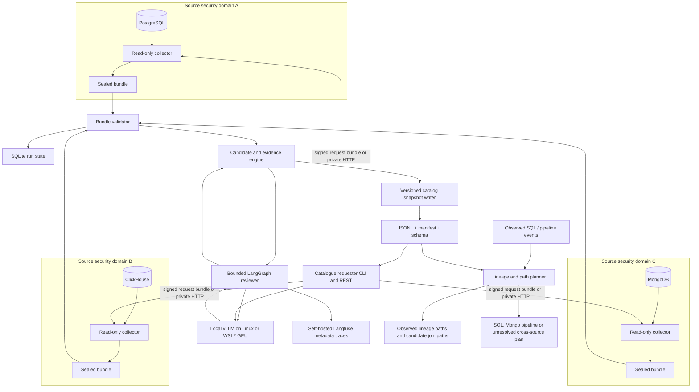

# Technical implementation contract

Status: binding design baseline with partial implementation, 2026-09-23. The artifact contract, metadata-first collectors, deterministic catalog builder, requester, scan adapters, and initial planner are implemented and tested with synthetic inputs. Live connector matrix, model/telemetry deployment, full lineage facets, benchmarks and acceptance tests remain open in [TODO.md](TODO.md). This file records **decisions to implement and verify**, not claims that every role works. The research and source links behind these decisions are in [ARCHITECTURE_RESEARCH.md](ARCHITECTURE_RESEARCH.md).

## 1. Product boundary and non-negotiable behavior

The product has four independently deployable roles: source collectors, a catalog builder, a catalogue requester, and a lineage and path planner. The requester and planner are independently installable Python packages with CLIs and optional HTTP JSON REST services. Collectors discover PostgreSQL, ClickHouse, and MongoDB metadata; the builder profiles within explicit budgets and infers *candidates* for same-source and cross-source references. The requester searches an existing snapshot, answers grounded natural-language questions through the private local model, and requests new scans. The planner returns observed transformation lineage, candidate join paths, and reviewable SQL/MongoDB plans without executing them. Similar values alone are never lineage. No central source-database login belongs in v1.

Each source has a separate collector process and network/credential boundary. One trusted assembler receives collector bundles. Cross-source sampled values may be compared **in memory**; raw values are discarded after feature extraction. Production requires an approved secure bundle transfer and common tokenization key distribution. The assembler's local LLM gets only minimized, redacted candidate context; it never gets credentials, raw sampled values, SQL literals, or live DB tools.

The initial scale assumption is about 10 sources, 200 objects, and 1,000 fields. All budgets, freshness windows, and limits are configuration, not hardcoded policy. Defaults below are proposals until measured and approved.

## 2. Execution topology



Collector responsibilities: scope authorization, source discovery, bounded profiling, source-local feature extraction, permitted SQL/pipeline observation, redaction, bundle schema validation, manifest hashes, and atomic publication. Builder responsibilities: validation and identity resolution, run reconciliation, cross-source feature comparison, candidate blocking and ranking, evidence policy, local semantic review, QA, and deterministic catalog publication. The requester owns search, grounded answers, and authorized scan dispatch. The planner owns lineage parsing/import, typed path search, and query-plan rendering. Both consume versioned artifacts without importing each other or source drivers.

No collector waits for another collector. A run can mark a missing source as `partial`, preserve prior known state with age metadata, and avoid silently deleting unseen objects. Source-local exceptions become typed diagnostics.

## 3. Repository and deployable boundaries

Approved package boundaries (create only as implementation tasks become active; exact published names remain subject to package-index checks):

```text
packages/contracts/         # versioned JSON Schemas, Pydantic boundary models, artifact validation
packages/collectors/        # source-site CLI, source drivers, budgets and sealed bundles
packages/catalog-builder/   # central profile matching, reviewer, snapshot publication
packages/requester/         # independent search, grounded questions, scan requests, CLI and REST
packages/planner/           # independent lineage, paths, SQL/Mongo plans, CLI and REST
tests/fixtures/          # labeled synthetic PG/CH/Mongo cases, SQL and event fixtures
schemas/                 # immutable published JSON Schemas per IR version
config/                  # safe example TOML only; local.toml ignored
scripts/                 # developer graph/CI helpers, not runtime modules
.githooks/               # local Git gate and refresh
.github/workflows/       # required PR checks
```

Use a `uv` workspace for development, but publish separate wheels: contracts, collectors, catalog builder, catalogue requester, and lineage planner. Each role depends only on contracts and its own justified libraries; requester and planner never import one another. Collector driver extras install only the matching driver. The builder, requester, and planner have no source drivers or source credentials. REST serving is an optional extra on requester/planner. A shared workspace lock does not prove package isolation: CI must install each wheel in a clean environment and test CLI, API, and file-contract compatibility independently. `uv` is not required at runtime.

## 4. Module and third-party decisions

| Concern | Decision | Specific use and boundary |
| --- | --- | --- |
| Language and build | Python 3.12+, `pyproject.toml`, `uv`, `uv.lock`, hatchling or equivalent build backend after packaging spike | Reproducible environment; verify Windows/Linux wheel availability and lock all extras. |
| CLI | Click | Commands `collect`, `assemble`, `validate-bundle`, `validate-graph`, `explain-edge`, `schema`. Exit codes and JSON diagnostics. |
| Config and IR | `tomllib`, Pydantic v2, standard `typing.Protocol` | TOML config, typed records, strict validation, secret references; no arbitrary YAML. |
| Serialization | standard `json`, `hashlib`, `pathlib`, `tempfile`; `jsonschema` for published contract | Canonical UTF-8 JSONL, digests, schema validation, atomic replace. |
| PostgreSQL | `pg8000` | Read-only direct catalog SQL, timeouts and TLS. No ORM and no Psycopg in permissive core. |
| ClickHouse | `clickhouse-connect` | `system.*`, engine metadata, bounded queries and permitted query log. |
| MongoDB | `pymongo` bundled `bson` | Collection/index/validator metadata, sampled documents; never install unrelated `bson`. |
| SQL lineage | SQLGlot | Parse supported PostgreSQL/ClickHouse SQL; our resolver binds identifiers to catalog objects. Unsupported SQL is diagnostic, never fabricated lineage. |
| Matching | RapidFuzz plus our deterministic policies | Name similarity is one feature, never sufficient alone. |
| Graph algorithms | NetworkX `MultiDiGraph`, replaceable planner-local view | Parallel typed edges and bounded path search; canonical persisted IR is independent of NetworkX. |
| Pipeline interchange | OpenLineage spec; `openlineage-python` extra only if needed | Import/export observed job/run/dataset facets, preserve provenance. |
| Local LLM | vLLM OpenAI-compatible server on Linux or WSL2 GPU; `openai` Python client against its private base URL; trial Qwen3 8B | One bounded structured-output call per ambiguous candidate batch; no cloud fallback. Record model digest, prompt/schema version, latency. Confirm GPU support and JSON conformance on the pinned versions. |
| Review workflow | LangGraph `StateGraph` | Explicit nodes for redaction, model call, validation and evidence conversion. Our deterministic assembler owns scheduling and publication. No autonomous tools, DB access, dynamic handoffs or model-selected SQL. Top-level `langchain` and `langgraph-swarm` are excluded; `langchain-core` may enter transitively with LangGraph. |
| Runtime state | SQLite stdlib and FTS5 where available | Local builder run index; requester search index; planner path index. Each package owns its own rebuildable state. Check FTS5 availability at startup and fail with a typed capability error. |
| Requester API | FastAPI and Uvicorn in the requester `api` extra | Private HTTP JSON REST over the same application functions used by the CLI; no source drivers or planner dependency. |
| Planner API | FastAPI and Uvicorn in the planner `api` extra | Private HTTP JSON REST over the same deterministic planner functions used by the CLI; no source credentials or query execution. |
| Telemetry | stdlib structured logging plus self-hosted Langfuse Python SDK | Trace reviewer nodes, local model latency/usage, validation outcomes and redacted error codes with approved metadata only. Never export raw prompts, outputs, SQL, values or credentials. Langfuse is observability, not source catalog state. |
| Test/tooling | pytest, Ruff, mypy/pyright, Bandit, pip-audit, `cyclonedx-py` or equivalent, license checker selected during dependency lock | CI must run deterministic unit, integration, contract, security and license gates. |
| Source-code intelligence | Graphify, Graft, Codebase Memory MCP | Developer-only structural graphs. Graphify first, then Graft, then CBM. Git hooks/CI refresh them without LLM/deep modes. |
| Ponytail | Ponytail plugin skills | Agent design/review discipline; use all named skills when available, record results and do not equate a slash command with a CI test. |

Version numbers and exact lock hashes are deliberately pending. The installed developer graph tools at setup were Graphify 0.9.65, Graft 0.18.0, CBM 0.11.0; CI should pin these or a reviewed upgrade. Application dependency pins require a real lockfile, CVE/license check, and connector test matrix before final selection.

## 5. Configuration and secrets

Configuration is explicit TOML plus `DBIG_*` environment overrides, with a strict precedence contract: CLI explicit flag > process environment > TOML > documented safe default. `.env` is a developer-local input to a launcher, never read implicitly in production. `.env` is ignored; `.env.example` has harmless placeholders. Secret values are resolved at runtime from process environment or an approved secret manager reference. Never put passwords, DSNs with embedded credentials, HMAC keys, tokens, or private SQL in source, examples, artifacts, logs, test snapshots, or graph tool indexes.

Source config fields: source ID, kind, connection reference, allowed databases/schemas/collections, TLS policy, read timeout, query budget, sample rows/documents, byte budget, concurrency, history access flag, permitted lineage event path, sensitivity policy. Assembler config fields: bundle roots, output path, freshness threshold, matching thresholds, private vLLM base URL/auth reference/model/digest, request timeout, batching, GPU concurrency, self-hosted Langfuse URL/key references, telemetry enablement, logging, bundle verification policy. Every user-supplied path is canonicalized and constrained to an approved root. The vLLM and Langfuse services have separate deployment secrets and network policies.

Secrets are never passed on command lines. Collector has least-privilege read permissions and a query cancellation timeout. The cross-source comparison key has run scope, a key ID only in manifests, and secure distribution to authorized collectors. If no shared key is available, disable cross-source value evidence and record that capability as unavailable rather than comparing incompatible hashes. Decide retention and cryptographic signing before production rollout.

## 6. IR and artifact contract

Use append-style JSONL files in a bundle directory plus a manifest written last. Planned files: `sources.jsonl`, `objects.jsonl`, `fields.jsonl`, `constraints.jsonl`, `profiles.jsonl`, `observations.jsonl`, `diagnostics.jsonl`. The assembler output adds `nodes.jsonl`, `edges.jsonl`, `evidence.jsonl`, `runs.jsonl`, and `manifest.json`. Canonical JSON uses stable key ordering and UTF-8; IDs are deterministic from normalized source identity and source-native stable identifiers where available. Do not base IDs on display names alone. Every record has `ir_version`, `record_type`, `id`, `source_id`, `observed_at`, `collector_version`, and provenance where applicable.

Manifest fields: format/IR version, source/run ID, creation window, collector build, scope hash, file paths, sizes, SHA-256 digests, counts, content classification, key ID if tokenized, optional signature metadata, diagnostics summary, and completion status. Readers reject unknown major versions, duplicate IDs, unsafe paths, missing files, digest mismatches, invalid JSON, impossible timestamps, missing references, and record counts that disagree with the manifest. Minor additions must be backward compatible. The producer writes temp files, fsyncs, validates, and atomically renames the manifest last; the consumer never reads an incomplete directory.

Object kinds: database, schema, table, view, materialized view, ClickHouse dictionary/engine-bearing table, MongoDB collection, job, and run. Field kinds include relational columns and normalized MongoDB document paths with type unions and array cardinality. Graph edge types: `CONTAINS`, `DECLARES_FK`, `REFERENCE_CANDIDATE`, `JOINS_OBSERVED`, `WRITES`, `READS`, `DERIVES_FROM`, `RUNS_JOB`. Each edge has status (`declared`, `strong`, `tentative`, `rejected`, `observed`), direction, evidence IDs, explanation, source/run provenance, first/last seen, and limitations. A field-name match can create only a *candidate*.

Evidence records are immutable and typed: catalog key, uniqueness/index, compatible type, name similarity, value containment/overlap, join observation, query-plan observation, SQL AST mapping, OpenLineage facet, LLM suggestion, and counterevidence. Preserve metrics and denominators; never publish an uncalibrated similarity as a probability. `confidence` remains null until calibrated on labeled data. Every relationship cites at least one non-LLM evidence record; lineage cites execution/definition metadata and parse resolution.

## 7. Collector implementation

Common protocol: `discover(config, budget) -> DiscoveryResult`, `profile(object, budget) -> ProfileResult`, `observe_lineage(config, budget) -> ObservationResult`, `emit_bundle(result, destination) -> Manifest`. Budget accounting covers queries, wall time, rows, bytes and source-specific concurrency. Cancel on expiry, emit partial diagnostics, and respect source read-only transactions where supported. No unrestricted `SELECT *` on large tables.

PostgreSQL: query `pg_catalog` for namespaces, relations, attributes, keys, FK constraints, indexes, view/materialized-view definitions, statistics and comments where allowed. Use quoted identifiers and parameterized dynamic values. Prefer catalog row estimates and existing statistics; use bounded sample queries only when permitted. Record partitioning and composite key order. Capture observed SQL only from configured logs/audit/job metadata, never assume `pg_stat_statements` includes result data or execution time history sufficient for lineage.

ClickHouse: query `system.databases`, `system.tables`, `system.columns`, `system.data_skipping_indices`, relevant constraints/projections/parts where available. Preserve engine, partition/sort/primary expressions and distributed/shard semantics. Capture `system.query_log` only with explicit access, retention bounds and redaction. Mutations and materialized views require engine-aware parsing; do not convert a same-name table relation into a FK.

MongoDB: list databases/collections, indexes, validator JSON Schema, collection options and safe stats; sample documents using bounded strategy, flatten nested paths with array markers, type counts, null/missing distinction and path depth limit. Preserve `_id` and index information. A path ending in `Id` is only a lexical candidate. Aggregation pipelines or change-stream/job records count as lineage only when observed and resolvable.

Collector errors become codes such as `PERMISSION_DENIED`, `TIMEOUT`, `UNSUPPORTED_VERSION`, `PARSE_UNRESOLVED`, `BUDGET_EXHAUSTED`, `PARTIAL_SCAN`; never silently substitute empty results for unavailable metadata.

## 8. Profiling and cross-source value evidence

Per field, compute bounded null/non-null counts, approximate or exact distinct count with method label, min/max for allowed types, length histogram, top-frequency sketches only if safe, and type/nullability distribution. Use source statistics where trustworthy, annotate freshness. Sample selection and size are recorded. Sensitive fields can be metadata-only. Value normalization is type-aware; preserve case/locale policy, leading zeros, time zone, binary encoding, and null distinction. Candidate pair comparison requires compatible normalized types and direction checks.

Raw sample values exist only in collector memory and, for allowed cross-source comparison, controlled assembler memory. Persist HMAC tokens or aggregate overlap metrics only according to the data policy; plain hashes are insufficient against dictionary attacks for low-entropy values. Encrypt bundle transport/storage if token sets are exported. Clear buffers on process exit; Python cannot guarantee memory zeroization, so deployment isolation and short retention are required. Never put raw values in LLM context, logs, graph artifacts, or developer code graphs.

Initial candidate blocking: compare only permitted source pairs; require compatible value domains or explicit manual relationship hint; then generate top-K per field by normalized lexical similarity plus key/uniqueness cues. Compute evidence on blocked pairs, not all 1,000² pairs. Support composite keys by ordered tuple comparison only when component mapping is justified. Direction asks whether child values are contained in a candidate unique parent key, plus null/duplication rates, join evidence and counterexamples. Abstain when sample support or uniqueness is insufficient. Cross-source matches are `REFERENCE_CANDIDATE` unless observed joins or stronger evidence warrants an approved status tier.

## 9. Lineage and query history

Inputs are observed SQL text/normalized fingerprints with provenance and times, view definitions, job/run records, and OpenLineage events. A view definition is *defined* transformation lineage, distinguished from an executed job. SQLGlot parses PostgreSQL/ClickHouse dialects; our resolver qualifies tables/columns against a snapshot, handles aliases/CTEs/stars where resolvable, and records unresolved expressions. Capture `INSERT ... SELECT`, `CREATE TABLE AS`, materialized view definitions, configured transformation jobs, and reads/writes. Column lineage is emitted only when expressions map to known fields; otherwise table-level edge plus diagnostic. SQL text stored only under policy after literal/comment redaction; default artifact stores fingerprint, parser version and redacted snippet.

The planner now maps explicit OpenLineage `job.facets.lineage` entries before event input/output arrays. For output datasets, a `facets.lineage` facet takes precedence over `facets.columnLineage`; mapped field inputs create separate field lineage edges and can be queried through the lineage paths API with field IDs. RunEvent `COMPLETE` paths are observed; JobEvent paths are defined. Unmapped fields, unsupported job-typed entries and outputs without explicit lineage produce diagnostics instead of fabricated paths. Facet transformation descriptions are discarded from the derived graph. The observed SQL resolver still abstains on nested SQL and does not yet cover all dialect/column cases.

OpenLineage import maps dataset namespace/name to source/object IDs and run/job facets to observed edges. Preserve RunEvent versus JobEvent provenance. Use an explicit target/source mapping from a lineage facet or resolved transformation SQL before asserting a particular input→output edge; a run listing several inputs and outputs alone does not justify their Cartesian product. Import column lineage only when the facet and field mapping are both available. Unmatched datasets remain unresolved observations. Distinguish lineage from observed joins: a SELECT join proves a query used two datasets, not that one was derived from the other. No LLM may invent lineage.

## 10. Local LLM review in version 1

After deterministic scoring, a bounded LangGraph `StateGraph` runs `redact -> request_vllm -> validate -> record_suggestion` for ambiguous candidate batches within configured token, request and time budgets. The trial model is Qwen3 8B; final model, quantization and digest depend on GPU VRAM and measured latency/accuracy. vLLM runs on a Linux or WSL2 GPU host; the assembler calls its private OpenAI-compatible endpoint through the `openai` Python client. This API compatibility does not authorize an OpenAI cloud call. Prompt includes normalized object/field labels, types, structural metrics, sanitized descriptions, source context and evidence IDs. It excludes raw rows, token sets, SQL literals and connection details. Require schema-constrained output: candidate ID, decision (`supports`, `opposes`, `unknown`), short reason, cited evidence IDs, and any suggested follow-up. Validate again with Pydantic and check all IDs; reject malformed, uncited or invented evidence. Persist model/digest, prompt/schema versions and response hash for audit; redact response text as necessary. Verify vLLM's pinned structured-output behavior against the schema before deployment.

The reviewer adds only `MODEL_SUGGESTION` evidence and can reprioritize review; it cannot convert a candidate into a declared FK or an observed lineage edge. A timeout, local server outage or invalid output produces a typed diagnostic and the deterministic graph still publishes. The v1 deployment enables review for ambiguous cases, then compares precision/recall and latency with the no-LLM baseline. LangGraph is a fixed workflow, not a free-running agent: no model tool calls, autonomous query planning, peer-agent handoffs or cloud API. Top-level LangChain and LangGraph Swarm add no needed v1 capability; reconsider only if a measured workflow requires their features.

Self-hosted Langfuse receives spans for run/candidate IDs, workflow node names, model artifact identity, prompt/schema versions, token counts, timing, validation status and redacted error codes. Start with manual SDK spans so model inputs/outputs and LangGraph state are not captured automatically. A LangGraph callback/agent visualization is allowed only after tests prove it transmits approved metadata alone. Langfuse requires its own web/worker, PostgreSQL, ClickHouse, Redis/Valkey and S3-compatible storage; these are telemetry infrastructure, not data sources or assembler dependencies. Restrict network access and retention. Langfuse unavailability must not block graph publication; bound any telemetry queue and emit local diagnostics. Test that canary secrets, sample values and SQL literals never appear in traces.

## 11. Assembler, state and incremental runs

Assembler validates all manifests before reading records, builds a normalized in-memory index and uses SQLite for durable run receipts and IDs. Process bundles idempotently by manifest digest. Reconcile object lifecycle across complete source scans only; a missing/failed source does not imply deletions. Edge first/last seen and evidence history survive reruns. Cache matching on object profile hashes, normalization version, algorithm version, and relevant config hash. Invalidate on source key changes, schema changes, consent changes or tokenization key rotation. Deterministic sorting means same inputs/config/tool versions produce byte-identical graph data except declared run metadata.

The initial SQLite receipt implementation stores one verified active bundle path and digest per source and a receipt for each accepted signed manifest. A partial rescan preserves the last complete active bundle for that source, records the partial receipt, and publishes a snapshot marked partial with the affected source/digest in builder run metadata. The next complete scan replaces the active bundle. Replayed receipts are idempotent. Bundle files must remain available for rebuilds; source-level receipt state currently rebuilds all graph data and does not yet cache field-level matching, historical edge first/last-seen timestamps, or profile-based invalidation.

Partial runs identify which sources and capabilities were unavailable. A graph can be published with partial status if its manifest says so; downstream can enforce full-only. No permanent central raw sample store.

## 12. Command and error contract

Planned commands (names and flags are a decision, pending CLI implementation):

```text
dbig collect --config <source.toml> --source-id <id> --out <bundle-dir>
dbig validate-bundle <bundle-dir> --json
dbig assemble --config <assembler.toml> --bundle <path> [--bundle <path> ...] --out <graph-dir>
dbig validate-graph <graph-dir> --json
dbig explain-edge <edge-id> --graph <graph-dir> --json
dbig schema --version <major.minor> --out <dir>
dbig-requester index --snapshot <catalog-dir> --state <state-dir>
dbig-requester search --state <state-dir> --query <text> --json
dbig-requester ask --state <state-dir> --question <text> --json
dbig-requester request-scan --source-id <id> --request <json> --dispatch <bundle|http> --json
dbig-requester serve --config <requester.toml>
dbig-planner build --snapshot <catalog-dir> --observations <dir> --out <planner-dir>
dbig-planner lineage-paths --graph <planner-dir> --from <id> --to <id> --json
dbig-planner join-paths --graph <planner-dir> --from <id> --to <id> --json
dbig-planner plan --graph <planner-dir> --path-id <id> --json
dbig-planner serve --config <planner.toml>
```

Exit codes: 0 complete success; 2 invalid invocation/config; 3 security/integrity violation; 4 unavailable source or partial result (unless `--allow-partial`); 5 internal error; 6 validation failure. JSON diagnostics have code, severity, source ID, object ID if safe, timestamp, retryability, and redacted message. CLI never prints secrets or raw values.

## 13. Security and operations

Use read-only accounts, TLS verification, per-query timeouts, connection pooling limits, process separation by source, and explicit allowlists. Bundle receiver enforces size limits, path traversal rejection, digest verification and trusted transport; optional signatures become mandatory if transfer is not otherwise authenticated. Require workload identity or equivalent secret delivery in production. Scrub logs and crash reports. Keep source-side raw sample in RAM only. Retention schedules apply to manifests and profiler tokens. Provide key rotation and rerun semantics. Run each collector on a schedule agreed with source owners; source load metrics and budgets are visible in diagnostics.

Threat tests: malicious bundle path/JSON, oversized record, duplicate ID, HMAC mismatch, prompt injection in comments/SQL, model hallucinated IDs, timeout, collector privilege failure, and stale manifest replay. The LLM prompt treats source metadata as data, never instructions.

## 14. Test and acceptance plan

Unit/contract: IR schema round-trips, versioning, stable IDs, atomic bundle write/read, digest tamper rejection, bounded budget accounting, normalization and scoring, SQL resolver known/unknown cases, LLM schema rejection and timeout, deterministic graph diff. Integration: disposable PostgreSQL, ClickHouse, MongoDB with representative keys, composite joins, arrays/nested paths, views, materialized views, and pipeline events; test least-privilege roles and source failures. Golden fixtures include true/false relationships, ambiguous names, sparse/low-cardinality fields and observed transformations. Measure candidate precision/recall at fixed review budgets; report coverage and abstention separately. Measure no-LLM and local-LLM accuracy and latency on the same held-out corpus. Acceptance thresholds require user approval after a labeled corpus exists; do not invent success percentages.

Performance: benchmark at the stated 10/200/1,000 scale with per-source load and bundle bytes, assembler wall time/RAM, LLM p50/p95, cache hit rate. Security: dependency vulnerability/license report, secrets scan, least-privilege integration checks, malformed bundle fuzz/property tests. CI cannot test live private databases; those run in a separate authorized environment.

## 15. Git, graph tooling, Ponytail and CI/CD contract

The repository hook path is `.githooks`, installed via `python scripts/install_hooks.py`. Pre-commit calls `scripts/graph_sync.py`: check for partial staging that would make graphs reflect a different tree, refresh Graphify with `graphify update .`, refresh Graft with `graft build .` and verify `graft check .`, then run `codebase-memory-mcp cli index_repository --repo-path . --mode fast --persistence false`. Every required command must exist and exit 0; no silent fallback. Post-commit runs the same refresh against the committed tree. All steps are deterministic structural modes with no semantic/deep LLM calls. Graph caches are ignored until the artifact policy is chosen. Git's `--no-verify` and `core.hooksPath` overrides can bypass local hooks; protected branches and required CI compensate, but no local mechanism can make bypass impossible.

CI on pull requests and pushes to `main`: install pinned Python, Graphify, Node/Graft, and Codebase Memory; run graph refresh/graft drift checks; check docs and TODO structure. Once code and a lockfile exist, run Ruff, types, tests and vulnerability audit. Integration containers, license/SBOM gates and measured quality thresholds remain implementation tasks. The release workflow refuses to publish until a tested package and lockfile exist. GitHub currently returns HTTP 403 for private-repository branch protection/rulesets on this account plan; by user decision, the repository remains private, so CI results cannot be a mandatory remote merge gate here.

Ponytail is a coding-agent methodology, not a runtime dependency. On every meaningful change, apply `/ponytail [lite | full | ultra | off]` with `full` as intended baseline when the plugin is installed; run review for current diff, audit for repository-wide design, debt to keep TODO debt visible, gain only with measurements, and help when command behavior is uncertain. In Codex, upstream documents these as `@ponytail-*` skills after plugin installation/restart. If unavailable, explicitly report that status and manually apply the same minimal-design checks; never pretend a skill ran. Agent instructions in AGENTS.md and CLAUDE.md are the controlling project policy.

## 16. Decisions requiring user input or empirical evidence

1. Resolved: generated developer graphs are local/CI caches and are never committed.
2. Resolved: make the first commit and use `https://github.com/Reza-Sh83/db-catalogue.git` as `origin`.
3. Exact GPU model/VRAM and RAM; model size and latency remain provisional.
4. Safe source sample/byte/time budgets and per-source authorization.
5. Bundle transfer, signatures, retention and shared tokenization-key mechanism.
6. Target versions and compatibility matrix for PostgreSQL, ClickHouse and MongoDB.
7. Source of observed SQL/job metadata and its privacy policy.
8. Labeled evaluation corpus and acceptance thresholds.

These are tracked in TODO.md. Work that does not depend on them may proceed; behavior-changing assumptions must be surfaced to the user, including in the middle of a task.

On 2026-09-23 the user delegated these choices to implementation. The initial local profile is conservative: collectors require read-only credentials and verified TLS; sampling, history access, cross-source token comparison, and free-text export are disabled unless explicitly configured. Signed filesystem bundles are the first scheduler handoff; an HTTP adapter must authenticate its caller and use the same signed request envelope. Signing and token keys are separate environment references, and unsigned scan requests are rejected. Unknown event sources yield no observed lineage rather than invented edges. Model identity and acceptance thresholds remain measured outputs, not defaults; a GPU cannot be selected or declared supported without host evidence. The version and driver matrix will be declared only after integration tests against those versions. Production connection details and retention are deployment configuration, not repository constants.

The metadata-only profile publishes SHA-256 digests of PostgreSQL view definitions and ClickHouse key expressions instead of their raw text. MongoDB validators and indexes contribute field names/types without sampling; optional samples contribute only path/type unions, missing/null flags and bounded counts, never values. This preserves change detection while full definition parsing and lineage await an approved observed-SQL source and classification. The available local GPU reports GTX 1650 with 4 GiB VRAM; Docker Desktop's Linux daemon is unavailable and WSL enumeration returned access denied on 2026-09-23. No supported model size or live server version is inferred from this evidence.

The first live metadata compatibility matrix was established by CI run 35911699728: PostgreSQL 16.15 (catalog read through a role granted schema usage and table SELECT), ClickHouse 25.8.33.6 (`system.tables` and `system.columns`), and MongoDB 7.0.41 (`listCollections` and indexes). The three tests passed with synthetic schemas. CI fixture services did not test verified TLS or production authentication. Only these exact tested versions have empirical metadata compatibility evidence; this is not a claim that adjacent versions or secure production connections have passed.

On 2026-09-23 the user requested that private vLLM integration be configured in code now while live GPU/model tests wait for an accessible GPU host they will identify later. Synthetic reviewer, answer-grounding and metadata-only telemetry tests remain active. No model artifact, digest, latency, live privacy result, or Langfuse deployment is claimed until it is actually tested. This deferral does not remove the live v1 acceptance gate.

## 17. Independent requester and planner contract (approved 2026-09-23)

The user selected **both** separately installable packages/CLIs exchanging versioned files **and** separately deployed HTTP JSON REST services. This section supersedes earlier single-package, headless-only, and planner-in-assembler descriptions in the research record. The requester, scan adapters, and initial planner have synthetic-tested implementations. The architecture and TODO record the binding scope and remaining work.

### 17.1 Dependency and ownership rules

| Distribution | Owns | Required application dependencies | Optional dependencies |
| --- | --- | --- | --- |
| `dbig-contracts` | IR v1, JSON Schema, manifests, validation, stable IDs, signatures | Pydantic v2, `jsonschema`, Python standard library | None |
| `dbig-collectors` | Site-specific discovery, profiles and signed bundles | `dbig-contracts`, Click, standard library | `pg8000`, `clickhouse-connect`, or `pymongo` by source extra |
| `dbig-catalog-builder` | Cross-source evidence, reference candidates, deterministic snapshot, bounded semantic review | `dbig-contracts`, RapidFuzz, LangGraph, OpenAI-compatible Python client, Langfuse SDK, SQLite stdlib | NetworkX only if builder-side traversal proves necessary |
| `dbig-catalogue-requester` | Structured catalogue search, grounded local-LLM answers, scan dispatch | `dbig-contracts`, Click, SQLite/FTS5 stdlib, OpenAI-compatible Python client | FastAPI/Uvicorn `api` extra; LangGraph only if multi-step request workflow is justified by tests |
| `dbig-lineage-planner` | Observed lineage import, lineage and join paths, SQL/Mongo/query-plan rendering | `dbig-contracts`, SQLGlot, NetworkX, Click | FastAPI/Uvicorn `api` extra; `openlineage-python` only for typed event emission |

The names are intended distribution names, subject to package-index availability and final lock audit. Do not introduce imports from requester to planner or vice versa. Source credentials and drivers are confined to collectors. The planner makes no LLM call; path selection and rendering use validated IR and deterministic policies. The requester may call the same private vLLM server used by the builder, but the packages share no process state or direct Python dependency. No top-level LangChain, LangGraph Swarm, Amundsen, Elasticsearch, Neo4j, Marquez, OpenLineage SQL parser, or second SQL parser is required. Graphify/Graft/Codebase Memory remain developer-only graphs.

### 17.2 Versioned artifact handoff

The builder publishes a sealed **catalog snapshot** using the section 6 `nodes.jsonl`, `edges.jsonl`, `evidence.jsonl`, `runs.jsonl`, and `manifest.json` convention. The snapshot includes object/field definitions, declared constraints, `REFERENCE_CANDIDATE` edges and their evidence, plus approved observation references. Planner-local lineage and path indexes and requester-local SQLite FTS indexes are derived caches, never the interchange contract. Observed SQL/pipeline metadata and OpenLineage event files enter the planner through validated observation records; raw values and source credentials never enter either package. A planner can operate on a compatible catalog snapshot without a requester. A requester can operate on that snapshot without a planner. OpenLineage-only input can yield lineage paths after dataset mapping, but join paths require compatible field/reference evidence; missing evidence produces an explicit unavailable result.

Every artifact declares schema major/minor version, content type, producer, source run IDs, creation/as-of time, completeness, SHA-256 file digests, counts, and provenance. A reader rejects unknown major versions, invalid references, excessive size, unsafe paths, bad signatures/digests, or ambiguous source identities; a compatible minor version adds fields without changing meaning. Create canonical fixtures and clean-wheel consumer tests before promising compatibility. The research document's earlier `entities.jsonl`/`relationships.jsonl` wording is historical; the section 6 filenames above are the binding design.

### 17.3 Catalogue requester

Structured requests filter by object/field kind, source, name, type, tags/capabilities, freshness, and evidence status, with pagination and stable sort. At the initial scale, build a local SQLite FTS5 index from a validated snapshot, retaining only approved metadata and object IDs. Store a snapshot digest with the index and refuse stale or mismatched requests until reindexed. Natural-language questions use bounded retrieval followed by a private vLLM call against **only retrieved and redacted metadata**; the model returns cited catalog IDs and an answer, validated against those results. It cannot query sources, invent fields, issue scans, assert lineage, or run SQL. If the model is unavailable, structured search remains usable and the natural-language route returns a typed unavailability response. Manual metadata-only Langfuse traces cover this call under the same privacy rules as the builder.

The scan-request contract names an authorized source ID, requested scope/capabilities, reason, requester identity, idempotency key, expiry, and reply location; it contains no source credentials. Two adapters use the same signed, versioned request model: (1) write a signed bundle into the existing scheduler's approved handoff, or (2) POST it over private authenticated HTTP to a collector-side adapter. The collector verifies signature, replay/expiry, caller authorization, allowed scope and local load budget, then queues a scan locally and returns a receipt/status. The requester never bypasses collector policy or directly connects to a database. Exact scheduler interface, HTTP authentication mechanism, key management and retention require deployment evidence and remain open TODO items.

REST v1 routes: `GET /v1/catalogue/search`, `POST /v1/catalogue/questions`, `POST /v1/scan-requests`, and `GET /v1/scan-requests/{id}`. CLI and REST call the same application functions. Responses include contract version, snapshot digest, IDs, evidence/freshness, completeness, and typed errors. API authentication, authorization, payload limits, rate limits and TLS are required before deployment; do not invent their concrete configuration.

### 17.4 Lineage and path planner

Maintain separate edge sets for observed/defined `DERIVES_FROM`/`READS`/`WRITES` lineage and declared or inferred reference candidates. `JOINS_OBSERVED` records that a query used a join, not data movement. A lineage-path request traverses only lineage edges with execution/definition provenance and timestamps. A join-path request traverses approved declared/reference-candidate edges, marks tentative links, applies configured hop/result limits and returns ranked paths with every supporting and contrary evidence ID. Missing mappings, stale snapshots and partial observations are visible; never silently complete a path with an LLM guess. OpenLineage RunEvents, JobEvents and facets are mapped conservatively as described in section 9.

For a selected path, the planner constructs a typed query plan from catalog IDs and approved predicates. For a SQL-capable single-engine segment, render dialect-specific SQL through SQLGlot ASTs with quoted identifiers and bound **values**; validate the resulting AST against the selected objects, joins and read-only policy. Identifiers are allowlisted from the snapshot, never concatenated from user text. For MongoDB segments, emit a JSON aggregation pipeline with validated collection/path references and bounded stages. No generated query is executed by this product. For cross-database paths, return executable **source-side** read queries where possible plus ordered logical extract/transfer/join steps, schemas, expected keys and prerequisites. Until an approved staging/federated target is configured, mark staging and final join execution `unresolved`; do not claim the complete cross-source plan is executable. If a target is later configured, add its dialect/capability checks and explicit approval before rendering target SQL.

REST v1 routes: `POST /v1/lineage/paths`, `POST /v1/join-paths`, and `POST /v1/plans`. CLI and REST use the same validated functions. A plan response carries plan/version ID, snapshot digest, path/evidence IDs, source dialects, rendered SQL with parameter metadata and/or Mongo pipeline JSON, ordered logical steps, unresolved prerequisites, and warnings. Do not include source credentials or raw sample values. The API is read-only with respect to all source databases.

### 17.5 Verification gates

Before calling the two packages independent, build and install each wheel in separate clean Windows and Linux environments and prove neither imports the other or a source driver. Contract fixtures must round-trip through both CLIs and REST APIs using the same sealed snapshot; test unknown major and additive minor versions. Test requester search/answer grounding, stale-index rejection, authorization/replay of both scan adapters, and model outage. Test planner lineage versus join separation, multi-input/multi-output OpenLineage ambiguity, SQL dialect and Mongo pipeline rendering, cross-source unresolved staging, prompt injection, read-only AST policy, and that no execution path exists. CI should start these gates only as the packages are implemented; current CI is a planning-stage policy/graph check, not evidence that these runtime behaviors work.
