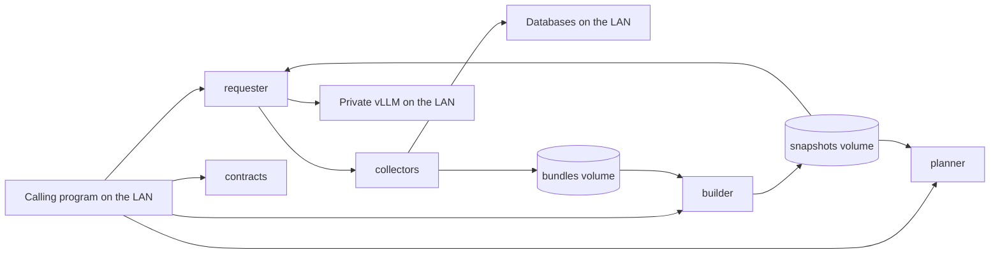

# db-catalogue: improvement report

**Date:** 2026-11-09
**Status:** Proposal. No application code changed.
**Base:** `main` at 3ff51f3, branch `docs/improvement-report`.
**Done so far:** all parts. Implementation of Part 1 has started on its own branch.
**Evidence rule:** every item below was checked against the code at 3ff51f3, a measurement or a named run file. `not checked` marks anything that was not. Line numbers appear only for artifacts, where they do not move.

## Table of contents

- [0. Confirmed constraints](#0-confirmed-constraints)
- [Part 1: Defects and fixes to apply now](#part-1-defects-and-fixes-to-apply-now)
  - [Summary](#summary)
  - [A. Release and test tooling](#a-release-and-test-tooling)
  - [B. Answer quality and privacy](#b-answer-quality-and-privacy)
  - [C. Relationship inference and collection](#c-relationship-inference-and-collection)
  - [D. Documentation and repository](#d-documentation-and-repository)
  - [E. Live checks not yet run](#e-live-checks-not-yet-run)
  - [F. Older open questions](#f-older-open-questions)
  - [G. Already fixed: do not touch](#g-already-fixed-do-not-touch)
  - [H. Decisions needed](#h-decisions-needed)
- [Part 2: Research, cited](#part-2-research-cited)
- [Part 3: Target architecture](#part-3-target-architecture)
- [Part 4: Appendices](#part-4-appendices)
- [Recommended sequence](#recommended-sequence)

---

## 0. Confirmed constraints
<!-- verified: 3ff51f3 -->

| # | Constraint | Source |
| --- | --- | --- |
| Q1 | db-catalogue becomes a service that other programs call by API. | Owner, 2026-11-08 |
| Q2 | All five packages (collectors, catalog-builder, requester, planner, contracts) become API services, one Docker container each. | Owner, 2026-11-08 |
| Q3 | Extend the existing optional HTTP services; do not build a second one. | AGENTS.md F5; task brief |
| Q4 | Local network only: no inbound from outside the LAN, no outbound beyond it. The remote database host is inside the LAN and counts as local. | Owner, 2026-11-08 |
| Q5 | Research covers `TODO.md`, the reports of prompts 1 to 3, live findings F5-F13, the later remote run, speed and precision. | Owner, 2026-11-08 |
| Q6 | This report is a proposal on its own branch. No merge until the owner writes `merge it`. | AGENTS.md B1 |
| Q7 | No cloud model fallback. The model is a private vLLM endpoint. Raw values, prompts and replies stay out of traces. | AGENTS.md section 4 |
| Q8 | A model never declares lineage and never gets source credentials or database tools. | AGENTS.md section 4 |

---

## Part 1: Defects and fixes to apply now
<!-- verified: 3ff51f3 -->

### Summary

| ID | Problem | Status | Severity | Who acts |
| --- | --- | --- | --- | --- |
| A1 | `release.yml` cannot succeed | Open | High | Implementer |
| A2 | 37 attack tests fail; `TODO.md` says 23 | Open | High | Implementer, then owner on each test |
| A3 | The documented setup misses package drivers | New, open | Medium | Implementer |
| A4 | GitLab `source-integration` needs a privileged runner | Not checked on the runner | Medium | Owner |
| A5 | `serve` has no end-to-end bind test | Open | Medium | Implementer |
| A6 | `test_live_collectors` cannot re-run on the same containers | Open | Low | Implementer |
| B1 | SDK DEBUG log can hold question and reply text | Open | High | Owner decides |
| B2 | An answer with no citation is refused with no retry | Open | High | Implementer |
| B3 | Paraphrased lineage claims pass the check | New, open | High | Implementer |
| B4 | Model does not chain edges through retrieved tables (N-I10) | Open | Medium | Implementer |
| B5 | A question about several sources can retrieve only one (N-C1) | Cause not replayed | Medium | Implementer |
| B6 | Questions about types find nothing (F13) | Partial | Medium | Owner decides |
| B7 | "List all" answers are cut at 10 hits | Open | Medium | Owner decides |
| B8 | `requester index` may show a traceback on a signed snapshot | Not reproduced | Medium | Implementer |
| C1 | 18 false pairs remain against ClickHouse parents | Partial | Medium | Owner decides |
| C2 | Query budget cuts format profiles, and the message gives no remedy | Open | Medium | Implementer |
| C3 | Cross-source candidates stay unverified when token keys differ | Open, by design | Medium | Owner config |
| C4 | Name-rule limits: differing names and differing type families | Open, by design | Low | Owner decides |
| C5 | Three inference defects from the attack tests | New, open | Medium | Implementer |
| D1 | `docs.yml` skips `docs/*.md`: 92 Vale errors | Open | Medium | Implementer |
| D2 | `TECHNICAL_IMPLEMENTATION.md` stamps missing | Open | Low | Implementer |
| D3 | Live-test report says 28 and 40 | Open | Low | Implementer |
| D4 | `.claude/skills/ponytail*` differ from v5.3.3 | Open | Low | Owner decides |
| D5 | `.handoff/` holds 37 older tracked files | Open | Low | Owner decides |
| D6 | `TODO.md` is out of date | Open | Low | Implementer |
| E1 | Fixes not re-run live; run incomplete | Open | Medium | Owner yes per run |

### A. Release and test tooling

#### A1: `release.yml` cannot succeed
<!-- verified: 3ff51f3 -->

`.github/workflows/release.yml` runs `test -d src`, but the repository has no root `src` folder, so the job stops before it publishes. It also runs plain `uv build`, which does not build all workspace packages.

**Fix:** delete `test -d src`; change the build step to `uv build --all-packages`.
**Verify:** `actionlint .github/workflows/release.yml`, then `uv build --all-packages` with a memory cap.

#### A2: 37 attack tests fail, and the record is wrong
<!-- verified: 3ff51f3 -->

Measured on 2026-11-09: 29 `attack*.py` files, run one at a time with a 6 GB cap and full package extras. Files outside the eight below all pass. The two files whose failures came from missing drivers then passed (see A3).

`TODO.md` says 23 failures, with "ids in the P7 ledger." The ledger holds no ids; it says 37, and the id list was in an ignored file. The measured count is 37. The figure 23 has no source: `not checked` beyond that.

| File under `tests/catalogue_fixes/` | Failures | What it shows | Assessment |
| --- | --- | --- | --- |
| `attack2_d3_lowercase.py` | 27 | Expected lowercase `vendorid` to link to `vendor`; found no pair | Probably superseded by the later DEC-1 and DEC-16 rules. `not checked` per test. Must be confirmed before anything changes (L1). |
| `attack3_b_answering_retrieval.py` | 6 | 5 lineage paraphrases accepted (B3); 1 DEC-7 probe | B3 is a real defect. DEC-7 probe `not checked`. |
| `attack3_a_dec1.py` | 1 | Two candidates for one child and parent table | C5 |
| `attack3_a_dec2.py` | 1 | A column measured 0.2 unique is still treated as a key parent | C5 |
| `attack3_a_dec4.py` | 1 | `KeyError: 'warnings'` on a three-hop path | C5 |
| `attack_search.py` | 1 | Search for `pos` returns `po_number` | Minor retrieval noise |

**Fix:** record the 37 ids and a verdict for each in `TODO.md`. Fix the real defects. If a test contradicts a later decision, stop and ask (L1). Also, `tests/phase7/attack7_p7_4.py::test_debug_logs_bare_reply` asserts only the re-send, so it follows B1.
**Verify:** the batch run reports the same ids as the ledger.

#### A3: The documented setup misses package drivers (new)
<!-- verified: 3ff51f3 -->

AGENTS.md section 5 says `uv sync --locked --all-extras --dev`. Measured: this leaves `pg8000` and `clickhouse_connect` uninstalled, and 17 attack tests fail with `ModuleNotFoundError`. With `--all-packages` added they pass or skip (`attack3_c_e1_key.py` 46 passed; `attack6_f7_f9.py` 13 passed, 12 skipped). `.github/workflows/ci.yml` uses both forms, in different jobs.

**Fix:** use `uv sync --locked --all-packages --all-extras --dev` in AGENTS.md section 5. Check which CI job needs which form before changing `ci.yml`.
**Verify:** on a fresh environment, both attack files show no import error.

#### A4: GitLab `source-integration` needs a privileged runner
<!-- verified: 3ff51f3 -->

`.gitlab-ci.yml` runs `docker:29.9.2-dind`, and its header asks for a privileged Linux Docker runner. The failure itself is not recorded in the repository. Runner state and pipeline status: `not checked`.

**Fix:** the owner sets `privileged = true` for that runner in its `config.toml`. This is outside the repository, so B10 needs the runner config kept in a committed file or documented.
**Verify:** `source-integration` is green for both matrix legs.

#### A5: `serve` has no end-to-end bind test
<!-- verified: 3ff51f3 -->

`TODO.md` records that `create_app` and the bind refusal are tested apart, never as one served request. This matters more once services are the product. Part 3 will include it in the service acceptance tests.

**Verify:** a test binds a port, sends one authenticated request and reads the reply.

#### A6: `test_live_collectors` cannot re-run on the same containers
<!-- verified: 3ff51f3 -->

`tests/test_live_collectors.py` creates its schema without dropping it first. CI uses fresh containers, so only local re-runs are affected.

**Fix:** drop the schema in the test's setup.

### B. Answer quality and privacy

#### B1: SDK DEBUG log can hold question and reply text
<!-- verified: 3ff51f3 -->

`packages/requester/src/dbig_requester/answer.py::answer_question` re-sends a bare reply with `CORRECTION`. Nothing in `packages` or `scripts` sets a level for the `openai`, `httpx` or `httpcore` loggers. `TODO.md` records that the attack test saw both texts in the DEBUG log. AGENTS.md forbids raw prompt or reply tracing until canary tests prove masking. This needs DEBUG to be switched on, so the default level does not leak.

**Options:** see H1.
**Verify:** a canary question and reply do not appear in captured logs at DEBUG.

#### B2: An answer with no citation is refused with no retry
<!-- verified: 3ff51f3 -->

In the 2026-10-28 run, 4 of 40 answers failed with `MODEL_INVALID_CITATION`, check `none` (N-D9, N-S8, N-S9, N-I3). In `answer.py::answer_question` the correction retry covers only `_unexplained`; a reply with no citations raises at once.

**Fix:** treat "answered, no citation" as a second retry reason, inside the same loop and `answer_retries` bound. It needs its own fixed correction text, because `CORRECTION` says the verdict had no explanation.
**Verify:** a stub model returns no citations, then valid ones; the answer succeeds. Replay the four questions.
**Expected gain:** up to 4 of 40 refusals become answers. Not measured.

#### B3: Paraphrased lineage claims pass the check (new)
<!-- verified: 3ff51f3 -->

`answer.py::LINEAGE_CLAIM` matches only `derived from`, `flows into` and `writes to`. The attack tests show that "gadget is fed by part," "populated from," "loads into," "built from" and "the lineage of gadget is part" all pass. Claims of lineage are a stated limit of the product (AGENTS.md: the model has no authority to declare lineage).

The test's docstring calls this a documented ceiling, not a defect by itself. A longer word list is a tuned fix and will miss the next phrase. **Direction:** [Part 2](#b3-stopping-free-text-lineage-claims) compares the options and recommends rendering relationships from stored edges.
**Verify:** the five attack cases are refused, and ordinary "joins to" answers are not.

#### B4: The model does not chain edges through retrieved tables (N-I10)
<!-- verified: 3ff51f3 -->

N-I10 asked for the company name of a `PersonContact` row. `answers-both.json` on `fix/phase7` shows the reply citing all three edges, then saying no path exists. So retrieval worked and the model did not chain them. `search.py::bridge_paths` adds path lines only through tables that are not themselves ends; here `Person` and `Experience` were retrieved, so no path line was written. That link between the two is inferred; `not replayed`.

**Fix:** also write the shortest path when the intermediate tables are retrieved, under the same hop limit.
**Verify:** replay N-I10 and check the path line is in the context, then ask once more live.

#### B5: A question about several sources can retrieve only one (N-C1)
<!-- verified: 3ff51f3 -->

N-C1 asked about "both databases." The reply says only `pg-diffbot` was retrieved, and all citations are from it. Top-10 domination by one source fits, but the context was not replayed (`not checked`).

**Fix, if the replay confirms it:** split the limit across sources when a question spans several sources, in `search.py`.
**Verify:** replay N-C1 and count hits per source.

#### B6: Questions about types find nothing (F13)
<!-- verified: 3ff51f3 -->

Retrieval went from 59 of 134 expected names (44%) to 104 of 134 (78%) (`artifacts/run-20261020/step3-summary.md`). N-C4 and N-C7 still return `NO_CATALOGUE_MATCH`, because `search.py::index_snapshot` indexes only `name, context, description`. Adding type text was deferred because "text" matches 94 of 170 fields.

**Options:** see H4.

#### B7: "List all" answers are cut at 10 hits
<!-- verified: 3ff51f3 -->

N-C6 named 2 of 4 numeric columns. `requester/config.py` sets `retrieval_limit` to 10. **Options:** see H5.

#### B8: `requester index` may show a traceback on a signed snapshot
<!-- verified: 3ff51f3 -->

`TODO.md` records this. `cli.py::index` calls `search.py::index_snapshot`, which calls `read_artifact` without a key, and neither handles an exception. Behaviour on a real signed snapshot was not reproduced.

**Fix:** reproduce first (D3). Pass the key from config and report a one-line error with the fix (J11).

### C. Relationship inference and collection

#### C1: 18 false pairs remain against ClickHouse parents
<!-- verified: 3ff51f3 -->

`artifacts/run-20261020/step1-summary.md`: 79 candidates, 61 true, 18 false. All 18 have a ClickHouse parent (14 `Company.companyID`, 4 `Person` or `Location`). A zero overlap can drop a pair only against a complete parent, and only 3 of 38 ClickHouse hash sets are complete, by design (`builder.py`, reason `parent_sampled`). **Options:** see H6.

#### C2: Query budget cuts format profiles, and the message gives no remedy
<!-- verified: 3ff51f3 -->

With the default `max_queries` of 50 (`collectors/config.py::SourceConfig`), the remote `pg-diffbot` run left 78 format profiles unread and the bundle `partial`. The run passed with 200. The message in `runtime.py` says only "format profiles not read: query budget reached."

**Fix:** name the setting and the count needed in the message (J11). Keep the default unless the owner asks.
**Verify:** collect with the default and read the diagnostic.

#### C3: Cross-source candidates stay unverified when token keys differ
<!-- verified: 3ff51f3 -->

The remote run has 3 `unverified_cross_source` candidates, because the two collections used different token keys. **Fix:** collect both sources with one `DBIG_TOKEN_KEY`, which is a configuration step. Part 3 will make it one service-wide secret.
**Verify:** cross-source candidates carry an overlap number.

#### C4: Name-rule limits
<!-- verified: 3ff51f3 -->

`investorcompanyid` to `company.companyid` is not proposed (DEC-20). `ch.Location.companyID` (`Nullable(Int64)`) to `Company.companyID` (`String`) is not proposed (type-family rule). Both are by design. **Fix:** the decisions file (DEC-36) can add such a pair by hand. Value-based discovery is for Part 2.

#### C5: Inference defects from the attack tests (new)
<!-- verified: 3ff51f3 -->

From A2: two candidates for one child and parent table (`attack3_a_dec1.py`); a parent measured 0.2 unique that a weak claim still admits (`attack3_a_dec2.py`); and a `KeyError` on a three-hop path (`attack3_a_dec4.py`). Each needs reading against its DEC entry first: a test may be stale.

**Verify:** each test passes, or the owner rules it stale.

### D. Documentation and repository

#### D1: `docs.yml` skips `docs/*.md`
<!-- verified: 3ff51f3 -->

`.github/workflows/docs.yml` lists only `docs/LESSONS.md` under `docs/`. Measured with `vale --minAlertLevel=error` on 2026-11-09: 92 errors in four files.

| File | Errors |
| --- | --- |
| `docs/ARCHITECTURE_RESEARCH.md` | 70 |
| `docs/THREAT_MODEL.md` | 12 |
| `docs/LOCAL_RUN.md` | 9 |
| `docs/LIVE_TEST.md` | 1 |

**Fix:** fix the errors, then change the list to `docs/*.md`. `markdownlint` and `lychee` on these files: `not checked`.
**Verify:** the same Vale command reports 0; the docs workflow is green.

#### D2: Stamps missing in `TECHNICAL_IMPLEMENTATION.md`
<!-- verified: 3ff51f3 -->

§5-11, 13 and 16 have no `verified` stamp. §4 and 15 are stamped bce5fee, and §14 is f30780c. `TODO.md` also lists README License and Links, `THREAT_MODEL.md`, `LIVE_TEST.md` and `LOCAL_RUN.md`. The owner has chosen not to add a stamp check (commit 3ff51f3).

**Fix:** verify each section against the code, then stamp it. Do this after the service work, which rewrites several sections.

#### D3: Live-test report says 28 and 40
<!-- verified: 3ff51f3 -->

`artifacts/live-test-report.md` line 75 says 28; lines 16, 165, 307 and 324 say 40. Line 165 adds up to 40 (12 + 6 + 10 + 1 + 11). **Fix:** change line 75 to 40.

#### D4: `.claude/skills/ponytail*` differ from v5.3.3
<!-- verified: 3ff51f3 -->

`SKILL.md` differs from `~/Tools/ponytail` in `ponytail`, `ponytail-audit` and `ponytail-review`. The other three skills were not compared. `TODO.md` records the user's earlier "leave them alone." **Options:** see H3.

#### D5: `.handoff/` holds 37 older tracked files
<!-- verified: 3ff51f3 -->

`scripts/ci_check.py` checks only names in the root, so a folder never fails. M1 gives every file a fixed home, and `.handoff/` has none. **Options:** see H2.

#### D6: `TODO.md` is out of date
<!-- verified: 3ff51f3 -->

`TODO.md` has 163 open boxes. About 25 lines describe work that exists in code (checked by grep for existence, not for each clause).

- Line 55 calls `.gitlab-ci.yml` untracked; it is tracked.
- Line 370 says relational connectors do not sample; `runtime.py::_tokenize_clickhouse` and the 2026-10-20 run show they do.
- Line 151 (camelCase keys) is handled by the case-boundary split in `builder.py`.
- Line 21: see A2.

**Fix:** tick the done lines with their proof, and correct these lines.

### E. Live checks not yet run

Each run needs its own owner yes.

| Item | State |
| --- | --- |
| F8 review config | Code fixed: `ReviewConfig.max_tokens` is optional. Review not re-run: the 2026-10-28 run had no review section. |
| F14, F15, F17, F18 | Code on `main`. Not re-checked against their original cases. |
| P7-6 | 1 of 3 repeats done (2026-10-28). Owner grading not done. |
| P7-7 benchmark | Not run. |
| `tests/test_live_model.py` | Written, not run. |
| Deployment items | vLLM and Langfuse deployment, canary traces, GPU model and throughput: not done. Part 3 will cover them. |
| Remote-run files | `artifacts/run-20261028-remote/` exists only on `fix/phase7`, which is not an ancestor of `main`. Its fixes came through squash cf7a5c3. |

Separately, the remote run found a password in a README on the remote host. It is outside this repository. The owner should rotate it.

### F. Older open questions

These are from `TODO.md` and still await an answer. They were not re-tested in this round.

| `TODO.md` line | Question | Proposal |
| --- | --- | --- |
| 87 | DEC-22: UUID and date normalisation for value tokens | Part 2 |
| 150 | A 2-row lookup is unique in every column. Require a minimum row count? | Part 2. Current behaviour not re-tested. |
| 152 | MongoDB views have no UUID and make a catalogue `partial` | Part 2 |
| 153 | Observed joins never become paths | Part 2 |
| 167 | A MongoDB key inside an array cannot be a `$lookup` path | Keep as a stated limit |
| 270, 271 | Observed-SQL sources and their classification | Owner input |
| 396 | Scheduler interface, authentication and key retention | Part 3 |
| 445 | Public endpoint against `private_base_url` | Closed by constraint Q4: keep the control |

### G. Already fixed: do not touch

| ID | Fix | Evidence |
| --- | --- | --- |
| F5 | Zero overlap drops a pair only against a complete parent | `builder.py`; `run-20261020/step1-summary.md`: 0 owner-true dropped, was 12 |
| F6 | 16 of 16 known-wrong pairs gone, 5 of 5 kept; residual in C1 | same file |
| F7 | ClickHouse value hashes | `runtime.py::_tokenize_clickhouse`; 38 hash sets |
| F9 | Probe read cap | `max_threads: 1` in `runtime.py`; 1.10x to 1.31x, was 7.8x |
| F10 | Ordinary names link only to a declared key | `dropped_ordinary_name` in `builder.py` |
| F11 | No PG and ClickHouse join in one query | 2026-10-20 step 3; N-C8, N-S3, N-S7 |
| F12 | `outcome` is a required field | `answer.py`; 0 mismatches, was 4 |

### H. Decisions needed

Lead rulings of 2026-11-09 are in the last column. H4 and H5 change answer behaviour the docs do not decide, so they await the owner.

| # | Decision | Options | Recommendation | Ruling (lead, 2026-11-09) |
| --- | --- | --- | --- | --- |
| H1 | B1 DEBUG text | (a) cap `openai`, `httpx`, `httpcore` at WARNING where the client is built, and make the test assert the canaries are absent; (b) accept and document in `THREAT_MODEL.md` | (a): it is three lines and matches the AGENTS.md rule | (a) |
| H2 | D5 `.handoff/` | (a) move finished files to `docs/archive/` and keep the folder for live handoffs; (b) keep and document; (c) also add a top-level folder list to `ci_check.py` | (a), with (c) only if wanted | (a) without (c); live handoff files stay in `.handoff/` |
| H3 | D4 ponytail copies | (a) sync to v5.3.3; (b) record the drift | (b), which honours the user's earlier "leave them alone" | (b) |
| H4 | B6 type questions | (a) map type words in a question to the existing `data_type` filter; (b) index type text; (c) leave | (a): (b) was measured as too broad | Awaiting owner |
| H5 | B7 "list all" | (a) a list mode that returns every field of the matched tables; (b) raise `retrieval_limit`; (c) leave | (a): (b) makes prompts larger and slower for every question | Awaiting owner |
| H6 | C1 false pairs | (a) read the full ClickHouse column for a sketch of the parent; (b) leave them labelled `parent sampled` | [Part 2](#better-results-inference-h6-resolved): (a), opt-in and bounded | Decide in Part 2 after measuring |
| H7 | A2 the 27 D3 tests | (a) implementer checks them against DEC-1 and DEC-16 and the owner rules on each group; (b) leave them failing | (a) | (a) |

---

## Part 2: Research, cited
<!-- verified: 3ff51f3 -->

Every external fact was read on 2026-11-09 from the linked page. Each expected gain is stated only where a run file or a local measurement supports it. Library health is in [Appendix C](#appendix-c-external-candidates).

### Where the time goes

| Stage | Measured | Source |
| --- | --- | --- |
| Whole non-model build, one source | 11.27 s and 19.13 s | `REPORT.md` on `fix/phase7` (sum of collect, validate, assemble, render, index) |
| One answer | median 29.21 s, max 65.0 s | same |
| 40 answers, model seconds | 1265.3 s total, run at 6 in parallel | `answers-both.json` on `fix/phase7` |
| One answer, text rate | median 17.3 characters per second; time against answer length correlates at 0.83 | calculated from the same file |
| LLM review, 4 batches | 457 s, 28,551 completion tokens against 7,859 prompt tokens | `LIVE_VERIFY_REPORT.md` Step 8 |
| Snapshot parse and validation | median 0.023 s for 777 KB, 1,485 records | measured here, `read_artifact` on `artifacts/run-20261020/snapshot-on`, 5 runs |

**Conclusion:** the model is the cost. The time a request spends in `read_artifact` is about 0.1% to 0.2% of a median answer (one or two reads per question), so caching it is not a speed gain for questions. It matters only for high-rate `search` calls.

### Speed

| ID | Change | Evidence | Expected gain | How to measure |
| --- | --- | --- | --- | --- |
| S1 | Turn reasoning off for answers: `chat_template_kwargs.enable_thinking=false` and `--reasoning-parser qwen3`; set `max_tokens` in config | [vLLM reasoning outputs](https://docs.vllm.ai/en/latest/features/reasoning_outputs/) says Qwen3 reasons by default. 17.3 characters per second and 28,551 completion tokens for 20 suggestions fit hidden reasoning. That is inference; it was not checked on the server. | No source gives a range. If the inference holds, the largest single gain. | A/B on the 40 questions: median time, `usage.completion_tokens`, graded accuracy. Accept only if accuracy holds. |
| S2 | Find the concurrency knee | [vLLM metrics](https://docs.vllm.ai/en/latest/usage/metrics/): `num_requests_waiting`, `generation_tokens`. The run used 6 in parallel; whether they queued is `not checked`. | Unknown until swept | Sweep 1, 2, 4, 6, 8 and plot tokens per second and waiting count. Set the service semaphore at the knee. |
| S3 | Confirm prefix caching | [design page](https://docs.vllm.ai/en/latest/design/v1/prefix_caching/). Default state is `not checked`. The system prompt is shared by all questions. | Unknown | Ratio of `prefix_cache_hits` to queries |
| S4 | One format-profile query per table, not one per column (`runtime.py::_profile_formats_postgresql` and its ClickHouse twin) | `pg-diffbot` has 111 format profiles over 13 tables (`REPORT.md`) | At most 111 to 13 queries, about 8.5 times fewer. It also removes most of C2. Wall time not measured. | Query count and collect time, same sample |
| S5 | Run review batches in parallel under the same semaphore (`reviewer.py::review_candidates`); reuse one client | Batches are independent and run one at a time | At most about 4 times on 4 batches, if the server is not at its knee | Review wall time |
| S6 | Answer as a job with bounded concurrency | Routes are plain `def` and a slow model can hold all pool threads (inventory §6) | Search stays responsive; not a speed gain | Search p95 while 8 questions run |

### Better results: retrieval

| ID | Change | Evidence | How to measure |
| --- | --- | --- | --- |
| P1 | Split the limit across sources for a multi-source question (B5) | N-C1 cited one source only | Hits per source on N-C1 |
| P2 | Add a path line through retrieved tables (B4) | See below | N-I10 replay |
| P3 | List mode and type-word filter (H4, H5, awaiting owner) | RSL-SQL reports 94% strict recall on BIRD ([paper](https://arxiv.org/abs/2411.00073)); its metric differs from ours and is not comparable | Recall of expected names on the 40 questions (today 104 of 134, 78%) |
| P4 | Hybrid BM25 plus local embeddings, only if P1 to P3 leave a measured gap | [FTS5](https://sqlite.org/fts5.html); [RRF example](https://simonwillison.net/2024/Oct/4/hybrid-full-text-search-and-vector-search-with-sqlite/). [CRUSH4SQL](https://arxiv.org/abs/2311.01173) reports dense retrieval alone is weak for choosing a schema subset. | Same recall figure, plus VRAM and p95 |

Recommendation: do P1 to P3 first. Each is deterministic and needs no new dependency. P4 adds a model to the GPU and a pre-1.0 extension, so it needs a measured need (AGENTS.md).

### B4: does a code-written path line fix chaining?

The lead asked to test this before proposing a prompt change.

- **Confirmed by reading the code:** `search.py::bridge_paths` skips a path when `ends.intersection(inner)` is non-empty, on the reasoning that it is "two shorter paths." A direct edge has `hops < 2`, so no line is written either. On N-I10, `PersonContact`, `Person`, `Experience` and `Company` were all retrieved, so the four-table route has no line.
- **Not tested:** whether a line changes the model's reply. That needs one live model call and an owner yes.
- **Test (no prompt change):** replay the recorded N-I10 context with one added path line, 3 repeats, then 3 repeats without it. Pass: the route is named in at least 2 of 3 with the line, and the controls stay as they were.

If it passes, the fix is in `bridge_paths` only: write a path line through retrieved tables, under `path_max_hops`. If it fails, the prompt is the next place to look.

### B3: stopping free-text lineage claims

Compared against the five attack replies and the 34 replies recorded on 2026-10-28. Of those, 33 have citations, and 14 cite an edge.

| Option | Attack replies refused | Effect on the recorded replies | Verdict |
| --- | --- | --- | --- |
| O1 `LINEAGE_CLAIM` pattern (today) | 0 of 5 | 0 false refusals | Word lists always miss the next phrase |
| O2 Structured claim type beside free `answer` | 0 of 5: `answer` is unchanged | None | Rejected: the prose is still free |
| O3 Sentence gate: refuse a sentence naming two tables with no cited edge | Not 5 of 5 where an edge exists | 5 of 19 no-edge replies would be refused (N-C2, C3, C5, C9, C10), all ordinary lists | Rejected on the false-refusal rate |
| O4 Code renders every relationship from the cited edges (the lead's idea) | 0 of 5 by refusal: the attack replies cite a table, not an edge (`_answer_with`). Their text never enters the structured result. | 14 of 33 replies change: their relationship text comes from the stored edge name and status | **Recommended, with the label below** |
| O5 Code renders every answer | 5 of 5 by construction | All free explanation is lost, including the honest "not in catalogue" reasoning | Too costly |

**Recommended design (O4):**

1. Keep the model schema. `answer.py::Answer` `citations` already holds ids checked against the retrieved ones; the cited edge ids are the relationship list. [ALCE](https://arxiv.org/abs/2305.14627) reports NLI citation checks agree with humans about 78-85% of the time, so an exact id check is better than entailment.
2. Add `relationships` to the response: code writes one entry per cited edge from the stored edge only (id, from, to, columns, status, evidence metadata), so a tentative edge stays tentative. Evidence holds counts and scores, never sampled values.
3. `answer` stays the model's prose, unchanged for callers. The response schema documents it as model text and `relationships` as the only catalogue facts about links. Agreed with the implementer on 2026-11-10 instead of a `model_text` rename, which would change every caller and about 40 tests.
4. Keep `LINEAGE_CLAIM` as a backstop.

**What this guarantees:** no relationship reaches the structured API output without a stored edge. **What it does not:** prose in `answer` can still say "fed by." The five attack tests assert a refusal, so they would keep failing. Changing them needs a ruling (L1); see [Decision D8](#decisions-for-the-owner).

### Better results: inference (H6 resolved)

The 18 false pairs in C1 all have a real overlap of 0 (`artifacts/run-20261020/step1-summary.md`). The zero-overlap rule cannot drop them because the parent read is a sample.

| Measure | Value | Source |
| --- | --- | --- |
| HMAC and in-memory set for 1,266,268 values | 1.46 s, 256 MB peak | Measured here, Python, synthetic values |
| Digests of 16 bytes for that set | about 20 MB on disk (1,266,268 × 16 bytes, before any index) | Arithmetic |
| Network read of the column | `not checked`: needs one owner-approved query | |
| ClickHouse `uniqTheta` | 3.125% relative error | [ClickHouse docs](https://clickhouse.com/docs/sql-reference/aggregate-functions/reference/uniqthetasketch) |

**Recommendation for H6: option (a), opt-in and bounded.** Read a whole parent column only when it is a candidate parent and is under a configured row cap. Store the digests as the existing token file does. A sketch cannot replace this: 3% error is too coarse to prove a zero, and unkeyed sketch states would leave the database. Sketches remain useful only as a first filter.

**Expected gain, on this one labelled set:** 18 false pairs are dropped, so precision goes from 61 of 79 (77%) to 61 of 61, if no true pair has zero overlap on a full read. 14 of the 18 point at `Company.companyID`, with 1,266,268 values in `artifacts/run-20261014/gate3-summary.md`; that the figure is this column was not rechecked. Parents above the cap stay labelled `parent sampled`. **Measure:** re-run the 79 pairs with the full read, and report precision and recall.

| ID | Other inference change | Evidence | Recommendation |
| --- | --- | --- | --- |
| P5 | Require a cardinality proportion alongside containment | [join-quality paper](https://arxiv.org/abs/2305.19629); [2025 benchmark](https://arxiv.org/abs/2510.24599) | Test on the labelled pairs. Report per filter. |
| P6 | Calibrate a score on owner labels | About 130 labelled pairs. Isotonic fits small sets too closely ([Niculescu-Mizil](https://arxiv.org/abs/1207.1403)); the evidence is mixed ([2025](https://arxiv.org/abs/2509.23665)). | `Platt` scaling or the existing Wilson interval; compare by cross-validated log loss. Labels come from few databases, so do not claim a general guarantee. |
| P7 | Exact inclusion-dependency discovery (BINDER, SPIDER) | [BINDER paper](https://hpi.de/oldsite/fileadmin/user_upload/fachgebiete/naumann/publications/PDFs/2015_papenbrock_divide.pdf): up to 26 times faster than SPIDER | Idea only; needs full values, which H6 bounds |
| P8 | MinHash-based discovery | Weak candidates at high thresholds ([study](https://arxiv.org/abs/2402.06282)); Valentine reports no clear winner without row overlap ([paper](https://arxiv.org/abs/2010.07386)) | Do not adopt |

### Better output: more precision

| ID | Change | Why |
| --- | --- | --- |
| O-1 | One typed API response: `outcome`, `answer` (model text), `relationships[]` (with status, overlap, Wilson interval, `basis`), `citations[]`, `snapshot_digest`, `model_id` | A program can act on the fields without parsing prose. All data already exists in `answer.py` and the index. |
| O-2 | A golden set of the 40 questions: expected edge ids and names, expected refusals, graded by id and replayed offline | Today grading is manual and incomplete (E1). [ragas](https://github.com/explodinggradients/ragas) has been quiet since February 2026, and a small metric set is easy to write by hand. |
| O-3 | One failure code per refusal with its fix (J11), from `answer.py::_failure_reason` | A caller can retry or report |

---

## Part 3: Target architecture
<!-- verified: 3ff51f3 -->

### 3.1 Current state

Facts below were read at 3ff51f3 (`path::symbol` in `packages/`).

| Package | HTTP today | Bind refusal | Auth |
| --- | --- | --- | --- |
| collectors | `api.py::create_app`: scan requests and status. Enqueues only. | `cli.py::serve` | One shared bearer token |
| requester | `api.py::create_app`: search, questions, scan requests | `cli.py::serve` | One shared bearer token, 60 per minute limit |
| planner | `api.py::create_app`: lineage paths, join paths, plans | `cli.py::serve` | One shared bearer token, 60 per minute limit |
| catalog-builder | None, CLI only | None | None |
| contracts | None, library only | None | None |

No Dockerfile or compose file exists. Artifacts move as files, and nothing pushes them between packages. `collectors/scan.py::process_next` handles one request per call, and no loop calls it. A row left in `running` after a crash is never recovered.

### 3.2 Target

One container per package, five containers. Three HTTP apps are extended, and two are small new ones built the same way (F5).

| Service | New or changed routes | Why it must exist | State | Outbound |
| --- | --- | --- | --- | --- |
| collectors | Existing routes, plus a worker loop that calls `process_next`, plus lease recovery for `running` rows | It alone holds database credentials | Queue SQLite, `bundles` read-write | Databases |
| catalog-builder | `POST /v1/builder/assemblies` (job), `GET /v1/builder/assemblies/{id}` | Runs the CLI's `assemble` for a caller. Review is optional. | `bundles` read-only, `snapshots` read-write, state SQLite | vLLM (review only), Langfuse |
| requester | Existing routes, plus `POST /v1/catalogue/reindex` | Search and grounded answers | `snapshots` read-only, index | vLLM, collectors, Langfuse |
| planner | Existing routes, plus `POST /v1/planner/graph` | Paths and plans. Never runs them. | `snapshots` read-only, graph | None |
| contracts | `GET /v1/contracts/schemas`, `GET /v1/contracts/schemas/{name}`, `POST /v1/contracts/validate/{record_type}` | See below | None | None |

**What the contracts container serves.** It has no internal runtime: the other services keep importing the library and never call it. Its one job is to let programs that do not run our Python read the 15 schemas and check a record's structure. It generates schemas from the Pydantic models, because `schemas/ir-v1/` is not in the wheel, and uses `validate_row`. It holds no signing key, so it cannot verify a signature, and it has no volume and no outbound path. If no outside program will use it, the honest choice is not to run it; see Decision D5.

**Shared changes, each made once (F2):**

- `contracts/security.py`: one bind rule replacing the three `is_loopback_literal` checks, and one per-caller key check replacing three `authorize` copies.
- All services: `GET /healthz`, unauthenticated, returning a fixed `{"status":"ok"}`, for the Docker health check.
- Long work becomes a job, reusing the pattern of the collector's SQLite queue, with a lease. [`huey`](https://github.com/coleifer/huey) would also work, but the queue already exists (F5).
- Snapshots mount at the same absolute path everywhere, because `meta.snapshot` and `graph.json` store absolute paths.
- SQLite: WAL and a busy timeout for the files written during requests ([WAL](https://sqlite.org/wal.html)).

### 3.3 The LAN boundary

The guarantee: **no inbound from outside the LAN, no outbound beyond it.** It is enforced at five independent layers, so one misconfiguration does not open it.

| Layer | Mechanism | Stops | Evidence |
| --- | --- | --- | --- |
| L1 Host bind | Each port in compose has `host_ip` set to the LAN address, from an untracked `.env`. Never `0.0.0.0` or `[::]`. | Exposure on other interfaces | Default is all addresses: [port publishing](https://docs.docker.com/engine/network/port-publishing/), [Compose](https://docs.docker.com/reference/compose-file/services/) |
| L2 Inbound firewall | `DOCKER-USER`: accept established; on the LAN interface, drop sources outside the LAN CIDR | Off-subnet traffic that is routed to the host. Published ports bypass `ufw` and `INPUT`, so a host firewall alone does not work. | [packet filtering](https://docs.docker.com/engine/network/packet-filtering-firewalls/), [iptables](https://docs.docker.com/engine/network/firewall-iptables/) |
| L3 Egress firewall | `DOCKER-USER`, matching the fixed compose subnet: accept only the exact database, vLLM and Langfuse address and port; drop all else | Any outbound beyond the LAN, and to other LAN hosts | Same page; it gives no egress example, so a test is required (T5) |
| L4 Application | Every model, Langfuse and collector URL passes `private_base_url`. Add the same private check on the database host. | A wrong config reaching a public address | `contracts/security.py::private_base_url`; the database host has no such check today |
| L5 Caller identity | Per-caller key per request: 32 random bytes, stored as SHA-256 with scopes and expiry, compared with `hmac.compare_digest`, two active hashes for rotation | Any LAN host without a key | [OWASP REST](https://cheatsheetseries.owasp.org/cheatsheets/REST_Security_Cheat_Sheet.html), [`compare_digest`](https://docs.python.org/3/library/hmac.html#hmac.compare_digest) |

Choices and why:

- **`iptables` backend, not `nftables`.** The `nftables` backend is experimental and has no `DOCKER-USER` chain, so those rules would be ignored ([`nftables` docs](https://docs.docker.com/engine/network/firewall-nftables/)).
- **IPv4 only.** IPv6 publishing is on by default; compose networks keep IPv6 off, and an `ip6tables` twin drops the rest.
- **No `internal: true` network.** It cannot publish ports, by community report; `not checked` here. Databases need raw TCP, so it would add a TCP proxy per target.
- **Static IPs in the compose subnet.** `private_base_url` rejects names. Fixed `ipv4_address` values keep that rule unchanged.
- **No DNS needed at run time.** Every target is an IP literal, so L3 also blocks DNS.
- **Firewall as code (B10).** A committed script and a `systemd` unit (`After=docker.service`) install the rules, in a sub-chain that it flushes first. Rule survival after a Docker restart is not stated in the docs, so T6 tests it. Installing them changes the host and needs an owner yes.
- **Hardening.** `read_only`, `tmpfs`, `cap_drop: [ALL]`, `no-new-privileges`, non-root user, `mem_limit`, `pids_limit`, file secrets, digest-pinned base image ([Compose](https://docs.docker.com/reference/compose-file/services/)).
- **Images are built before deployment.** The no-outbound rule applies at run time. Where the build runs is Decision D6.

### 3.4 How the boundary is tested

The guarantee is checked, not only configured.

| Test | Where | Command or method | Pass |
| --- | --- | --- | --- |
| T1 Compose policy | CI | Parse `docker compose config --format json` in `scripts/ci_check.py` | Every port has a private `host_ip`; no `network_mode: host`, no `privileged`; hardening keys present |
| T2 Bind rule | Unit test | The new function with loopback, private, public and name inputs | Public and names refused |
| T3 Auth | Tests over a real bound port (A5) | No key, wrong key, wrong scope, expired key, rotated key | 401 or 403; rotated key works in overlap |
| T4 Inbound | Live | `nmap -Pn -p-` from a LAN host, then from off the subnet | Only the five ports from the LAN; nothing from off the subnet |
| T5 Egress | Live, inside each container | Connect to a public IP on 443, a public DNS server, an IPv6 address, and an unlisted LAN host; then each allowed target | Blocked targets time out; allowed targets connect |
| T6 Survival | Live | Repeat T4 and T5 after `systemctl restart docker` and after a reboot | Same results |
| T7 Rules snapshot | Live | `iptables -S DOCKER-USER` compared with the committed expected list | Identical |
| T8 Image | CI | `trivy config` and `trivy image` | No high findings |

T4 to T7 ship as one script, `scripts/lan_boundary_check.py`, with a non-zero exit on any failure (K4). Off-subnet testing needs a second network position, which only the owner can provide.

### 3.5 Service flow

1. A caller asks the requester for a scan. The requester signs it and posts to the collector.
2. The collector's worker runs it and writes a signed bundle.
3. The caller starts an assembly on the builder, which writes a snapshot.
4. The caller triggers reindex on the requester and a graph build on the planner.

Until step 4 finishes, the existing `STALE_INDEX` code tells a caller to wait. Who triggers steps 3 and 4 is Decision D3.

### Decisions for the owner

Lead rulings of 2026-11-09: D3, D4, D5 and D7 accepted as option (a). D1, D2, D6 (network boundary) and D8 (retires a test assertion, L1) await the owner. In the ideas table below, the recommendations are accepted and none is in scope now.

| # | Decision | Options | Recommendation |
| --- | --- | --- | --- |
| D1 | TLS between services on the LAN | (a) Uvicorn TLS with a private CA and IP-based certificates, extending `scripts/make_ci_certs.py`; (b) mTLS; (c) plain HTTP, relaxing `private_base_url` | (a). A plain key can be read by any LAN host, and [NIST SP 800-207](https://csrc.nist.gov/pubs/sp/800/207/final) rejects trust by location. No sixth proxy container is needed. |
| D2 | Database connections from the collector container | (a) TLS on each database; (b) allow `tls=false` for private addresses; (c) an SSH tunnel container | (a) if the databases support it. Today they are reached by SSH tunnel, and `_require_loopback` allows plain only on loopback. `not checked`: TLS on the remote host. |
| D3 | Who runs the pipeline | (a) the calling program calls each step; (b) a new orchestrator route on the builder; (c) each service watches its volume | (a), the least code. Add (b) only if callers ask. |
| D4 | Where caller keys live | (a) one mounted secrets file per service; (b) one file shared by all | (a): a leak affects one service |
| D5 | The contracts container | (a) run it as designed; (b) skip it if nothing outside will use it | (a), per the owner's "all five"; (b) is smaller if no such caller exists |
| D6 | Where images are built | (a) on a machine with internet, loaded as a tarball; (b) on the host, with a temporary allowance | (a): the boundary never has an exception |
| D7 | Job engine | (a) extend the collector's SQLite queue; (b) `SqliteHuey` | (a) per F5. F7 needs a yes for (b). |
| D8 | The five B3 attack tests | (a) rule that the guarantee is the structured output and retire the tests' refusal assertion with a C5 note; (b) require refusal, which means O5 | (a) |

### Other ideas for the owner

| Idea | Options | Recommendation |
| --- | --- | --- |
| Catalogue change feed | (a) a route listing what changed between two snapshots; (b) none | (a), after the services run: the data is already versioned |
| Scan-finished notification | (a) callback to a configured LAN URL; (b) polling | (b) first; the status routes exist |
| Observed joins as paths (`TODO.md` line 153) | (a) parse `ON` columns so the planner can use them; (b) leave | (a), once a real query-log source exists |
| An MCP interface for agents | (a) a thin MCP wrapper on requester and planner; (b) none | (b) until an agent needs it. `not checked` beyond the idea. |

---

## Part 4: Appendices
<!-- verified: 3ff51f3 -->

### Appendix A: Method

- Code facts were read at 3ff51f3 by subagents and rechecked where they decide a result (I4).
- Attack tests: one file at a time, 6 GB cap, `uv sync --locked --all-packages --all-extras --dev`.
- No database, model server or live host was contacted in this work.

### Appendix B: Run measurements

| Measure | Value | Source |
| --- | --- | --- |
| Remote scale | `pg-diffbot` 13 tables, 124 columns; `zoominfo-ch` 7 tables, 45 columns | `REPORT.md` on `fix/phase7` |
| Answer outcomes, 2026-10-28 | 24 answered, 10 not in catalogue, 6 refused | same |
| Spot check, 2026-10-28 | 4 of 5 correct, 1 incomplete; not full grading | same |
| Answer grades, 2026-10-20 | Right 19, Partial 13, Wrong 0, not established 5, no match 2, error 1 | `artifacts/run-20261020/step3-summary.md` |
| Answer grades, 2026-10-18 | Right 17, Partial 13, Wrong 6 | `artifacts/run-20261014/leader/LEAD_REVIEW.md` |
| Candidates, 25,000 rows | 79: 61 true, 18 false | `artifacts/run-20261020/step1-summary.md` |
| Review against owner marks | 11 true: 10 support; 9 false: 4 support, 4 unknown, 1 oppose | `LIVE_VERIFY_REPORT.md` |
| GPU model and tokens per second | Never measured | `TODO.md` line 269 |

### Appendix C: External candidates

Data from `gh` and project pages on 2026-11-09. Advisories for the Python stack rows are `not checked`.

| Project | License | Latest | Health | Use |
| --- | --- | --- | --- | --- |
| [FastAPI](https://github.com/fastapi/fastapi) | MIT | 0.162.2, 2026-11-07 | Active | Already used (0.141.1); keep |
| [Uvicorn](https://github.com/encode/uvicorn) | BSD-3 | 0.54.0, 2026-09-25 | Active | Already used; keep |
| [vLLM](https://github.com/vllm-project/vllm) | Apache-2.0 | 0.32.0, 2026-10-18 | Active; 30 published advisories, so pin and review | Existing server |
| [`trivy`](https://github.com/aquasecurity/trivy) | Apache-2.0 | 0.76.2, 2026-11-05 | Active; 5 advisories, not inspected | CI tool, needs a yes |
| [`conftest`](https://github.com/open-policy-agent/conftest) | "Other" per `gh`; `not checked` | 0.71.1, 2026-10-06 | Active | Not needed: T1 is a few lines of Python |
| [`hadolint`](https://github.com/hadolint/hadolint) | GPL-3.0, ask first | 2.15.1, 2026-07-31 | Active | Optional CLI only |
| [`dockle`](https://github.com/goodwithtech/dockle) | Apache-2.0 | 0.4.15, 2025-01-06 | Slow releases | Skip |
| [docker-bench-security](https://github.com/docker/docker-bench-security) | Apache-2.0 | 1.6.1, 2023-12-20 | Stale releases | One-off audit only |
| [`huey`](https://github.com/coleifer/huey) | MIT | 3.5.4, 2026-11-01 | Active | Alternative in D7 |
| [`Granian`](https://github.com/emmett-framework/granian) | BSD-3 | 2.8.7, 2026-10-28 | Active | Idea only |
| [procrastinate](https://github.com/procrastinate-org/procrastinate), [`arq`](https://github.com/python-arq/arq) | MIT | 3.10.0; 0.28.0 | Need Postgres or Redis | Do not adopt |
| [`sqlite-vec`](https://github.com/asg017/sqlite-vec) | Apache-2.0 or MIT | 0.1.9, 2026-03-31 | Pre-1.0 | Only for P4 |
| [FlagEmbedding](https://github.com/FlagOpen/FlagEmbedding) | MIT | 1.4.2, 2026-08-24 | Active | Only for P4; model licenses per Hugging Face metadata |
| [`datasketch`](https://github.com/ekzhu/datasketch) | MIT | 2.0.0, 2026-07-05 | Active | Do not adopt (P8) |
| [datasketches-python](https://github.com/apache/datasketches-python) | Apache-2.0 | 5.2.0, 2025-03-01 | Slow releases | Idea only |
| [ragas](https://github.com/explodinggradients/ragas) | Apache-2.0 | 0.4.3, 2026-01-13 | Quiet since February 2026 | Idea only |
| [`asyncpg`](https://github.com/MagicStack/asyncpg) | Apache-2.0 | 0.32.0, 2026-10-06 | Active | Not needed: the collector uses pg8000 |
| [`psycopg`](https://github.com/psycopg/psycopg) | LGPL-3.0, copyleft | not checked | Active | Not needed |

### Appendix D: Not checked

- Any behaviour on a live Docker host: L1 to L3 come from documentation, and T4 to T7 have not run.
- Whether `internal: true` networks can publish ports; DNS forwarding on them.
- vLLM on the owner's server: reasoning, prefix caching, concurrency, `--max-num-seqs`, quantisation.
- CIS control numbers and the OWASP API5 text.
- Cost of a full ClickHouse column read over the network.
- `groupBitmap`, `sipHash64`, Uvicorn workers, DuckDB, and uplift figures for `Aurum`, `D3L` and `Starmie`.

---

## Recommended sequence
<!-- verified: 3ff51f3 -->

| Step | Work | Needs | Done when |
| --- | --- | --- | --- |
| 1 | Part 1 fixes (implementer, running) | Rulings in section H | Each item's verify step passes |
| 2 | S1 to S3: reasoning off, concurrency sweep, cache check | Owner yes per live run | A/B table written; accuracy holds |
| 3 | B4 path-line test, B2 retry, P1, O-2 golden set | Owner yes for live calls | N-I10 and the four refusals replayed |
| 4 | H6 cost query, then the opt-in full parent read | Owner yes for the query | Precision and recall on the 79 pairs |
| 5 | B3 O4 and typed response O-1 | D8 | No relationship in the output without an edge |
| 6 | Shared bind rule, per-caller keys, `/healthz`, jobs, lease recovery | D1, D4, D7 | T2 and T3 pass |
| 7 | Builder and contracts HTTP apps, requester and planner routes | D3, D5 | A5 passes for all five |
| 8 | Dockerfiles, compose, hardening, T1, T8 | D6, F7 yes for CI tools | CI green |
| 9 | Host firewall script and live boundary tests T4 to T7 | Owner yes, D2, and a second network position | T4 to T7 pass, also after restart and reboot |
| 10 | S4, S5, then P3 and P5, each measured; P4 only on a measured gap | H4, H5 | Numbers recorded in `docs/LESSONS.md` or this report |

Steps 2 and 3 come before the service work because they change the API's response shape and cost. Step 9 comes last because the boundary can be proven only on the deployed system.
